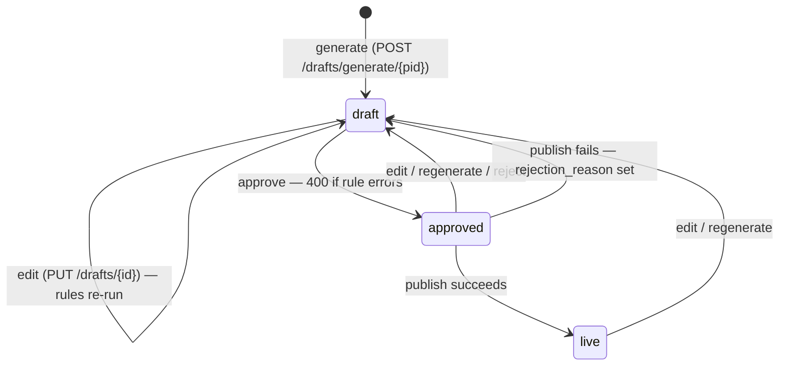

# How ListingPilot Works Today

> A factual description of the code as it currently runs. **Not the spec.** For intended behaviour see [`ListingPilot_PRD_SRS_v1.1.md`](ListingPilot_PRD_SRS_v1.1.md); for the pilot plan see [`MVP_PLAN.md`](MVP_PLAN.md).
>
> **Inspected:** 28 Oct 2026 at commit `66e2e78` (`main`). Backend tests: 35 passing. Paths are relative to the repo root; `file:line` points at the relevant code.

---

## Contents

1. [Real vs simulated vs missing](#1-real-vs-simulated-vs-missing)
2. [Startup behaviour](#2-startup-behaviour)
3. [End-to-end walkthrough](#3-end-to-end-walkthrough)
4. [AI engine](#4-ai-engine)
5. [Rule engine](#5-rule-engine)
6. [Draft lifecycle](#6-draft-lifecycle)
7. [Marketplace adapters](#7-marketplace-adapters)
8. [Background jobs](#8-background-jobs)
9. [Frontend fallbacks](#9-frontend-fallbacks)
10. [Where data lives](#10-where-data-lives)
11. [Configuration](#11-configuration)
12. [How to run and test](#12-how-to-run-and-test)
13. [API reference](#13-api-reference)
14. [Current gaps](#14-current-gaps)

---

## 1. Real vs simulated vs missing

| Area | State | Evidence |
| --- | --- | --- |
| Catalogue template, import (xlsx/csv/Tally XML), export (xlsx/csv/json), CRUD | **Real** | `backend/app/api/v1/endpoints/catalogue.py` |
| Photo upload | **Real**, saved locally; returned URL is hard-coded to `http://localhost:8000` | `catalogue.py:53` |
| AI copy generation | **Real** (OpenRouter cascade or Claude), with a built-in template fallback | `backend/app/services/ai_service.py` |
| Technical specs / A+ content | **Partly invented**: gaps are filled with built-in sample values and generic claims (§4.5) | `ai_service.py:252-368` |
| Rule checks and 0–25 score | **Real** | `backend/app/services/rule_engine.py` |
| Edit → re-check → approve gate → publish gate | **Real**, enforced server-side | `backend/app/api/v1/endpoints/drafts.py:285-367` |
| Amazon publish | **Simulated** without all 4 SP-API credentials (the current state): fake ASIN, 5 % random rejection. Live path coded, never run | `backend/app/services/amazon_adapter.py:555-658` |
| Amazon price/stock update, listing status | **Simulated only** | `amazon_adapter.py:661-706` |
| Amazon live schema fetch (PTD) | **Coded but never called** | `backend/app/services/amazon_ptd_service.py:844` |
| Flipkart publish, price/stock | **Simulated only**; live branches are `pass` | `backend/app/services/flipkart_adapter.py:71,107` |
| Meesho export | **Real file generation** into the official templates on disk, from product data only; refused with a list of problems when a compulsory column is empty (§7.3) | `backend/app/services/meesho_adapter.py` |
| Meesho "publish" | Marks the draft `live` with ID `MSH-<sku>`; nothing leaves the system | `drafts.py:404-413` |
| SKU × marketplace status grid | **Real** (shows whatever is in the DB, including simulated IDs) | `drafts.py:513` |
| Reports | **Real backend numbers**; the dashboard replaces zeros with demo figures | `backend/app/api/v1/endpoints/reports.py`, `frontend/app/page.js:612-617` |
| Settings: brand voice, banned claims, credentials | **Real**, stored in a JSON file, credentials in plain text | `backend/app/services/settings_service.py` |
| System health | **Static**: always "healthy"/"connected" | `settings_service.py:200-240`, `backend/app/api/v1/endpoints/health.py` |
| Celery batch generation | **Real**, not used by the dashboard | `backend/app/tasks/batch_tasks.py:54` |
| Celery batch publish | **Broken**: every draft ends up failed (§8) | `batch_tasks.py:242-247` |
| Live twin preview's own publish button | **Broken** in dev: posts to the Next.js server, not the API (§3.3) | `frontend/app/components/MarketplaceLiveTwinPreview.jsx:401` |
| Login, audit log, Setup wizard, workspaces/users, encrypted credentials, migrations | **Missing** | — |

---

## 2. Startup behaviour

### Backend

Start command: `uvicorn app.main:app --app-dir backend --port 8000`.

1. **Config.** `backend/app/core/config.py` loads `ROOT/.env`, then `./.env` (`config.py:57`). Unknown keys are ignored.
2. **Database** (`backend/app/core/database.py`): **Neon PostgreSQL only.** `DATABASE_URL` must be a `postgresql://` URL (turned into `postgresql+psycopg2://`), otherwise import fails with a RuntimeError. There is no SQLite or other fallback. The engine uses `pool_pre_ping`, `pool_recycle=300` and a 5 s connect timeout.
3. **Startup check and tables** (`main.py` lifespan): `check_connection()` connects once; if Neon is unreachable (e.g. port 5432 blocked on the co-working Wi-Fi) the server **refuses to start** with that message. Then `Base.metadata.create_all` creates `products` and `listing_drafts` if missing. No migrations yet; existing tables are never altered. The seed script runs the same check.
4. **Celery** (`backend/app/core/celery_app.py:12-50`): pings Redis at `CELERY_BROKER_URL` with a 0.5 s timeout. If unreachable, or `CELERY_TASK_ALWAYS_EAGER=true`, it uses `memory://` / `cache+memory://` and runs tasks inline in the API process.
5. **App wiring** (`main.py`): CORS for `BACKEND_CORS_ORIGINS` (`main.py:35`); a middleware printing `[METHOD] path -> status (ms)` for every request (`main.py:43`); routers under `/api/v1` (`main.py:50`); `backend/uploads/` served at `/static/uploads` (`main.py:51`); `GET /` returns a banner (`main.py:54`).
6. **Settings file.** `backend/app/data/dynamic_settings.json` is created with defaults the first time settings are read (`settings_service.py:78`). `LISTINGPILOT_SETTINGS_FILE` overrides the path.
7. **Meesho templates** are scanned lazily on first use and cached in memory for the life of the process (`meesho_adapter.py:81`).

### Frontend

`cd frontend && npm run dev` serves http://localhost:3000. `frontend/next.config.mjs` loads the root `.env`. There are **no API rewrites or proxies**.

On first render `frontend/app/page.js` uses built-in demo data: `INITIAL_PILOT_PRODUCTS` (`page.js:10`) and `INITIAL_PILOT_DRAFTS` (`page.js:116`), wired in at `page.js:244-248`. `fetchAllData()` (`page.js:576`) then fires 8 parallel GETs (products with `page_size=200`, categories, stats, drafts, baseline report, settings, system health, Meesho templates). Each result replaces the demo data **only if it is non-empty**. With the backend down or an empty database, the demo data stays on screen.

The API base is `NEXT_PUBLIC_API_BASE`, defaulting to `http://localhost:8000/api/v1` (`page.js:6`).

---

## 3. End-to-end walkthrough

The dashboard is one client component, `frontend/app/page.js` (4,546 lines). Tabs: **Catalogue**, **AI Drafts & Review**, **Multi-Channel Hub**, **Reports**, **Settings** (`page.js:1694-1745`). Above them is a KPI bar fed by `GET /catalogue/stats` (`backend/app/services/catalogue_service.py:167`): total SKUs, stock, average price, products missing required attributes, products with fewer than 3 photos.

### 3.1 Catalogue tab (`page.js:1747`)

| Button / action | Handler | API call | What the backend does |
| --- | --- | --- | --- |
| Download template | `handleDownloadTemplate` (`page.js:1264`) | `GET /catalogue/template` | Builds a styled multi-sheet workbook (`backend/app/services/template_generator.py:172`) with column guidance, sample SKUs and `CATEGORIES_INFO` (required attributes and min photos for 6 categories) |
| Import (modal, file picker) | `handleFileUpload` (`page.js:1362`) | `POST /catalogue/import` | `CatalogueParser.parse_file` (`backend/app/services/catalogue_parser.py:78`) routes by extension to Excel, CSV or Tally XML; `CatalogueService.batch_upsert_products` (`catalogue_service.py:96`) creates new SKUs and updates existing ones |
| Export (xlsx / csv / json) | `handleExport` (`page.js:1295`) | `GET /catalogue/export?format=` | `CatalogueExporter` (`backend/app/services/catalogue_exporter.py`), all products, attributes as columns |
| Add product (modal) | `handleAddProduct` (`page.js:1390`) | `POST /catalogue/products` | `CatalogueService.create_product` |
| Click a product → Inspector drawer (`page.js:3683`) | — | — | Attributes, photo gallery, per-marketplace pre-check |
| Inspector: save details | `handleSaveProductDetails` (`page.js:833`) | `PUT /catalogue/products/{id}` | `CatalogueService.update_product` |
| Inspector: upload photo | `handleUploadPhotoFile` (`page.js:745`) | `POST /catalogue/upload-image`, then `PUT /catalogue/products/{id}` | Saves `prod_<hex>.<ext>` to `backend/uploads/`; returns `http://localhost:8000/static/uploads/...` (`catalogue.py:37-58`). Accepts jpg/jpeg/png/webp/gif; no size or content check |
| Inspector: add URL, remove, set primary | `handleAddPhotoUrl` / `handleRemovePhoto` / `handleSetPrimaryPhoto` (`page.js:779-808`) | `PUT /catalogue/products/{id}` via `saveProductImageChanges` (`page.js:809`) | Updates `images` and `image_count`. The frontend doesn't check the response status |

**Import details** (`catalogue_parser.py`):
- Headers are matched against alias lists in `HEADER_MAPPINGS` (`catalogue_parser.py:10-46`). For example, `sku` matches "item code", "part no" and "seller sku id *"; `stock` matches "closing balance" and "inventory *". Recognised attribute headers (`KNOWN_ATTR_HEADERS`, `:48`) go into `attributes`.
- Row checks: missing SKU or name → error; duplicate SKU in the file → error; price ≤ 0 → warning; a short hard-coded banned-phrase list in name/notes → warning (`catalogue_parser.py:285`; this list is separate from the Settings list).
- Defaults: a missing MRP becomes **price × 1.2** (`catalogue_parser.py:249`). An image cell holding a number *n* becomes placeholder filenames `image_1.jpg … image_n.jpg` (`:259`).
- Tally XML: reads `STOCKITEM` (or `LEDGER`) nodes; SKU = `PARTNO` or `TALLY-0001…` (`catalogue_parser.py:316`).
- Upsert: on update, attributes are **merged** (new keys overwrite old), and images are replaced only if the row has images (`catalogue_service.py:113-136`).
- Response: `ImportSummaryResponse` with created/updated/failed counts and row errors and warnings (`backend/app/schemas/import_export.py`). **The dashboard shows only the created count** (`page.js:1377`).

### 3.2 AI Drafts & Review tab (`page.js:1917`)

| Button / action | Handler | API call |
| --- | --- | --- |
| Generate / regenerate (selected product, chosen marketplace) | `handleRegenerateDraft` (`page.js:884`) | `POST /drafts/generate/{product_id}?marketplace=` |
| Batch generate (modal: marketplace incl. "All", category incl. "All", overwrite) | `handleRunBatch` (`page.js:1151`) | `POST /drafts/generate-batch?marketplace=&category=&overwrite=` |
| Close batch modal while running | `closeBatchModal` (`page.js:1145`) | Aborts the fetch |
| Save edits | `handleSaveDraftEdits` (`page.js:631`) | `PUT /drafts/{id}` |
| Approve | `handleApproveDraft` (`page.js:684`) | `POST /drafts/{id}/approve` |
| Reject (modal with reason, `page.js:4118`) | `handleRejectDraft` (`page.js:715`) | `POST /drafts/{id}/reject` |
| Publish | `handlePublishMarketplace` (`page.js:982`) | `POST /drafts/{id}/publish` |
| Payload view | `fetchAmazonPayloads` (`page.js:460`) | `GET /drafts/{id}/amazon-payload`, `GET /drafts/{id}/aplus-payload` |

**Generate (single)** (`drafts.py:42-96`): loads the product, calls `AIService.generate_listing` (§4), runs `RuleEngine.evaluate` (§5), then **upserts** the one draft for that (product, marketplace). Status is set to `draft` and approval cleared.

**Generate (batch)** (`drafts.py:100-190`): loops products × marketplaces **sequentially inside the HTTP request**. Existing drafts are skipped unless `overwrite=true`. Before each draft it checks `request.is_disconnected()`; when the browser aborts, it stops, commits what it has, and returns `cancelled: true`. Per-item exceptions are collected in `errors`.

**The editor has five sub-views:** listing copy (`page.js:2295`), Amazon technical-details table (`:2366`), A+ content and comparison table (`:2436`), raw SP-API / A+ JSON (`:2544`), and the live twin preview (`:2603`).

**Edit** (`drafts.py:285-321`): applies changed fields, re-runs the rules, sets `is_approved=false`, `status=draft`.

**Approve** (`drafts.py:324-344`): returns 400 if `rule_results.has_errors`; otherwise `approved`.

**Reject** (`drafts.py:347-364`): `status=draft`, `is_approved=false`, stores `rejection_reason`.

**Publish** (`drafts.py:367-439`): returns 400 unless `is_approved` and `status == "approved"`. It dispatches to the adapter (§7). On success: `status=live`, `external_listing_id`, `marketplace_sku`, `last_sync_at`, cleared `rejection_reason`, and `SettingsService.record_sync()`. On failure: `status=draft`, `is_approved=false`, `rejection_reason` from the adapter.

### 3.3 Live twin preview

`frontend/app/components/MarketplaceLiveTwinPreview.jsx` (1,259 lines) renders the draft as an Amazon, Flipkart or Meesho product page, in desktop or mobile mode, with views for page, SP-API JSON, A+ JSON and compliance audit. It is used inline (`page.js:2606`) and fullscreen (`page.js:4357`). Missing photos are replaced by three Unsplash images; missing price by ₹1,499; missing stock by 45 (`MarketplaceLiveTwinPreview.jsx:25-40`).

Its own **publish button** calls `fetch("/api/v1/drafts/{id}/publish")` with a **relative URL** (`MarketplaceLiveTwinPreview.jsx:401`). With no rewrite in `next.config.mjs`, this goes to the Next.js server instead of the API and fails. If it ever succeeds without an ID, the message falls back to a hard-coded ASIN `B0DGJ8YZDF` (`:404`). It also uses a browser `alert()` (`:396`).

### 3.4 Multi-Channel Hub tab (`page.js:2631`)

| Action | API call | Backend |
| --- | --- | --- |
| Status grid | `GET /drafts/marketplace-status?category=&search=` | One row per product: for each marketplace, draft ID, status (`not_started` if no draft), approval, external ID, score, error flag, last sync, rejection reason (`drafts.py:513-584`). Runs one query per product per marketplace |
| Jump to a draft | — | Switches to the Drafts tab |
| Download Meesho sheet (category or All) | `GET /drafts/meesho/export?category=` or `?as_zip=true` (`handleDownloadMeeshoSheet`, `page.js:1044`) | `MeeshoAdapter.generate_batch_export` (§7.3); records a Meesho sync time |
| Templates and taxonomy modal (`page.js:4374`) | `GET /drafts/meesho/templates`, `GET /drafts/meesho/categories?search=` | Lists templates found on disk; searches `docs/meesho/categories/meeshoCategories.json` |

### 3.5 Reports tab (`page.js:2995`)

`GET /reports/baseline` (`reports.py:16-109`) returns:
- **overview**: products, drafts, products with/without drafts, coverage %;
- **pipeline**: counts per status;
- **quality**: average score, first-pass rate (drafts without errors), approval rate (`approved` ÷ all drafts; `live` drafts are not counted), rejection rate (drafts with any `rejection_reason`), rating distribution;
- **marketplace**: drafts per marketplace, live on Amazon.

The dashboard adds "time saved" = drafts × 0.75 h (`page.js:616`) and substitutes demo values for any zero (§9).

### 3.6 Settings tab (`page.js:3120`)

| Sub-tab | API | Notes |
| --- | --- | --- |
| Brand voice (`page.js:3156`) | `PUT /settings/brand-voice` | Fields: brand name, tone, target audience, claims to avoid. Read by every AI prompt |
| Banned claims (`page.js:3225`) | `PUT /settings/banned-claims` | Replaces the whole list. Default 12 entries (`settings_service.py:28-41`) |
| Credentials (`page.js:3281`) | `GET/PUT /settings/credentials` | Stored in plain text. GET masks as `abc****xyz` (`settings_service.py:145`). PUT ignores empty values and values starting with `***` (`settings_service.py:180-190`). The AI "model" shown is hard-coded `nvidia/nemotron-3.5-lightning:free` (`settings_service.py:174`) |
| System health (`page.js:3461`) | `GET /settings/system-health` | Static service list, last-sync map, and "stub mode" alerts when Amazon/Flipkart IDs are empty (`settings_service.py:200-240`) |
| Operations manual (`page.js:3537`) | — | Static in-app guide |

---

## 4. AI engine

File: `backend/app/services/ai_service.py`.

### 4.1 Prompt

`PROMPT_SYSTEM` (`ai_service.py:17-63`) is filled with the brand voice from Settings. The user prompt (`generate_listing`, `:68-95`) has SKU, name, category, brand, price, all attributes, notes, the target marketplace, and Amazon product-type guidance from `AmazonPTDService.get_category_prompt_guidance` (`amazon_ptd_service.py:826`).

Rules stated in the prompt: title under **200 / 120 / 100** characters for Amazon / Flipkart / Meesho (`ai_service.py:30`); exactly 5 bullets; 2–3 paragraph description; 5–8 keywords **within 250 bytes** (`:33`); 6–10 technical specs; A+ content (headline, brand story, 3 feature cards, comparison table); use only supplied data (`:27`); no promotional claims (`:36`). Output must be strict JSON.

For **Meesho** the user prompt adds: don't use the words Meesho QC flags (`MEESHO_FLAGGED_WORDS` in `meesho_adapter.py`: care, comfort, colors), head bullet 5 "WASH & MAINTENANCE", and give each product its own title.

### 4.2 Provider and key selection (`ai_service.py:97-112`)

- Key: the `openrouter_api_key` in the settings file is used unless it is empty, contains `*`, or starts with `sk-or-v1-abcdef`; otherwise `OPENROUTER_API_KEY` from `.env`.
- If `AI_PROVIDER == "openrouter"` (or there's an OpenRouter key and no Anthropic key) → OpenRouter. Else if `ANTHROPIC_API_KEY` is set → Claude. Else → built-in generator.

### 4.3 OpenRouter cascade (`ai_service.py:116-218`)

Models are tried in order, skipping duplicates (`:134-155`):

1. `OPENROUTER_MODEL` (config default `minimax/minimax-m3.1-flash`, `config.py:29`)
2. `google/gemma-4-26b-a4b-it` (comment: routed via OpenRouter BYOK)
3. `google/gemini-3.5-flash-lite`
4. `google/gemma-4-26b-a4b-it:free`
5. `nvidia/nemotron-3.5-lightning:free`
6. `minimax/minimax-m3.1-flash`
7. `nvidia/nemotron-3-ultra-550b-a55b:free`
8. `google/gemma-4-31b-it:free`
9. `liquid/lfm-2.5-2.6b:free`
10. `recursive/flint-v1.0:free`
11. `openrouter/free`

Per request: one shared `httpx.AsyncClient`, 22 s timeout, temperature 0.3, max_tokens 3000. A model is skipped and the next one tried when it:
- returns **HTTP 429**: it goes into a module-level cooldown map (`_MODEL_COOLDOWN_UNTIL`, `:9`) for `Retry-After` seconds (default 60, clamped 1–600, `_rate_limit_cooldown` at `:370`). Models in cooldown are skipped by **all** later requests in the same process (`:157`);
- returns any other HTTP error, a network error, no choices, or empty content (for reasoning models, JSON inside `message.reasoning` is extracted first);
- returns JSON that doesn't parse (`_parse_json_response(..., fallback_on_error=False)` returns `None`, `:195`).

Each skip prints one line. If all fail, or every model is in cooldown, the built-in generator is used.

### 4.4 Claude path (`ai_service.py:220-249`)

A single `POST https://api.anthropic.com/v1/messages` with `CLAUDE_MODEL` (default `claude-3-5-sonnet-20241022`), max_tokens 1500, 45 s timeout. Any failure falls back to the built-in generator. There's no cascade or cooldown.

### 4.5 Post-processing (`ai_service.py:252-368`, `:380-402`)

After parsing, titles over 200 characters are cut to 197 + "..." (for every marketplace, `:396`). Then `_enrich_with_apple_grade_specs_and_aplus` runs on **every** result, including fallback output:

- **Technical specs:** product attributes are merged in. Then, for each required field and the first 4 optional fields of the product type, if no attribute matches by name, **the product type's built-in sample value is inserted** (`:273-285`). For bedsheets, for example, a missing size becomes "King (108 x 108 inches / 274 x 274 cm)" and a missing weight "950 g" (`amazon_ptd_service.py:422-430`). `Country of Origin` defaults to **"India"** (`ai_service.py:287`).
- **A+ content:** missing headline, story or feature cards are generated from templates. A missing comparison table is filled with fixed claims such as "Exceeds 100+ Cycles (Heavy Duty)" and a "1 Year Manufacturer Assurance" warranty when none is recorded (`ai_service.py:294-366`).

So technical specs and A+ content can contain values that are **not** in the product data.

### 4.6 Built-in generator (`ai_service.py:404-470`)

Deterministic. Title = brand + name + colour/material/size (skipping parts already in the name), cut to 195 / 115 / 95 characters (`:431`). Five bullets are built only from attributes found (Pattern, Material/Fabric, Size/Dimensions, Included, Occasion, Care…), with generic wording when an attribute is absent. For Meesho the colour and care bullets are headed "FINISH" and "WASH & MAINTENANCE". Description lists the attributes. Five keywords are derived from category, name and brand. Tagged `engine: "category_agnostic_rule_engine"`, then enriched as in §4.5.

---

## 5. Rule engine

File: `backend/app/services/rule_engine.py`, `RuleEngine.evaluate(product, draft, marketplace)` (`:17`). It runs on single generate, batch generate, edit, and as a pre-check in `GET /drafts/product/{id}` when no draft exists (that pre-check always uses Amazon rules, `drafts.py:273`).

| # | Check | Amazon | Flipkart | Meesho | Code |
| --- | --- | --- | --- | --- | --- |
| 1 | Required attributes for the category | error each | error each | error each | `:22-37` |
| 2 | Photo count | < 3 error (category min), < 5 warning | < 1 error, < 3 warning | < 1 error | `:39-91` |
| 3 | Price > 0 | error | error | error | `:94-100` |
| 4 | Title empty | error | error | error | `:115` |
| 5 | Title length | > 200 error | > 120 error | > 100 error | `:118-140` |
| 6 | Title < 40 chars | warning | warning | warning | `:141-148` |
| 7 | Banned claim in title, bullets or description (whole-word regex, case-insensitive; one hit per block reported) | error | error | error | `:153-172` |
| 8 | HTML tag in description | — | — | error | `:175-181` |
| 9 | Bullets | < 5 warning | < 3 warning | < 3 warning | `:184-201` |
| 10 | Words Meesho QC flags (care, comfort, colors) in title, bullets or description | — | — | warning | `meesho_flagged_word` |

Rules 4–10 only run when a draft exists; without one, an info issue "not yet generated" is added.

**Required attributes** come from `CATEGORIES_INFO` in `template_generator.py` (lines 8–131): Bedsheets (Material, Size, Thread count, Care), Pooja items (Material, Dimensions, Finish), Kurtas (Material, Fit, Sleeve, Length, Care), Planters (Material, Dimensions, Drainage), Ethnic footwear (Upper material, Sole, Sizes, Closure), Quilts (Fill, Outer, Size, Weight, Care). **Any other category requires only "Material"** (`rule_engine.py:24`). Attribute names must match exactly.

**Score (0–25):** title (0–5) + bullets (0–5) + attributes (5 − 2 per missing, min 0) + keywords (1 per keyword, max 5) + photos (1, 3 or 5) (`:214`). Rating: Excellent ≥ 20, Good ≥ 15, otherwise Needs Improvement (`:221`). `passed` = draft exists and no errors (`:218`).

Title limits and photo minimums are **hard-coded**. The `marketplace_limits` block in the settings file is never read. Banned claims **are** read live from Settings (`:154`).

---

## 6. Draft lifecycle

Model: `backend/app/models/draft.py`. Statuses used by the backend: `draft`, `approved`, `live`.



- One draft per (product, marketplace). This is enforced by the generate code's upsert, not by a database constraint.
- Regenerating overwrites the copy and clears approval (`drafts.py:66-77`).
- "Rejected" is not a status: a rejected or failed draft is `draft` with `rejection_reason` set. A successful publish clears it.
- Deleting a product cascades to its drafts (`draft.py`, FK `ondelete="CASCADE"`).

---

## 7. Marketplace adapters

### 7.1 Amazon (`backend/app/services/amazon_adapter.py`)

**Credentials** (`:72-91`): `seller_id`, `client_id`, `client_secret`, `refresh_token`, from the settings file first, then `.env`. Live mode requires all four. `GET /drafts/credentials-status` reports mode and what's missing (`:94-115`).

**Payload** (`build_sp_api_listing_payload`, `:187-427`): Listings Items 2021-08-01 document with `productType` from `AmazonPTDService.resolve_product_type` (keyword map, default `PRODUCT`) and `requirements: "LISTING"`. Attributes: `item_name`, `bullet_point`, `product_description`, `generic_keyword`, `brand`, parsed dimensions and weight, colour, size, material, images, then Legal Metrology and offer fields. **Defaults when data is missing:**
- country of origin "India" → `IN` (`:358-360`);
- manufacturer `"<brand> Creations Private Limited"` (`:362`);
- packer `"<brand> Central Fulfillment Hub, Sanganer, Jaipur, RJ - 302029"` (`:365`);
- importer "Not Applicable (Manufactured in India)";
- generic name "Consumer Merchandise";
- MRP = **price × 1.35** (`:383`).

If an attribute "Parent SKU" exists, child-variation fields with theme `COLOR_NAME/SIZE_NAME` are added (`:420-425`).

**A+ payload** (`:430-530`): an A+ Content 2020-11-01 document built from `aplus_content`. Preview only; never submitted.

**Live publish** (`create_listing`, `:555-628`): exchanges the refresh token for a Login with Amazon access token (`:533`), then `PUT https://sellingpartnerapi-eu.amazon.com/listings/2021-08-01/items/{sellerId}/{sku}?marketplaceIds=…` with header `x-amz-access-token`. HTTP 200/201/202 → success. The external ID is read from `identifiers[0].identifier`, **falling back to a random `B0…` string** (`:595`). The listing is marked `live` immediately; there's no status polling. Other responses → rejection with Amazon's issue messages. AWS keys are not used.

**Stub publish** (`:631-658`): fake ASIN `B0` + 8 hex characters. With probability **0.05** (`random.random() < 0.05`, `:635`) it returns a rejection `MISSING_LEGAL_METROLOGY: …`. Results are therefore non-deterministic.

`update_price_stock` (`:661`) and `get_listing_status` (`:683`) return canned responses in both modes.

`AmazonPTDService` (`amazon_ptd_service.py`) holds the keyword → product-type map and built-in field definitions with sample values. `fetch_live_ptd_schema` (`:844`) would call the SP-API Definitions endpoint and cache to `backend/app/data/ptd_schemas/`, but **nothing calls it**.

### 7.2 Flipkart (`backend/app/services/flipkart_adapter.py`)

`is_configured` reads `FLIPKART_APP_ID` / `FLIPKART_APP_SECRET` from **`.env` only** (`:24-29`); credentials saved in Settings are ignored. `create_listing` (`:56`) always returns success with a fake FSN `LST` + 13 hex characters (`:75`) and `mode: "stub"`. The live branch is `pass` (`:71`). `update_price_stock` is the same (`:95-120`).

### 7.3 Meesho (`backend/app/services/meesho_adapter.py`)

**Templates.** `scan_available_templates` (`:81`) reads every `.xlsx` in `docs/meesho/templates/` (fallback `docs/templates/`). It takes column headers from row 3, compulsory markers from row 2 (`:118`), and dropdown option lists from the Validation Sheet. The 4 templates present are Bedsheets 10058, Shirts 10001, Sneakers 13178 and T-shirts 10000.

**Matching a category to a template** (`find_template`, `:238-297`): normalised exact key → path in `meeshoCategories.json` → substring (longest template name first) → a synonym table (bedding/duvet → bedsheets, tee → tshirts, shoes/footwear → sneakers).

**Filling** (`populate_template`) loads an in-memory copy of the template and writes one row per product starting at **row 5**. Every value comes from the product, its Meesho draft or simple arithmetic on them; nothing is defaulted (`_row_inputs`, `_template_value`). A product attribute named exactly like a template column always wins, so sellers can supply any Meesho field (e.g. `Manufacturer Pincode`, `Color`) directly.

| Column | Value written |
| --- | --- |
| Product name | Meesho draft title, else product name; HTML stripped; cut to 95 characters |
| Meesho price / MRP / inventory | product price / product MRP / product stock, as stored |
| Wrong/defective discount | attribute only (optional column, empty otherwise) |
| Description | draft description + "Key Features:" bullets; without a draft, the product's own description |
| GST, HSN | attributes "GST %"/"GST Rate"/"GST", "HSN ID"/"HSN Code"/"HSN" |
| Net weight (gms) | grams parsed from "Net Weight (gms)"/"Net Weight"/"Weight" ("350 g (set)" → 350, "1.2 kg" → 1200) |
| Country of origin; manufacturer, packer, importer name/address/pincode | attributes with the column's name only |
| Variation | attribute "Size"/"Variation" |
| Colour, fabric, pattern, included components, net quantity | matching attributes ("Colour", "Material", "Pattern"/"Print", "Included", …) |
| Bedsheet length/width size; product length/width (cm) | longer/shorter side of the first "A x B in" in Size/Dimensions (cm = inches × 2.54) |
| Pillow length/width; no. of pillow covers | the "A x B in" and the "N pillow" in the Included text |
| Images 1–4 | product `images[0..3]` as stored |
| Style ID / SKU ID / Brand Name / Group ID | Style Code/ID attribute else SKU / SKU / product brand / Group ID attribute |

**Dropdown columns** (`_match_dropdown_option`) take only high-confidence matches, returned with the template's exact spelling: exact (case-insensitive) → same number, with or without a unit ("180 TC" → "180") → exactly one option named as a whole word in the value ("100% cotton" → "Cotton", "90 x 100 in (double)" → "Double"; longest option wins, so "Navy Blue" beats "Blue"). Brand, HSN, GST, country, Group ID and colour accept only exact or numeric matches, so "Indigo and white" is not turned into "White" and Brand is never picked.

**Problems** are collected per SKU: a compulsory column (row-2 "* Compulsory Field" marker) left empty, a value that isn't a template option, or several designs sharing one Product Name (Meesho merges them as sizes of one product and rejects the rows; distinct sizes of one Style ID may share a name). Any compulsory problem raises `MeeshoExportIncomplete`; non-compulsory ones (e.g. a brand not on Meesho's list) leave the cell empty and don't block.

**Export** (`generate_batch_export`, `:795-863`): groups products by category; one `ListingPilot_Meesho_<cat>.xlsx` per category. When there are several categories and `as_zip=true`, they're zipped as `ListingPilot_Meesho_Batch_<YYYYMMDD_HHMM>.zip`. With several categories and `as_zip=false`, **only the first category's file is returned** (`:843-850`). Categories without a template get a generated 27-column workbook (`_generate_synthetic_workbook`) filled by the same rules; its columns ending in `*` are compulsory. Problems from all categories are gathered into one `MeeshoExportIncomplete`, and `GET /drafts/meesho/export` answers **422** with `detail: {message, problems: [{sku, category, field, reason, blocking}]}` instead of a file. The frontend shows the first three problems in an error toast (it no longer falls back to a client-built CSV). A "Validate Sheet" alias tab is added for test compatibility (`:776-779`).

**"Publish"** for Meesho (`drafts.py:404-413`) just returns `MSH-<sku>`; the export doesn't require drafts to be approved or published.

---

## 8. Background jobs

File: `backend/app/tasks/batch_tasks.py`. Configuration: `backend/app/core/celery_app.py` (JSON serialiser, `Asia/Kolkata`, `task_track_started`, prefetch 1).

- **`generate_batch_drafts_task`** (`:54-183`): same logic as the synchronous batch, with `update_state(PROGRESS)` per item, using `_run_async` (`:22`) to run the async AI call. `tenant_id`, if given, filters `Product.brand == tenant_id OR brand ILIKE %tenant_id%` (`:72-74`); there is no real tenant isolation.
- **`publish_batch_drafts_task`** (`:187-273`): **does not work.** It calls the async `AmazonAdapter.create_listing` / `FlipkartAdapter.create_listing` without awaiting them (`:243-245`), so `res.get` fails on a coroutine object. For Meesho it calls `MeeshoAdapter.generate_bulk_upload_row` (`:247`), which **doesn't exist**. Every draft is caught by the `except` and counted as failed. No test exercises it (`backend/tests/test_celery_tasks.py` only checks registration and the generate dispatch).
- **`get_celery_task_status`** (`:276`): state, progress meta and result for `GET /drafts/tasks/{task_id}`.
- `get_task_db_session` (`:40`) uses the FastAPI test DB override when present, so tests run tasks against the Neon test branch.

The dashboard does not call any `/drafts/tasks/*` endpoint.

---

## 9. Frontend fallbacks

Nearly every handler in `frontend/app/page.js` has a `catch` that **simulates success locally**. It triggers on network errors and on any non-OK response, because handlers throw on `!res.ok`. Nothing simulated is saved.

| Handler | On failure the UI… | Line |
| --- | --- | --- |
| `fetchAllData` | keeps demo products/drafts; Reports values that are `0` become **81.3 % coverage, 88.4 % first-pass, 35.2 % approval**, a fixed distribution, and "time saved" based on 48 drafts | `page.js:576-626` (`:612-617`) |
| `handleSaveDraftEdits` | shows the edits as saved and re-checked | `:631-682` |
| `handleApproveDraft` | marks the draft **approved** and shows "Draft Approved! 🎉", including when the backend refused with 400 for rule errors (the UI pre-checks `has_errors`, `:686`, so this mostly happens when the backend is unreachable or out of sync) | `:684-713` |
| `handleRejectDraft` | sets status **`rejected`**, a value the backend never uses | `:715-742` |
| `handleUploadPhotoFile` | adds a browser-only `blob:` URL | `:745-777` |
| `handleSaveProductDetails` | "Saved Locally" | `:833-882` |
| `handleRegenerateDraft` | writes a local draft with marketing bullets ("PREMIUM QUALITY & RELIABILITY…") and a hard-coded score of **24/25 Excellent** | `:884-978` |
| `handlePublishMarketplace` | sets status **live** with a random `B09X…` ASIN / `LST…` FSN / `MSH-…` and "Published to Amazon! 🚀", **including when the backend refused (e.g. draft not approved)** | `:982-1041` |
| `handleRunBatch` | runs a local batch simulation (but an abort shows "Cancelled" and reloads instead) | `:1151-1260` |
| `handleDownloadTemplate` / `handleExport` | builds a CSV from on-screen data | `:1264-1360` |
| `handleFileUpload` | "Import Simulated" | `:1362-1388` |
| `handleAddProduct` | "Product Recorded Locally" | `:1390-1442` |
| Settings handlers | "Saved Locally" / "Services online." | `:1444-1560` |

Reloading the page re-reads the database, so the screen falls back in line with reality.

---

## 10. Where data lives

| Data | Location | Notes |
| --- | --- | --- |
| Products, drafts | Neon Postgres (`DATABASE_URL`) | The only database (§2) |
| Uploaded photos | `backend/uploads/` | URLs stored as `http://localhost:8000/static/uploads/...` |
| Brand voice, banned claims, credentials, last-sync | `backend/app/data/dynamic_settings.json` | Gitignored; plain text; global (no workspace) |
| Cached Amazon schemas | `backend/app/data/ptd_schemas/` | Only written by `fetch_live_ptd_schema`, which is unused |
| Meesho master templates | `docs/meesho/templates/*.xlsx` | Read-only; copies are filled in memory |
| Meesho category tree | `docs/meesho/categories/meeshoCategories.json` | Used for search and template matching |
| Server secrets | `.env` (root) | Gitignored; template `.env.example` |
| AI rate-limit cooldowns | Process memory | Lost on restart |

**`products`** (`backend/app/models/product.py`): `id`, `sku` (unique), `name`, `category`, `brand` (default "Gulmohar Home"), `mrp`, `price`, `stock`, `images` (JSON list), `image_count`, `attributes` (JSON), `description`, `current_listing` (JSON), `created_at`, `updated_at`.

**`listing_drafts`** (`backend/app/models/draft.py`): `id`, `product_id` (FK, cascade), `marketplace`, `title`, `bullets`, `description`, `keywords`, `technical_specs`, `aplus_content`, `status`, `is_approved`, `rule_results`, `marketplace_sku`, `external_listing_id`, `last_sync_at`, `rejection_reason`, `created_at`, `updated_at`.

There are no `workspace_id` / `user_id` columns, no audit table, and no rejection history.

**Seed data** (`backend/app/seeds/seed_pilot_data.py`): `PILOT_PRODUCTS` has 19 hand-written Gulmohar Home SKUs (Bedsheets 5, Pooja items 5, Kurtas 3, Planters 2, Ethnic footwear 2, Quilts 2) with Unsplash image URLs and a weak `current_listing`. `seed_database()` (`:456`) upserts them, then adds 40 generated variants (`:468-490`); every 5th has no attributes.

---

## 11. Configuration

Read by `backend/app/core/config.py` from the root `.env`. Template: `.env.example`.

| Variable | Default in code | Effect |
| --- | --- | --- |
| `DATABASE_URL` | `""` | Neon Postgres URL; required, unreachable → server won't start |
| `TEST_DATABASE_URL` | `""` | Tests only: a separate Neon branch; tables dropped and recreated each run |
| `BACKEND_CORS_ORIGINS` | localhost/127.0.0.1 on 3000 and 5173 | CORS |
| `DEFAULT_BRAND` | `Gulmohar Home` | Fallback brand |
| `AI_PROVIDER` | `openrouter` | `openrouter` or `anthropic` |
| `OPENROUTER_API_KEY` | none | Used when no usable key is in Settings |
| `OPENROUTER_MODEL` | `minimax/minimax-m3.1-flash` | First model in the cascade |
| `ANTHROPIC_API_KEY`, `CLAUDE_MODEL` | none, `claude-3-5-sonnet-20241022` | Claude path |
| `REDIS_URL`, `CELERY_BROKER_URL`, `CELERY_RESULT_BACKEND` | `redis://localhost:6379/0` | Celery |
| `CELERY_TASK_ALWAYS_EAGER` | `false` | Force inline tasks |
| `AMAZON_SELLER_ID`, `AMAZON_SP_API_CLIENT_ID`, `AMAZON_SP_API_CLIENT_SECRET`, `AMAZON_SP_API_REFRESH_TOKEN` | none | All four → Amazon live mode (Settings values take priority) |
| `AMAZON_MARKETPLACE_ID` | `A21TJRUUN4KGV` | Amazon.in |
| `AMAZON_AWS_ACCESS_KEY`, `AMAZON_AWS_SECRET_KEY`, `AMAZON_AWS_ROLE_ARN` | none | Unused |
| `FLIPKART_APP_ID`, `FLIPKART_APP_SECRET` | none | Only change the reported mode; adapter is a stub |
| `NEXT_PUBLIC_API_BASE` | `http://localhost:8000/api/v1` (in `page.js`) | Frontend → API |
| `LISTINGPILOT_SETTINGS_FILE` | `backend/app/data/dynamic_settings.json` | Settings file path (`settings_service.py:16`) |

**Credentials entered in Settings** override `.env` for Amazon and OpenRouter, but not Flipkart.

---

## 12. How to run and test

```powershell
# repo root
.venv\Scripts\python.exe -m pip install -r backend/requirements.txt
.venv\Scripts\python.exe backend/app/seeds/seed_pilot_data.py
.venv\Scripts\python.exe -m uvicorn app.main:app --app-dir backend --reload --port 8000
#   Swagger: http://127.0.0.1:8000/api/v1/docs   ReDoc: /api/v1/redoc

cd frontend; npm install; npm run dev        # http://localhost:3000

# optional worker (needs Redis)
.venv\Scripts\python.exe -m celery -A app.core.celery_app worker --loglevel=info -P solo

# tests
.venv\Scripts\python.exe -m pytest backend/tests -q
```

`pytest.ini` sets `pythonpath = backend`, `testpaths = backend/tests`.

**Test setup** (`backend/tests/conftest.py`): points `LISTINGPILOT_SETTINGS_FILE` at a temporary file. The database is the **Neon branch in `TEST_DATABASE_URL`**; the run stops if it's unset, not Postgres, the same database as `DATABASE_URL`, or unreachable. Each run drops and recreates the tables, then seeds the pilot products plus 40 extras. `get_db` is overridden and `SessionLocal` rebound to the test branch, so nothing in a test can reach the app database. Groq/OpenRouter/Anthropic keys are blanked, so no test calls a real AI provider; provider tests use fake keys and mocked `httpx`.

| File | Tests | Covers |
| --- | --- | --- |
| `test_catalogue_api.py` | 5 | CRUD, stats, categories |
| `test_import_export.py` | 4 | Template, imports, exports |
| `test_ai_drafts.py` | 4 | Generate + rules, edit/approve gate, preview |
| `test_ai_groq.py` | 10 | Groq provider, rate-limit cooldown and waits, generation source |
| `test_phase2_endpoints.py` | 6 | Amazon publish/payloads, status grid, reports |
| `test_phase3_endpoints.py` | 9 | Flipkart stub, Meesho templates/export refusal/dropdowns |
| `test_meesho_export.py` | 12 (22 cases) | Meesho values from product data only, high-confidence dropdown matching, blocking problems, 422 endpoint, flagged words |
| `test_phase4_endpoints.py` | 5 | Brand voice, banned claims, credential masking, health |
| `test_celery_tasks.py` | 4 | Task registration, generate dispatch, status |
| **Total** | **59** (69 cases) | |

Not covered: the batch-publish task, live Amazon/Flipkart paths, the OpenRouter cascade, and the whole frontend.

---

## 13. API reference

Base URL `http://127.0.0.1:8000/api/v1` (no authentication). Routers are wired in `backend/app/api/v1/api.py`.

### Health — `endpoints/health.py`
| Method | Path | Returns |
| --- | --- | --- |
| GET | `/health` | Static `{"status":"healthy","phase":1,…}` |

### Catalogue — `endpoints/catalogue.py`
| Method | Path | Notes |
| --- | --- | --- |
| GET | `/catalogue/categories` | Distinct categories (route declared twice, `:25` and `:215`; the first wins) |
| POST | `/catalogue/upload-image` | Multipart image → `{url, filename}` |
| GET | `/catalogue/template` | Master template `.xlsx` |
| POST | `/catalogue/import` | Multipart file → `ImportSummaryResponse` |
| GET | `/catalogue/export?format=xlsx\|csv\|json&category=&search=` | File download |
| GET | `/catalogue/products?category=&search=&page=&page_size≤500` | `{total, page, page_size, items, categories}` |
| GET / PUT / DELETE | `/catalogue/products/{id}` | |
| POST | `/catalogue/products` | 201 |
| GET | `/catalogue/stats` | `{total_skus, total_stock, category_counts, avg_price, missing_attributes_count, low_photo_count}` |

### Drafts — `endpoints/drafts.py`
| Method | Path | Notes |
| --- | --- | --- |
| POST | `/drafts/generate/{product_id}?marketplace=amazon\|flipkart\|meesho` | `:42` |
| POST | `/drafts/generate-batch?marketplace=…\|all&category=&overwrite=` | `:100`; cancellable by disconnect |
| POST | `/drafts/tasks/generate-batch?marketplace=&category=&overwrite=&tenant_id=` | `:195`; Celery |
| GET | `/drafts/tasks/{task_id}` | `:221` |
| POST | `/drafts/tasks/publish-batch?marketplace=&tenant_id=` (body: `[draft_id…]`) | `:229`; broken (§8) |
| GET | `/drafts/product/{product_id}?marketplace=` | `:254`; draft or Amazon pre-check |
| PUT | `/drafts/{id}` | `:285` |
| POST | `/drafts/{id}/approve` | `:324` |
| POST | `/drafts/{id}/reject` (body `{reason}`) | `:347` |
| POST | `/drafts/{id}/publish` | `:367`; returns `{draft, publish_result}` |
| GET | `/drafts/{id}/amazon-payload` | `:442` |
| GET | `/drafts/{id}/aplus-payload` | `:476` |
| GET | `/drafts/marketplace-status?category=&search=` | `:513` |
| GET | `/drafts/meesho/export?category=&as_zip=` | `:587` |
| GET | `/drafts/meesho/templates` | `:621` |
| GET | `/drafts/meesho/categories?search=&limit=` | `:632` |
| GET | `/drafts/credentials-status` | `:648` |
| GET | `/drafts/amazon-status` | `:659` |
| GET | `/drafts/stats` | `:666` |
| GET | `/drafts?marketplace=&status=` | `:689` |

### Reports — `endpoints/reports.py`
| Method | Path |
| --- | --- |
| GET | `/reports/baseline` (`:16`) |
| GET | `/reports/draft-stats` (`:112`) |

### Settings — `endpoints/settings.py`
| Method | Path |
| --- | --- |
| GET | `/settings` (`:47`), credentials masked |
| PUT | `/settings/brand-voice` (`:53`) |
| GET / PUT | `/settings/banned-claims` (`:60`, `:66`) |
| GET / PUT | `/settings/credentials` (`:77`, `:83`) |
| GET | `/settings/system-health` (`:90`) |

Also `GET /` (banner) and `/static/uploads/*` outside `/api/v1`.

---

## 14. Current gaps

**The screen can show things that didn't happen**
- Simulated success on failed approve, publish, generate, import and save (§9).
- Reports replace zeros with demo numbers (`page.js:612-617`).
- Health is static (`health.py`, `settings_service.py:200-240`).
- Simulated Amazon publish fails randomly 5 % of the time (`amazon_adapter.py:635`).

**Data written that wasn't supplied**
- Tech specs from product-type sample values; Country of Origin "India" (`ai_service.py:273-287`).
- A+ comparison claims and a default warranty (`ai_service.py:328-366`).
- Amazon Legal Metrology defaults and MRP × 1.35 (`amazon_adapter.py:358-383`).
- Import: MRP = price × 1.2, placeholder image filenames (`catalogue_parser.py:249,259`).

**Against current marketplace rules**
- Amazon title limit 200 in rules and prompt; Amazon.in now enforces 75 and has Item Highlights (not modelled).
- Keywords "within 250 bytes" in the prompt; Amazon.in's limit is under 200.
- Meesho image cells carry local/Unsplash URLs; Meesho needs links from its own uploader.
- Rule-engine required attributes come from 6 hard-coded categories; the Meesho export itself now uses the template's compulsory markers.

**Broken or unused paths**
- Celery batch publish fails for every draft (`batch_tasks.py:243-247`).
- The twin preview's publish button posts to the wrong server (`MarketplaceLiveTwinPreview.jsx:401`).
- `fetch_live_ptd_schema` is never called.
- Meesho multi-category export without `as_zip` returns only the first file.
- Uploaded photo URLs are hard-coded to `localhost:8000` (`catalogue.py:53`).

**Missing**
- Amazon: status polling / real ASIN, price/stock update, GTIN search, validation preview.
- Flipkart: any live call; Settings credentials.
- Meesho: templates for Pooja items, Kurtas, Planters, Quilts, Ethnic footwear; processed-file import; duplicate checks.
- Import screen doesn't show row errors.
- Rule limits and required attributes not editable.
- No workspaces/users, audit log, Setup wizard, encrypted credentials, migrations, login.

**Engineering**
- One 4,546-line page component; `print` logging; no CI; no frontend tests; N+1 queries in the status grid; product `category` is free text.
