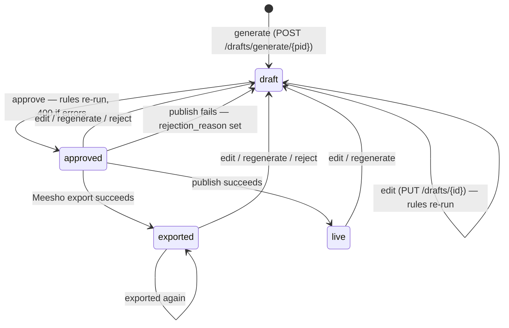

# How ListingPilot Works Today

> A factual description of the code as it currently runs. **Not the spec.** For intended behaviour see [`ListingPilot_PRD_SRS_v1.1.md`](ListingPilot_PRD_SRS_v1.1.md); for the pilot plan see [`MVP_PLAN.md`](MVP_PLAN.md).
>
> **Updated:** 5 Nov 2026, code at `3548fe6` on `main`. Backend tests: 239 cases, all passing against the Supabase test database (§12). Paths are relative to the repo root. Code is named by file and function; line numbers aren't kept because every edit makes them wrong.

---

## Contents

1. [Real vs simulated vs missing](#1-real-vs-simulated-vs-missing)
2. [Startup behaviour](#2-startup-behaviour)
3. [End-to-end walkthrough](#3-end-to-end-walkthrough)
4. [AI engine](#4-ai-engine)
5. [Rule engine](#5-rule-engine)
6. [Draft lifecycle](#6-draft-lifecycle)
7. [Marketplace adapters](#7-marketplace-adapters)
8. [Background jobs](#8-background-jobs)
9. [Frontend fallbacks](#9-frontend-fallbacks)
10. [Where data lives](#10-where-data-lives)
11. [Configuration](#11-configuration)
12. [How to run and test](#12-how-to-run-and-test)
13. [API reference](#13-api-reference)
14. [Current gaps](#14-current-gaps)

---

## 1. Real vs simulated vs missing

| Area | State | Evidence |
| --- | --- | --- |
| Catalogue template, import (xlsx/csv/Tally XML), export (xlsx/csv/json), CRUD | **Real** | `backend/app/api/v1/endpoints/catalogue.py` |
| Photo upload | **Real**: Supabase Storage through the backend, with signed links and no local copy. Add Product removes its uploads when the product isn't added | `backend/app/services/storage_service.py` |
| AI copy generation | **Real** (OpenRouter cascade or Claude), with a built-in template fallback | `backend/app/services/ai_service.py` |
| Technical specs / A+ content | **From data only**: the model's specs plus the product's own attributes; no sample values or default A+ copy (§4.5) | `ai_service.py` `_enrich_with_apple_grade_specs_and_aplus` |
| Rule checks and 0–25 score | **Real** | `backend/app/services/rule_engine.py` |
| Edit → re-check → approve gate → publish gate | **Real**, enforced server-side | `backend/app/api/v1/endpoints/drafts.py` |
| Amazon publish | **Simulated** without all 4 SP-API credentials (the current state): fake ASIN, 5 % random rejection. Live path coded, never run | `backend/app/services/amazon_adapter.py` |
| Amazon price/stock update, listing status | **Simulated only** | `amazon_adapter.py` |
| Amazon live schema fetch (PTD) | **Coded but never called** | `backend/app/services/amazon_ptd_service.py` |
| Flipkart publish, price/stock | **Simulated only**; live branches are `pass` | `backend/app/services/flipkart_adapter.py` |
| Meesho export | **Real file generation** into the official templates on disk, from product data only; refused with a list of problems when a compulsory column is empty (§7.3) | `backend/app/services/meesho_adapter.py` |
| Meesho "publish" | **Refused (409)**: Meesho has no listing API; the listing goes live only by uploading the exported sheet on supplier.meesho.com | `drafts.py` publish |
| SKU × marketplace status grid | **Real** (shows whatever is in the DB, including simulated IDs) | `drafts.py` |
| Reports | **Mixed**: baseline metrics come from the backend, but the Reports tab hard-codes the rejection rate and the quality bars and shows 4 Flipkart listings when there are none (§14) | `backend/app/api/v1/endpoints/reports.py`, `frontend/app/page.js` |
| Settings: brand voice, banned claims, credentials | **Real**, stored in a JSON file. Secret keys are refused (422) and stay in `.env` | `backend/app/services/settings_service.py` |
| System health | **Static** on the backend: always "healthy"/"connected". The dashboard no longer echoes that: it shows Amazon stub/live from the credentials, Flipkart as stub-only, the Meesho template count and real last-sync times (§3.6) | `settings_service.py`, `backend/app/api/v1/endpoints/health.py` |
| Celery batch generation | **Real**, not used by the dashboard | `backend/app/tasks/batch_tasks.py` |
| Celery batch publish | **Broken**: every draft ends up failed (§8) | `batch_tasks.py` |
| Live twin preview's own publish button | **Real**: posts to the API and reports the draft's real result (§3.3) | `frontend/app/components/MarketplaceLiveTwinPreview.jsx` `handleLivePublish` |
| Login, audit log, Setup wizard, workspaces/users, encrypted credentials, migrations | **Missing** | — |

---

## 2. Startup behaviour

### Backend

Start command: `uvicorn app.main:app --app-dir backend --port 8000`.

1. **Config.** `backend/app/core/config.py` loads `ROOT/.env`, then `./.env` (`config.py`). Unknown keys are ignored.
2. **Database** (`backend/app/core/database.py`): **Supabase PostgreSQL only** (moved from Neon on 1 Nov 2026). `DATABASE_URL` must be a `postgresql://` URL (turned into `postgresql+psycopg2://`), otherwise import fails with a RuntimeError. There is no SQLite or other fallback. The engine uses `pool_pre_ping`, `pool_recycle=300` and a 15 s connect timeout.
3. **Startup check and tables** (`main.py` lifespan): `check_connection()` connects once (3 attempts); if the database is unreachable the server **refuses to start**. The message includes the driver's error and a hint matched to it: DNS can't resolve the host (set DNS to 8.8.8.8 / 1.1.1.1), connection timed out or refused (port 5432 likely blocked, e.g. the co-working Wi-Fi), no IPv6 route (Supabase's direct host is IPv6-only; use the Session pooler string), bad credentials, or a generic check-your-URL hint. Then `Base.metadata.create_all` creates `products` and `listing_drafts` if missing. No migrations yet; existing tables are never altered. The seed script runs the same check.
4. **Celery** (`backend/app/core/celery_app.py`): pings Redis at `CELERY_BROKER_URL` with a 0.5 s timeout. If unreachable, or `CELERY_TASK_ALWAYS_EAGER=true`, it uses `memory://` / `cache+memory://` and runs tasks inline in the API process.
5. **App wiring** (`main.py`): CORS for `BACKEND_CORS_ORIGINS`, exposing `Content-Disposition` so the dashboard can name downloaded exports; a middleware printing `[METHOD] path -> status (ms)` for every request (`main.py`); routers under `/api/v1` (`main.py`); `backend/uploads/` served at `/static/uploads` (`main.py`); `GET /` returns a banner (`main.py`).
6. **Settings file.** `backend/app/data/dynamic_settings.json` is created with defaults the first time settings are read (`settings_service.py`). `LISTINGPILOT_SETTINGS_FILE` overrides the path.
7. **Meesho templates** are indexed by folder path on first use (about 0.6 s for 3,787 files, no workbook opened); a template's workbook is read only when an export uses it. Both are cached for the life of the process (`meesho_adapter.py`).

### Frontend

`cd frontend && npm run dev` serves http://localhost:3000. `frontend/next.config.mjs` loads the root `.env`. There are **no API rewrites or proxies**.

`frontend/app/page.js` has **no built-in demo data**: products and drafts start empty and the dashboard numbers start at 0. `fetchAllData()` fires 8 parallel GETs (products with `page_size=200`, categories, stats, drafts, baseline report, settings, system health, Meesho templates) and shows exactly what they return, including an empty catalogue. The KPI bar's "Avg Quality" comes from the baseline report's average score. The draft editor keeps the open draft across reloads, else opens the first draft for the selected marketplace (never another channel's draft under the wrong label). If the products request fails, a "Backend Unreachable" error toast is shown.

The API base is `NEXT_PUBLIC_API_BASE`, defaulting to `http://localhost:8000/api/v1` (`page.js`).

---

## 3. End-to-end walkthrough

The dashboard is one client component, `frontend/app/page.js` (about 4,100 lines). Tabs: **Catalogue**, **AI Drafts & Review**, **Multi-Channel Hub**, **Reports**, **Settings** (`page.js`). Above them is a KPI bar fed by `GET /catalogue/stats` (`backend/app/services/catalogue_service.py`): total SKUs, stock, average price, products missing required attributes, products with fewer than 3 photos.

### 3.1 Catalogue tab (`page.js`)

**Add Product** (top right of the dashboard) has an optional Meesho section (`components/MeeshoCategoryFields.jsx`). The seller picks the Meesho category, and the form lists that category's fields from `GET /drafts/meesho/category-fields/{template_id}` (`MeeshoAdapter.category_fields`): compulsory first, optional collapsed, with the template's exact options and Meesho's help text as a tooltip. Dropdowns of more than 50 options become a search box. Fields the form already has (`FORM_COVERED_COLUMNS`), Seller Details from Settings, and the Style and Group IDs the export sets aren't asked for. Filled values are sent in the same create request, as `Meesho <column>` attributes with `Meesho Category`, so a product is never half-saved. A value that isn't one of the options stops the save. Missing compulsory fields don't: the product is saved, the toast says how many remain, and the export gate still blocks it. Choosing another category clears the Meesho values. The create endpoint itself doesn't check Meesho values; the form and the export do. Its **Product Images** field (`components/ProductImagesField.jsx`) takes up to 4 photos, Meesho's image columns: pasted links and uploaded JPEG/PNG files (several at once, each through `POST /catalogue/upload-image` to the bucket), with the first as the front photo, which the export writes to Image 1. Save and Cancel are disabled during an upload or a save. **A product that isn't added leaves no photos behind:** removing a photo, Cancel, the close button or clicking outside the form call `POST /catalogue/discard-images`, and closing or reloading the page sends the same request as a beacon (best effort, and never during a save, since a leftover file is better than a product with broken photos). The route has no login, so it removes a file only when its link is in this bucket, its name is exactly what `upload_product_photo` makes, it was uploaded in the last 24 hours (`DISCARD_WINDOW`; a date in the future or one that can't exist is refused) and no product references it; one bad link refuses the whole request (422), and a storage failure is a 503 that the form shows. Pasted links are never touched.

**Generate with AI** (same field) makes extra images from a photo uploaded in this form. The browser shrinks the photo under 512 x 512, the input limit of Cloudflare Workers AI, and sends it with the form's name, category, material, size and Meesho values to `POST /catalogue/generate-image`. `AIService.image_prompt` builds the prompt from those and `AIService.generate_product_image` calls the model in `CLOUDFLARE_IMAGE_MODEL`. Each image gets its own scene, or the seller's background note, and the prompt tells the model to keep the product exact. The image is stored like an upload, with `_ai_` in its file name, so Cancel and Remove clean it up too. Images are labelled AI-generated, and Regenerate replaces one in place and removes the old file. They can't be the front photo, and Save is refused if only AI images remain. A saved product keeps only links, so the `_ai_` name is what marks them later: the product drawer labels them AI-generated and offers no Set #1 (`isGeneratedImage`), and the Meesho export gate blocks a product whose Image 1 is one (`storage_service.is_generated_photo`).

**Generate with AI in the product drawer** (`GenerateForProduct` in `components/ProductImagesField.jsx`) does the same for a product already in the catalogue. It works from the product's #1 photo when that's a real photo and the product has fewer than 4. The browser reads that photo from its link and shrinks it, and the prompt uses the product's stored name, category and attributes, minus legal, tax, price, weight and ID fields (`productImageFacts`). The new image is added after the product's photos; if that save fails, its file is removed from the bucket and the error is shown. There is no Regenerate in the drawer: the seller removes an image with ✕ and generates another. The server still never fetches a link: a front photo whose host doesn't let the browser read it (a pasted link to another site) gets a message to upload it as a file. A pasted link can't be a source, so the server never fetches a URL it was given.

| Button / action | Handler | API call | What the backend does |
| --- | --- | --- | --- |
| Download template | `handleDownloadTemplate` (`page.js`) | `GET /catalogue/template` | Builds a styled multi-sheet workbook (`backend/app/services/template_generator.py`) with column guidance, sample SKUs and `CATEGORIES_INFO` (required attributes and min photos for 6 categories) |
| Import (modal, file picker) | `handleFileUpload` (`page.js`) | `POST /catalogue/import` | `CatalogueParser.parse_file` (`backend/app/services/catalogue_parser.py`) routes by extension to Excel, CSV or Tally XML; `CatalogueService.batch_upsert_products` (`catalogue_service.py`) creates new SKUs and updates existing ones |
| Export (xlsx / csv / json) | `handleExport` (`page.js`) | `GET /catalogue/export?format=` | `CatalogueExporter` (`backend/app/services/catalogue_exporter.py`), all products, attributes as columns |
| Add product (modal) | `handleAddProduct` (`page.js`) | `POST /catalogue/products` | `CatalogueService.create_product` |
| Click a product → Inspector drawer (`page.js`) | — | — | Attributes, photo gallery, per-marketplace pre-check |
| Inspector: save details | `handleSaveProductDetails` (`page.js`) | `PUT /catalogue/products/{id}` | `CatalogueService.update_product` |
| Delete product (catalogue row or Inspector) | `DeleteProductDialog.jsx`, then `handleProductDeleted` | `DELETE /catalogue/products/{id}` | Asks first, in the page. The database removes the product's drafts with it. Photos stay in storage, and a listing already on a marketplace stays there, which the dialog says for an exported or live draft |
| Inspector: upload photo | `handleUploadPhotoFile` (`page.js`) | `POST /catalogue/upload-image` (with the SKU), then `PUT /catalogue/products/{id}` | The backend stores the photo in Supabase Storage (`services/storage_service.py`) as `<SKU>_<time>_<id>.jpg/png` and returns a 5-year signed link; JPEG or PNG only (checked by content, not name), at most 10 MB; 422 for anything else, 503 when storage isn't configured or reachable; nothing is kept on the server's disk. Every photo change (upload, link, remove, make primary) waits for the server and shows success only after it saved; a pasted link must start with http(s):// |
| Inspector: add URL, remove, set primary | `handleAddPhotoUrl` / `handleRemovePhoto` / `handleSetPrimaryPhoto` (`page.js`) | `PUT /catalogue/products/{id}` via `saveProductImageChanges` (`page.js`) | Updates `images` and `image_count`. The frontend doesn't check the response status |

**Import details** (`catalogue_parser.py`):
- Headers are matched **exactly** (after lower-casing and dropping `*`) against alias lists in `HEADER_MAPPINGS`. For example, `sku` matches "item code", "part no", "sku id"; `stock` matches "closing balance" and "inventory". Every other column is stored as an attribute under its title-cased header, so Meesho columns such as "Manufacturer Pincode" or "HSN ID" become attributes the Meesho export reads. Image columns ("Image 1 (Front)", "Image 2", …) go to `images` only.
- Row checks: missing SKU or name → error (no SKU is made up from the name: such SKUs collide and overwrite other products); duplicate SKU in the file → error; price ≤ 0 → warning; a short hard-coded banned-phrase list in name/notes → warning (`catalogue_parser.py`; this list is separate from the Settings list).
- No defaults: a blank MRP stays empty, a number in the images column is ignored with a warning, and a blank name/category/brand/price/stock/description **keeps the stored value** when the SKU already exists (`CatalogueService.batch_upsert_products`). New products without a brand get `DEFAULT_BRAND`; without a category, "General". The "Fill in" sheet of a workbook is read first (Meesho fill-in sheets, §7.3).
- Tally XML: reads `STOCKITEM` (or `LEDGER`) nodes; SKU = `PARTNO` or `TALLY-0001…`; category = the stock group; MRP and brand are left empty.
- Upsert: on update, attributes are **merged** (new keys overwrite old), and images are replaced only if the row has images (`catalogue_service.py`).
- Response: `ImportSummaryResponse` with created/updated/failed counts and row errors and warnings (`backend/app/schemas/import_export.py`). The dashboard toast shows created/updated/failed/warning counts and the first three row errors; it is an error when nothing was imported and a warning when some rows failed (`handleFileUpload`).

### 3.2 AI Drafts & Review tab (`page.js`)

Each product has one draft per marketplace, and the editor only ever shows the chosen marketplace's draft. Switching marketplace opens that product's draft there, including right after page load, when the first draft opened on its own. With no draft on that marketplace, the editor is empty and Save and Approve are disabled until one is generated.

| Button / action | Handler | API call |
| --- | --- | --- |
| Generate / regenerate (selected product, chosen marketplace) | `handleRegenerateDraft` (`page.js`) | `POST /drafts/generate/{product_id}?marketplace=` |
| Batch generate (modal: marketplace incl. "All", category incl. "All", overwrite) | `handleRunBatch` (`page.js`) | `POST /drafts/generate-batch?marketplace=&category=&overwrite=` |
| Close batch modal while running | `closeBatchModal` (`page.js`) | Aborts the fetch |
| Save edits | `handleSaveDraftEdits` (`page.js`) | `PUT /drafts/{id}` |
| Approve | `handleApproveDraft` (`page.js`) | `POST /drafts/{id}/approve` |
| Reject (modal with reason, `page.js`) | `handleRejectDraft` (`page.js`) | `POST /drafts/{id}/reject` |
| Publish | `handlePublishMarketplace` (`page.js`) | `POST /drafts/{id}/publish` |
| Payload view | `fetchAmazonPayloads` (`page.js`) | `GET /drafts/{id}/amazon-payload`, `GET /drafts/{id}/aplus-payload` |

**Generate (single)** (`drafts.py`): loads the product, calls `AIService.generate_listing` (§4), runs `RuleEngine.evaluate` (§5), then **upserts** the one draft for that (product, marketplace). Status is set to `draft` and approval cleared. Meesho copy that fails the deterministic checks is regenerated first (§4.1).

**Generate (batch)** (`drafts.py`): loops products × marketplaces **sequentially inside the HTTP request**. Existing drafts are skipped unless `overwrite=true`. Before each draft it checks `request.is_disconnected()`; when the browser aborts, it stops, commits what it has, and returns `cancelled: true`. Per-item exceptions are collected in `errors`.

**The editor has five sub-views:** listing copy (`page.js`), Amazon technical-details table, A+ content and comparison table, raw SP-API / A+ JSON, and the live twin preview.

**Edit** (`drafts.py`): applies changed fields, re-runs the rules, sets `is_approved=false`, `status=draft`.

**Approve** (`drafts.py`, `approve_draft`): re-runs the rules against the product as it is now (its data or Meesho category may have changed since the draft was checked) and stores the result; any error returns 400 naming the errors (up to five), otherwise the draft is `approved`.

**Editor safety** (`page.js`): the editor remembers which draft its text belongs to (`editDraftId`), and saving (also the save that approving does first) is refused while it still holds another draft's text. When a save, approve or reject finishes, the result replaces the open draft only if the seller hasn't moved to another product meanwhile. Before this (found 3 Nov 2026 by approving quickly down the list) a slow approval could flip the editor back and write one product's copy into another product's draft. **Compliance checks** (`components/RuleChecks.jsx`) list the draft's real rule results from the backend, every error (blocks approval) and warning with its message; it replaced a hard-coded list of three passing checks that never reflected the results.

**Reject** (`drafts.py`): `status=draft`, `is_approved=false`, stores `rejection_reason`.

**Publish** (`drafts.py`): returns 400 unless `is_approved` and `status == "approved"`. It dispatches to the adapter (§7). On success: `status=live`, `external_listing_id`, `marketplace_sku`, `last_sync_at`, cleared `rejection_reason`, and `SettingsService.record_sync()`. On failure: `status=draft`, `is_approved=false`, `rejection_reason` from the adapter.

### 3.3 Live twin preview

`frontend/app/components/MarketplaceLiveTwinPreview.jsx` renders the draft as an Amazon, Flipkart or Meesho product page, in desktop or mobile mode, with views for page, SP-API JSON, A+ JSON and compliance audit. It shows only the product's and draft's own data: no stand-in photos, price, MRP, bullets, specs, A+ cards or comparison table, and no ratings, delivery promises or "Lowest Price Guaranteed" badges. Stock shows the catalogue number ("Currently unavailable" at 0); a missing MRP shows as missing.

The **SP-API and A+ JSON views** show the backend's payloads (`GET /drafts/{id}/amazon-payload` and `/aplus-payload`, passed in from `page.js`), built from the last saved draft; nothing is assembled or filled in by the browser. The **audit** lists which Legal Metrology fields (country of origin, manufacturer, packer, net quantity, MRP) are missing from the product's attributes and counts keywords in UTF-8 bytes.

Its own **publish button** (hidden for Meesho drafts) posts to `${NEXT_PUBLIC_API_BASE}/drafts/{id}/publish` and reports what the backend did: accepted with the listing ID it returned, rejected with Amazon's/Flipkart's reason, or the error. The dashboard's copy of the draft is updated through `onPublished`. No `alert()`.

### 3.4 Multi-Channel Hub tab (`page.js`)

The Amazon and Flipkart cards show the real mode: Amazon "Stub mode" unless the credentials status is `ready`; Flipkart always "Stub only" (its adapter has no live path).

| Action | API call | Backend |
| --- | --- | --- |
| Status grid | `GET /drafts/marketplace-status?category=&search=` | One row per product: for each marketplace, draft ID, status (`not_started` if no draft), approval, external ID, score, error flag, last sync, rejection reason (`get_marketplace_status`). Loads all drafts in one query (`_drafts_by_product`); ~2 s for 19 products against the remote database (measured on Neon), where a query per cell took 25 s |
| Jump to a draft | — | Switches to the Drafts tab |
| Meesho Upload panel (`components/MeeshoUploadPanel.jsx`, the Meesho card's and action bar's "Meesho Upload" buttons) | `GET /drafts/meesho/readiness`, `GET /drafts/meesho/export?product_ids=&as_zip=true`, `GET /drafts/meesho/fill-in-sheet?product_ids=` | Lists every product grouped by Meesho category with a ready / problems badge (click for the reasons). The seller ticks the products for this upload (kept in this browser's localStorage); "Recheck selection" checks just those together. Export is disabled until every ticked product is ready; the server checks again and answers 422 otherwise. "Fill-in sheet for the not-ready" downloads the sheet for those products. A successful export records a Meesho sync time |
| Templates and taxonomy modal (`page.js`) | `GET /drafts/meesho/templates`, `GET /drafts/meesho/categories?search=` | Shows how many templates were found on disk (not one card each); searches `docs/meesho/categories/meeshoCategories.json`, each leaf marked by whether a template exists at its exact path |

### 3.5 Reports tab (`page.js`)

`GET /reports/baseline` (`reports.py`) returns:
- **overview**: products, drafts, products with/without drafts, coverage %;
- **pipeline**: counts per status;
- **quality**: average score, first-pass rate (drafts without errors), approval rate (`approved` ÷ all drafts; `live` drafts are not counted), rejection rate (drafts with any `rejection_reason`), rating distribution;
- **marketplace**: drafts per marketplace, live on Amazon.

The dashboard adds "time saved" = drafts × 0.75 h (`page.js`) and substitutes demo values for any zero (§9).

### 3.6 Settings tab (`page.js`)

| Sub-tab | API | Notes |
| --- | --- | --- |
| Brand voice (`page.js`) | `PUT /settings/brand-voice` | Fields: brand name, tone, target audience, claims to avoid. Read by every AI prompt |
| Banned claims (`page.js`) | `PUT /settings/banned-claims` | Replaces the whole list. Default 12 entries (`settings_service.py`) |
| Credentials (`page.js`) | `GET/PUT /settings/credentials` | Stored in plain text. GET masks as `abc****xyz` (`settings_service.py`). PUT ignores empty values and values starting with `***` (`settings_service.py`). The AI "model" shown is hard-coded `nvidia/nemotron-3.5-lightning:free` (`settings_service.py`) |
| System health | `GET /settings/system-health` | Backend: queries the database on every call (`SELECT 1`; `connected`, or `unreachable` with the driver error, overall `degraded` and a warn alert), reports AI/Amazon/Flipkart status from the configured keys (never a blanket "connected"), last-sync map, and "stub mode" alerts when Amazon/Flipkart IDs are empty (`settings_service.py`). Dashboard: nothing is shown as connected until the server answers ("Status not loaded" otherwise); cards show the database as Connected/Unreachable from that query, Amazon live/stub from the credentials status, Flipkart as stub-only, the number of Meesho templates loaded, and last sync times or "Never" |
| Operations manual (`page.js`) | — | Static in-app guide |

---

## 4. AI engine

File: `backend/app/services/ai_service.py`.

### 4.1 Prompt

`PROMPT_SYSTEM` (`ai_service.py`) is filled with the brand voice from Settings. The user prompt (`generate_listing`) has SKU, name, category, brand, price, all attributes, notes, the target marketplace, and Amazon product-type guidance from `AmazonPTDService.get_category_prompt_guidance` (`amazon_ptd_service.py`).

Rules stated in the prompt: a title of at most **90 % of the target marketplace's limit** and keywords within 90 % of its byte limit (`ai_service.py`). Limits live in `backend/app/services/marketplace_limits.py`, shared with the rule engine: titles 75 / 120 / 100 characters (Amazon / Flipkart / Meesho), keywords 200 bytes on Amazon.in and 250 elsewhere, so the prompt asks for 67 / 108 / 90 characters and 180 / 225 / 225 bytes. The other 10 % is buffer, so copy rarely overflows and needs regenerating; the rule engine still accepts anything up to the full limit. Only the target marketplace's numbers appear in the prompt. Also: exactly 5 bullets; 2–3 paragraph description; 5–8 keywords; technical specs only as stated in the attributes (no warranty, weight, origin, manufacturer or certifications that weren't given); A+ content (headline, brand story, 3 feature cards, comparison table); use only supplied data; no promotional claims. Output must be strict JSON.

**Meesho** has its own prompt (`MEESHO_PROMPT_SYSTEM`, `_generate_meesho`). The system prompt allows only facts stated in the product data: numbers and measurements as given, never converted or rounded; no "100%", "pure", "handmade", washing instructions, certifications or warranty unless the data says so; no praise words or offers. Title (90 characters): brand, the product type in shoppers' words and two or three stated attributes, never size, weight, dimension, price or a marketplace name. Then 3–5 one-fact bullets, a 2–4 sentence plain-text description that names the product type as shoppers search for it, including its common Hindi/Hinglish name (Meesho has no keyword field), and 5–8 keywords within 225 bytes. The user prompt gives the product's data (all attributes except the `Meesho Category` id; no price), its Meesho category breadcrumb, the template's compulsory dropdown fields shoppers filter by (`MeeshoAdapter.filter_fields`), the flagged words (`MEESHO_FLAGGED_WORDS`: care, comfort, colors) and the "WASH & MAINTENANCE" heading. **Regeneration:** model copy failing `RuleEngine.meesho_copy_issues` (an invented fact, a flagged word, a Product Name rule) or over 100 characters is regenerated with the failures listed, at most `MEESHO_COPY_RETRIES` = 2 times; what is still wrong then shows as rule errors to fix before approval. Template copy is never regenerated.

### 4.2 Provider and key selection (`ai_service.py`)

- Key: the `openrouter_api_key` in the settings file is used unless it is empty, contains `*`, or starts with `sk-or-v1-abcdef`; otherwise `OPENROUTER_API_KEY` from `.env`.
- If `AI_PROVIDER == "openrouter"` (or there's an OpenRouter key and no Anthropic key) → OpenRouter. Else if `ANTHROPIC_API_KEY` is set → Claude. Else → built-in generator.

### 4.3 OpenRouter cascade (`ai_service.py`)

Models are tried in order, skipping duplicates:

1. `OPENROUTER_MODEL` (config default `minimax/minimax-m3.1-flash`, `config.py`)
2. `google/gemma-4-26b-a4b-it` (comment: routed via OpenRouter BYOK)
3. `google/gemini-3.5-flash-lite`
4. `google/gemma-4-26b-a4b-it:free`
5. `nvidia/nemotron-3.5-lightning:free`
6. `minimax/minimax-m3.1-flash`
7. `nvidia/nemotron-3-ultra-550b-a55b:free`
8. `google/gemma-4-31b-it:free`
9. `liquid/lfm-2.5-2.6b:free`
10. `recursive/flint-v1.0:free`
11. `openrouter/free`

Per request: one shared `httpx.AsyncClient`, 22 s timeout, temperature 0.3, max_tokens 3000. A model is skipped and the next one tried when it:
- returns **HTTP 429**: it goes into a module-level cooldown map (`_MODEL_COOLDOWN_UNTIL`) for `Retry-After` seconds (default 60, clamped 1–600, `_rate_limit_cooldown`). Models in cooldown are skipped by **all** later requests in the same process;
- returns any other HTTP error, a network error, no choices, or empty content (for reasoning models, JSON inside `message.reasoning` is extracted first);
- returns JSON that doesn't parse (`_parse_json_response(..., fallback_on_error=False)` returns `None`).

Each skip prints one line. If all fail, or every model is in cooldown, the built-in generator is used.

### 4.4 Claude path (`ai_service.py`)

A single `POST https://api.anthropic.com/v1/messages` with `CLAUDE_MODEL` (default `claude-3-5-sonnet-20241022`), max_tokens 1500, 45 s timeout. Any failure falls back to the built-in generator. There's no cascade or cooldown.

### 4.5 Post-processing (`ai_service.py`)

After parsing, the reply is given the shape the draft code reads (`_normalize_listing`): missing keywords become empty instead of failing generate with a `KeyError`; bullets or keywords sent as one string are split on new lines (and commas for keywords); non-object specs/A+ become `{}`. A reply that isn't a JSON object, or has no title, no description, no bullets or more than 10 bullets, counts as unparseable and the next model is tried (gpt-oss has been seen writing the description into the bullet list). Titles over 200 characters are cut to 197 + "..." (for every marketplace). Then `_enrich_with_apple_grade_specs_and_aplus` runs on **every** result, including fallback output:

- **Technical specs:** the model's specs, plus every product attribute not already there, plus product-type fields (required and the first 4 optional) filled **only** when an attribute's name matches. Missing fields stay missing.
- **A+ content:** whatever the model wrote; nothing is added.

When a product has no attributes, the prompt says "none provided (do not invent any)".

### 4.6 Built-in generator (`ai_service.py`)

Deterministic. Title = brand + name + colour/material/size (skipping parts already in the name; never the size for Meesho); attributes that don't fit the marketplace's title limit are left out whole, and only a name longer than the limit is cut, at a word. Bullets restate attributes only (Pattern, Material/Fabric, Size/Dimensions, Included, Occasion, Care…); a bullet without an attribute behind it is left out, so there's no generic filler and no "authentic" or "verified" claims. For Meesho the colour and care bullets are headed "FINISH" and "WASH & MAINTENANCE". Description lists the attributes (not the Meesho Category id). Three keywords are derived from category, name and brand. Tagged `engine: "category_agnostic_rule_engine"`, then enriched as in §4.5.

---

## 5. Rule engine

File: `backend/app/services/rule_engine.py`, `RuleEngine.evaluate(product, draft, marketplace)`. It runs on single generate, batch generate, edit, approve (against the product's current data), after saving Meesho fields (`PUT /drafts/meesho/missing-fields`), and as a pre-check in `GET /drafts/product/{id}` when no draft exists (using the requested marketplace's rules).

| # | Check | Amazon | Flipkart | Meesho | Code |
| --- | --- | --- | --- | --- | --- |
| 1 | Required attributes: `CATEGORIES_INFO` (Amazon, Flipkart); the Meesho template's compulsory fields the data lacks (Meesho; one error when no Meesho category is chosen) | error each | error each | error each | `_meesho_required_issues` |
| 2 | Photo count | < 3 error (category min), < 5 warning | < 1 error, < 3 warning | < 1 error | `evaluate` |
| 3 | Price > 0 | error | error | error | `evaluate` |
| 4 | Title empty | error | error | error | `evaluate` |
| 5 | Title length (`marketplace_limits.TITLE_CHAR_LIMITS`) | > 75 error | > 120 error | > 100 error | `evaluate` |
| 6 | Title < 40 chars | warning | warning | warning | `evaluate` |
| 7 | Banned claim in title, bullets or description (whole-word regex, case-insensitive; one hit per block reported) | error | error | error | `evaluate` |
| 8 | HTML tag in description | — | — | error | `evaluate` |
| 9 | Bullets | < 5 warning | < 3 warning | < 3 warning | `evaluate` |
| 10 | Words Meesho QC flags in title, bullets or description (`MEESHO_FLAGGED_WORDS`: care, comfort, colors, and maroon, lotus, an, drop, which Meesho matched to brands on its list and held as "Brand/illegal keywords", 3 Nov 2026) | — | — | error | `meesho_flagged_word` |
| 11 | Title with a weight, dimension, price or another marketplace's name (`PRODUCT_NAME_RULES`) | — | — | error | `title` |
| 12 | Facts the data doesn't state (`copy_fact_issues`): a number (so conversions too), a claim (`CLAIM_TERMS`: 100%, pure, handmade, machine wash, warranty…) or one of the Meesho template's own option words (fabrics, colours, patterns… from `MeeshoAdapter.fact_vocabulary`; an option counts as stated when the data has all its words) | — | — | error | `unsupported_fact` |
| 13 | Praise the data doesn't use (`PUFFERY_TERMS`: premium, luxury, durable, best, perfect…) | — | — | warning | `puffery` |

Rules 4–10 only run when a draft exists; without one, an info issue "not yet generated" is added.

**Required attributes** for **Meesho** are the product's template's compulsory fields, found by the export's own checks (`MeeshoAdapter.missing_fields`; seller details and images are checked elsewhere), so they follow any of the 3,787 templates. For Amazon and Flipkart they come from `CATEGORIES_INFO` in `template_generator.py` (lines 8–131): Bedsheets (Material, Size, Thread count, Care), Pooja items (Material, Dimensions, Finish), Kurtas (Material, Fit, Sleeve, Length, Care), Planters (Material, Dimensions, Drainage), Ethnic footwear (Upper material, Sole, Sizes, Closure), Quilts (Fill, Outer, Size, Weight, Care). **Any other category requires only "Material"**. Attribute names are matched case-insensitively: the importer title-cases headers, so a sheet's "Thread count" is stored as "Thread Count".

**Score (0–25):** title (0–5) + bullets (0–5) + attributes (5 − 2 per missing, min 0) + keywords (1 per keyword, max 5) + photos (1, 3 or 5). Rating: Excellent ≥ 20, Good ≥ 15, otherwise Needs Improvement. `passed` = draft exists and no errors.

Title limits and photo minimums are **hard-coded**. The `marketplace_limits` block in the settings file is never read. Banned claims **are** read live from Settings.

---

## 6. Draft lifecycle

Model: `backend/app/models/draft.py`. Statuses used by the backend: `draft`, `approved`, `exported` (Meesho), `live`.



- One draft per (product, marketplace). This is enforced by the generate code's upsert, not by a database constraint.
- Regenerating overwrites the copy and clears approval (`drafts.py`).
- `exported` means the product went into a Meesho upload file, never that it is on Meesho; it stays approved, so it can be exported again. Nothing becomes `live` on Meesho until its processed file is imported (not built yet).
- "Rejected" is not a status: a rejected or failed draft is `draft` with `rejection_reason` set. A successful publish clears it.
- Deleting a product cascades to its drafts (`draft.py`, FK `ondelete="CASCADE"`).

---

## 7. Marketplace adapters

### 7.1 Amazon (`backend/app/services/amazon_adapter.py`)

**Credentials**: `seller_id`, `client_id`, `client_secret`, `refresh_token`, from the settings file first, then `.env`. Live mode requires all four. `GET /drafts/credentials-status` reports mode and what's missing.

**Payload** (`build_sp_api_listing_payload`): Listings Items 2021-08-01 document with `productType` from `AmazonPTDService.resolve_product_type` (keyword map, default `PRODUCT`) and `requirements: "LISTING"`. Attributes: `item_name`, `bullet_point`, `product_description`, `generic_keyword`, `brand`, parsed dimensions and weight, colour, size, material, images, then Legal Metrology and offer fields. Every draft technical spec is also passed through as an attribute (snake-cased key), so the payload carries whatever the specs say. **Legal Metrology comes only from the product's own attributes**, never from those specs: any country/manufacturer/packer/importer/net-quantity/generic-name/MRP key the specs produced is dropped first (the same names as the Meesho template): country of origin (India → `IN`, China → `CN`), manufacturer / packer / importer as "name, address", net quantity, generic name (else category) and the catalogue MRP. A missing value is left out so Amazon's validation reports it.

If an attribute "Parent SKU" exists, child-variation fields with theme `COLOR_NAME/SIZE_NAME` are added.

**A+ payload**: an A+ Content 2020-11-01 document built from `aplus_content`. Preview only; never submitted.

**Live publish** (`create_listing`): exchanges the refresh token for a Login with Amazon access token, then `PUT https://sellingpartnerapi-eu.amazon.com/listings/2021-08-01/items/{sellerId}/{sku}?marketplaceIds=…` with header `x-amz-access-token`. HTTP 200/201/202 → success. The external ID is read from `identifiers[0].identifier`, **falling back to a random `B0…` string**. The listing is marked `live` immediately; there's no status polling. Other responses → rejection with Amazon's issue messages. AWS keys are not used.

**Stub publish**: fake ASIN `B0` + 8 hex characters. With probability **0.05** (`random.random() < 0.05`) it returns a rejection `MISSING_LEGAL_METROLOGY: …`. Results are therefore non-deterministic.

`update_price_stock` and `get_listing_status` return canned responses in both modes.

`AmazonPTDService` (`amazon_ptd_service.py`) holds the keyword → product-type map and built-in field definitions with sample values. `fetch_live_ptd_schema` would call the SP-API Definitions endpoint and cache to `backend/app/data/ptd_schemas/`, but **nothing calls it**.

### 7.2 Flipkart (`backend/app/services/flipkart_adapter.py`)

`is_configured` reads `FLIPKART_APP_ID` / `FLIPKART_APP_SECRET` from **`.env` only**; credentials saved in Settings are ignored. `create_listing` always returns success with a fake FSN `LST` + 13 hex characters and `mode: "stub"`. The live branch is `pass`. `update_price_stock` is the same.

### 7.3 Meesho (`backend/app/services/meesho_adapter.py`)

**Templates.** All 3,787 official templates sit in `docs/meesho/Meesho Templates/<category path>/<name>-<id>-EXTERNAL-…xlsx`, one per Meesho category; `<id>` is Meesho's template id (Bedsheets 12776), unique across all of them. `template_index` lists them without opening any and gives each its real names from `meeshoCategories.json` as a breadcrumb (`Home & Kitchen > Home Furnishings > Bedding & Linen > Bedsheets`): the exact folder path first, then the same names with symbols ignored, because 39 names contain `/`, which their folders couldn't keep ("Memory / RAM" is saved as `Memory RAM`). Every category is exactly 4 levels deep, as in the supplier panel. `template_by_ref` finds a template by id, breadcrumb (any spacing or case around `>`) or folder path, exactly; nothing else matches. `_load_template` reads one when it's used: column headers from row 3, compulsory markers from row 2, dropdown option lists from the Validation Sheet. `GET /drafts/meesho/templates` lists id, category, breadcrumb and file for every template; `GET /drafts/meesho/taxonomy` (`drafts.py`) gives the 4-level tree with template ids for the picker.

**Which template a product goes in** (`resolve_item_template`): only the seller's choice decides (`meesho_choice`): the product's own **`Meesho Category`** attribute (a template id, or a breadcrumb as typed in an imported sheet), else the default chosen for its category (`meesho_category_defaults` in the settings file, `GET|PUT /drafts/meesho/category-defaults`, `drafts.py`). A product with neither, or whose choice names no template, is left out with a `Template` problem (`_template_problem`); it is never placed by its name. The dashboard sets both with a 4-column picker like the supplier panel, with search (`components/MeeshoCategoryPicker.jsx`): per category in Admin & Settings → Brand Voice → **Meesho Categories** (`MeeshoCategoryDefaults.jsx`), per product in the product's Meesho box (`MeeshoRequiredFields.jsx`, with "Use category default" to drop the product's own choice). `PUT /drafts/meesho/missing-fields/{id}` saves `Meesho Category` as the template id and accepts only an official template's id or breadcrumb; an empty value removes it. The fill-in sheet asks unplaced products for it, with every breadcrumb as its dropdown.

**Suggestions** (`suggest_templates`) come from the category's name, looked up by `template_candidates`: a template reference → the normalised leaf name → the **head noun** of each `&`/`,` part, with the one or two words before it joined on ("Double Bedsheets", "Bed Sheets"; longest match first so Tshirts beats Shirts) → the synonym tee → tshirt. Whole words only: "Steel bottles", "Settees" and "Men" match nothing, and "Sweatshirts" matches Sweatshirts, not Shirts. Templates for another audience than the product's name states are left out (`AUDIENCE_SECTIONS`): "Women's straight kurta" isn't offered Men Fashion's Kurtas. Suggestions appear in the picker and in the problem text; even a single one is not used until the seller picks it.

**Export** (`generate_batch_export`) is **all or nothing**: it groups the given products by resolved template (`_group_by_template`), fills each one, and makes a file only when **every** product passes every check; otherwise it raises `MeeshoExportIncomplete` with all problems from all templates, and no file is made. Nothing is skipped quietly: a product without a Meesho category blocks like any other gap, and the seller fixes it or takes it out of the upload. Several templates always come back as one zip; two templates with the same leaf name (Men's and Women's Tshirts) get the template id in the file name (`ListingPilot_Meesho_Tshirts_10000.xlsx`). `check_items` runs the same checks without making a file, for readiness.

**Filling** (`populate_template`) loads an in-memory copy of the template and writes one row per product starting at **row 5**. Every value comes from the product, its Meesho draft or simple arithmetic on them; nothing is defaulted (`_row_inputs`, `_template_value`). For any column, the seller's exact Meesho value is an attribute named **`Meesho <column>`** (`Meesho Size`, `Meesho Fabric`; `_seller_attribute`), which wins over everything else; then an attribute named exactly like the column (e.g. `Manufacturer Pincode`, `Color`). The fill-in sheet and the required-fields form save under `Meesho <column>`, so a Meesho value never overwrites a descriptive attribute of the same name: the Bedsheets **Size** dropdown (Double Queen, Single…) is `Meesho Size`, while `Size` keeps the measurement ("90 x 100 in (double)" can't tell Double Queen from Double King).

| Column | Value written |
| --- | --- |
| Product name | Meesho draft title, else product name; HTML stripped; never shortened (over 100 characters blocks) |
| Meesho price / MRP / inventory | product price / product MRP / product stock, as stored |
| Wrong/defective discount | attribute only (optional column, empty otherwise) |
| Description | draft description + "Key Features:" bullets; without a draft, the product's own description |
| GST, HSN | attributes "GST %"/"GST Rate"/"GST", "HSN ID"/"HSN Code"/"HSN" |
| Net weight (gms) | grams parsed from "Net Weight (gms)"/"Net Weight"/"Weight" ("350 g (set)" → 350, "1.2 kg" → 1200) |
| Country of origin; manufacturer, packer, importer name/address/pincode | attribute with the column's name; otherwise the seller's **Seller Details** from Settings (`SettingsService.get_seller_details`, `GET|PUT /settings/seller-details`, stored under `seller_details` in the settings file). A product's own value wins; an unset field stays empty and blocks. These fields are not asked per SKU in the fill-in sheet or the required-fields form, which point to Settings instead |
| Variation | attribute "Size"/"Variation" |
| Colour, fabric, pattern, included components, net quantity | matching attributes ("Colour", "Material", "Pattern"/"Print", "Included", …). Fabric/Material and Pattern/Print fill only the columns named exactly that: "Sole Material" and "Weave Pattern" need their own attribute |
| Bedsheet length/width size; other length/width (cm) columns | longer/shorter side of the first "A x B in" in Size/Dimensions (cm = inches × 2.54) |
| Product length / breadth / width / height, their unit (`Product Unit`, `Product Dimension Unit`), the `(cm)` versions and `Product Dimensions (L x B x H) in cm` (any template; `_measurements`) | the one "A x B [x C] unit" measurement the `Dimensions` (else `Size`) attribute states (`_stated_dimensions`): two sides are length (longer) and width/breadth, three are length, breadth, height as written; the unit as the template's dropdown spells it (`Inch`, `cm`); `(cm)` columns converted to cm, one decimal. A text with no clear measurement or several ("10 in diameter x 3.5 in depth", "3.5 x 3.5 in each pot, tray 11 x 4 in") fills nothing |
| Product weight + unit, Weight + Weight Unit (any template) | the one weight a `Weight` attribute states (`_stated_weight`): in the stated unit when the template lists that amount, else in the other unit (1.2 kg → `1.2` + `Kg`, 350 g → `350` + `G`); never rounded, so 480 g on a template listing neither 480 nor 0.48 is left to the seller. A `Weight` dropdown spelling both (`500gm`, `1.5kg`) gets that option |
| Dimensions (inches) (Bedsheets 12776) | the one `A*B-(Label)` option with the same two sides, narrowed by the row's Variation when several share them (`_dimension_option`); otherwise a blocking problem |
| Care Instructions, Ideal For, Ideal Season, Occassion Type, Quality, Type (Bedsheets 12776) | attributes with the column's name only; nothing in the product data implies them |
| Pillow length/width; no. of pillow covers | the "A x B in" and the "N pillow" in the Included text |
| Images 1–4 | product `images[0..3]` as stored |
| Style ID / SKU ID / Brand Name / Group ID | Style Code/ID attribute else SKU / SKU / product brand / the seller's Group ID, else one per product (`_group_ids`): each Style ID gets the next unused option in order (`Group 01`, `Group 02`…; 1, 2… when free text), so size variants share a group and different products never do. Meesho treats rows sharing a Group ID as one catalog and as sizes of one product: five bedsheets sent with Group ID 1 were rejected (30 Oct 2026) |

**Dropdown columns** (`_match_dropdown_option`) take only high-confidence matches, returned with the template's exact spelling: exact (case-insensitive) → same number, with or without a unit ("180 TC" → "180") → exactly one option named as a whole word in the value ("100% cotton" → "Cotton", "90 x 100 in (double)" → "Double"; longest option wins, so "Navy Blue" beats "Blue"). Brand, HSN, GST, country, Group ID and colour accept only exact or numeric matches, so "Indigo and white" is not turned into "White" and Brand is never picked.

**Problems** are collected per SKU: a compulsory column (row-2 "* Compulsory Field" marker) left empty, a value that isn't a template option, or several designs sharing one Product Name (Meesho merges them as sizes of one product and rejects the rows; distinct sizes of one Style ID may share a name). Any compulsory problem raises `MeeshoExportIncomplete`; non-compulsory ones (e.g. a brand not on Meesho's list) leave the cell empty and don't block. **Upload rules** (`_upload_rule_problems`), all blocking: the product's Meesho draft must exist and be **approved**; Product Name at most **100 characters** and free of a weight (`750 gm`), a dimension (`90 x 100`, `10 inch`), a price (`₹499`) or another marketplace's name (`PRODUCT_NAME_RULES`; bare units that are also words or model names, like `2 in 1`, `5G`, `3M`, aren't matched); no word Meesho's QC flags (`MEESHO_FLAGGED_WORDS`) in the title, description or bullets; **Meesho Price lower than MRP** and a Wrong/Defective discount below the Meesho Price (the template's own rules); every image link a web link that isn't Google Drive, a stock-photo site or a local address (`UNUSABLE_IMAGE_LINKS`). Links to the seller's own storage are allowed: Meesho accepted a Supabase Storage signed link (3 Nov 2026).

`GET /drafts/meesho/export` (`drafts.py`) takes the upload's `product_ids` (else a `category`, else every product; an id that doesn't exist is a 404, never dropped) and answers **422** with `detail: {message, problems: [{sku, category, field, reason, blocking}]}` instead of a file when anything blocks. A successful export marks each product's Meesho draft `exported` (never `live`) and records the time in `last_sync_at`. `GET /drafts/meesho/readiness?product_ids=` returns each product's Meesho category, `ready`, and its blocking problems, checked together as the upload would be; all products when no ids are given.

**Processed-file import** (`POST /drafts/meesho/processed-file`, `MeeshoAdapter.parse_processed_file`, `components/MeeshoQcImport.jsx` in the Meesho Upload panel): the seller uploads the error or warning file downloaded from the supplier panel (.xlsx, at most 10 MB, read-only and values only). For each SKU with an ERROR STATUS or MESSAGE, its Meesho draft goes back to unapproved with `rejection_reason` = "Meesho QC: <message>" and its checks rerun; the words Meesho flagged ("maroon(Warning)") are learned into the settings (`meesho_learned_flagged_words`) and join `MEESHO_FLAGGED_WORDS` everywhere (`MeeshoAdapter.flagged_words()`: the prompt, the copy check and the export gate). Unknown SKUs are reported, never dropped; an unreadable file changes nothing (422). Readiness shows each product's `qc_reason`; the editor shows it as "Rejected last time"; approving clears it. "Pick the N failed product(s)" selects them for the corrected export, uploaded with "Upload New File" on the same row. **Upload checklist:** every export zip carries `UPLOAD_CHECKLIST.txt`: per file the exact category path (and template id) to pick in the supplier panel and its SKUs, then the QC-error loop.

**Fill-in sheet** (`build_fill_in_sheet`, `GET /drafts/meesho/fill-in-sheet?product_ids=` or `?category=`): a workbook with a "Fill in" sheet (SKU, name, category, one column per blocking field using the template's own column names, highlighted where that SKU needs it, plus the current image links, with Image 1 highlighted when it is missing), Excel dropdowns with the template's exact options ("Allowed values"), "What's wrong" (every problem) and "How to use". A product without a Meesho category gets a **Meesho Category** column, with every category's breadcrumb as its dropdown, so the sheet is produced even when that is the only gap. Importing it in the Catalogue tab stores the values as attributes, which the export then reads. The Meesho Upload panel downloads it for the not-ready products on request; blockers a cell can't fix (approval, Product Name, image links) are listed under "What's wrong".

**Meesho required fields form** (`missing_fields`, `GET|PUT /drafts/meesho/missing-fields/{product_id}`, `frontend/app/components/MeeshoRequiredFields.jsx`): runs the export's own checks on one product and lists each blocking field with the attribute it is saved under (`Meesho <column>`, e.g. `Meesho Size`) and the template's exact options; images and Product Name blockers are listed separately since a value can't fix them. PUT merges values into the product's attributes (other attributes untouched); every key must be a field of the category's template and every dropdown value one of its options exactly, otherwise **nothing** is saved (422). After saving, the product's Meesho draft (if any) has its rules re-run and is returned as `draft`, so the editor's approval state reflects the new values. Nothing is pre-selected. Shown in AI Drafts & Review under the master data when the marketplace is Meesho, and in the product drawer's read-only view (not while editing, so the edit form's copy of the attributes can't overwrite a save). It also shows the product's Meesho category (or that none is chosen) with the picker (§7.3).

**"Publish"** for Meesho returns **409** with upload instructions and changes nothing; the frontend shows the same instructions without calling it.

---

## 8. Background jobs

File: `backend/app/tasks/batch_tasks.py`. Configuration: `backend/app/core/celery_app.py` (JSON serialiser, `Asia/Kolkata`, `task_track_started`, prefetch 1).

- **`generate_batch_drafts_task`**: same logic as the synchronous batch, with `update_state(PROGRESS)` per item, using `_run_async` to run the async AI call. `tenant_id`, if given, filters `Product.brand == tenant_id OR brand ILIKE %tenant_id%`; there is no real tenant isolation.
- **`publish_batch_drafts_task`**: **does not work.** It calls the async `AmazonAdapter.create_listing` / `FlipkartAdapter.create_listing` without awaiting them, so `res.get` fails on a coroutine object. For Meesho it calls `MeeshoAdapter.generate_bulk_upload_row`, which **doesn't exist**. Every draft is caught by the `except` and counted as failed. No test exercises it (`backend/tests/test_celery_tasks.py` only checks registration and the generate dispatch).
- **`get_celery_task_status`**: state, progress meta and result for `GET /drafts/tasks/{task_id}`.
- `get_task_db_session` uses the FastAPI test DB override when present, so tests run tasks against the test database.

The dashboard does not call any `/drafts/tasks/*` endpoint.

---

## 9. Frontend fallbacks

There are **no local fallbacks**. When a request fails or the backend answers non-OK, each handler in `frontend/app/page.js` shows an error toast saying what wasn't saved (and the server's reason when it gives one) and leaves the screen as it was; optimistic changes (banned-claim list) are rolled back. Nothing is simulated: no local drafts, IDs, scores, CSV exports or "saved locally" messages. Meesho publish is answered with upload instructions instead of a status change.

---

## 10. Where data lives

| Data | Location | Notes |
| --- | --- | --- |
| Products, drafts | Supabase Postgres (`DATABASE_URL`) | The only database (§2) |
| Product photos | Supabase Storage bucket `SUPABASE_STORAGE_BUCKET` (private; signed links on the product) | Written only by the backend with `SUPABASE_SERVICE_KEY`; the key never reaches the browser |
| Brand voice, banned claims, seller ID, Meesho category defaults, learned Meesho flagged words, last-sync | `backend/app/data/dynamic_settings.json` | Gitignored; plain JSON; global (no workspace). Secret credentials are never written here: `PUT /settings/credentials` refuses them (422) and names the `.env` variable to set (`SECRET_CREDENTIAL_ENV`) |
| Cached Amazon schemas | `backend/app/data/ptd_schemas/` | Only written by `fetch_live_ptd_schema`, which is unused |
| Meesho master templates | `docs/meesho/Meesho Templates/<category path>/*.xlsx` | Read-only; copies are filled in memory |
| Meesho category tree | `docs/meesho/categories/meeshoCategories.json` | Used for search and template matching |
| Server secrets | `.env` (root) | Gitignored; template `.env.example` |
| AI rate-limit cooldowns | Process memory | Lost on restart |

**`products`** (`backend/app/models/product.py`): `id`, `sku` (unique), `name`, `category`, `brand` (default "Gulmohar Home"), `mrp`, `price`, `stock`, `images` (JSON list), `image_count`, `attributes` (JSON), `description`, `current_listing` (JSON), `created_at`, `updated_at`.

**`listing_drafts`** (`backend/app/models/draft.py`): `id`, `product_id` (FK, cascade), `marketplace`, `title`, `bullets`, `description`, `keywords`, `technical_specs`, `aplus_content`, `status`, `is_approved`, `rule_results`, `marketplace_sku`, `external_listing_id`, `last_sync_at`, `rejection_reason`, `created_at`, `updated_at`.

There are no `workspace_id` / `user_id` columns, no audit table, and no rejection history.

**Seed data** (`backend/app/seeds/seed_pilot_data.py`): `PILOT_PRODUCTS` has 19 Gulmohar Home SKUs (Bedsheets 5, Pooja items 5, Kurtas 3, Planters 2, Ethnic footwear 2, Quilts 2). They are **demo values written to look real**, complete for each product's Meesho template: every compulsory field passes the export's checks (the `meesho` block of each product, saved as `Meesho <column>` attributes). Photos are signed links (5-year expiry) to `SKU_1.jpg` files in the seller's Supabase product-images bucket (`PRODUCT_IMAGES`). On 3 Nov 2026 these are **free-licence Unsplash stand-ins** (local copies in `assets/product-images/`), uploaded to test the workflow; they aren't photos of these products and must be replaced with the seller's own before a real upload. `seed_database()` only **adds SKUs that don't exist yet** and never changes stored products; the database is the source of truth. **`--replace`** deletes these 19 SKUs and their drafts (no other product), seeds them again, and sets Settings > Seller Details (`SELLER_DETAILS`, demo legal details) and the Meesho category defaults (`MEESHO_CATEGORY_DEFAULTS`: Bedsheets 12776, Pooja items 12811, Kurtas 10004, Planters 13367, Quilts 15875). The men's kurta (10149), the two diyas (13323) and both footwear products (12413, 12435) carry their own `Meesho Category`. Replace the demo values with the seller's own before a real upload. Reseeded on 3 Nov 2026, then run through the seller workflow in the app: Meesho drafts generated by AI (all 19 passed the fact check), approved, and exported (all 19 ready; one zip with 9 template files, one per Meesho category), so the drafts are `exported`.

**First real QC run (3 Nov 2026)**, supplier panel, Bedsheets (12776), 5 seed products: upload v2 passed QC for 2 and held 3 for "Brand/illegal keywords" (maroon, lotus, an, drop in the AI copy); after adding those words to `MEESHO_FLAGGED_WORDS`, regenerating and approving the 3 drafts, the corrected file ("Upload New File" on the held row) passed QC 3/3. No QC errors once each product had its own Group ID. Files uploaded are kept in `assets/meesho-uploads/` (not committed).

**Second run (3 Nov 2026), all remaining categories:** 14 products in 8 files (Diyas & Lanterns, Puja Articles, Kurtis, Men Kurtas, Planter, Men and Women Mojaris/Juttis, Quilts), uploaded per `UPLOAD_CHECKLIST.txt`. 13 passed QC on the first upload; BRS-221 was held for "borosilicate" (matched to the brand Borosil). Its warning file was imported in ListingPilot (Meesho Upload > Import error / warning file), which unapproved the draft and learned the word; the regenerated, approved copy passed QC on "Upload New File". **All 19 pilot products have passed Meesho QC** at file level; see the next paragraph for what the inventory showed on 4 Nov.

**Re-upload check (4 Nov 2026):** the Diyas & Lanterns file was uploaded again (14:57) with BRS-220 and BRS-221 and came back QC Error on 2/2 catalogs: "This product has been deactivated as it duplicates an existing Meesho product ID." BRS-221's name and description had changed since the accepted upload, so **rewording copy doesn't clear it**; the price, SKU and image were the same, and which of those Meesho matches on is unknown. This error has **no error file**: the row offers "View Catalog Errors", not "Download Error File", and the reason shows only in Inventory, so `POST /drafts/meesho/processed-file` never sees it. ListingPilot doesn't know which SKUs are already on Meesho (readiness says Ready and export allows them), so don't re-upload an accepted SKU. Inventory the same day: 15 of 19 were Active and have since been **paused** so the demo listings can't be ordered (pausing sets stock to 0, so resuming means entering stock again). KRT-312, BLU-416 and MJR-521 are "under QC, expect an action within 48 hours" although their files show QC Pass, and QLT-611 is "Blocked: Please contact supplier support". Those four aren't found by a SKU search, only by catalog ID, and they have no Pause action, so the three under QC could still go live on their own.

---

## 11. Configuration

Read by `backend/app/core/config.py` from the root `.env`. Template: `.env.example`.

| Variable | Default in code | Effect |
| --- | --- | --- |
| `DATABASE_URL` | `""` | Supabase Postgres URL; required, unreachable → server won't start |
| `TEST_DATABASE_URL` | `""` | Tests only: a separate database (`listingpilot_test` on the same Supabase instance); tables dropped and recreated each run |
| `BACKEND_CORS_ORIGINS` | localhost/127.0.0.1 on 3000 and 5173 | CORS |
| `DEFAULT_BRAND` | `Gulmohar Home` | Fallback brand |
| `AI_PROVIDER` | `openrouter` | `openrouter`, `groq` or `anthropic` |
| `OPENROUTER_API_KEY` | none | OpenRouter key |
| `OPENROUTER_MODEL` | `minimax/minimax-m3.1-flash` | First model in the cascade |
| `GROQ_API_KEY`, `GROQ_MODEL` | none, `openai/gpt-oss-120b` | Groq path |
| `ANTHROPIC_API_KEY`, `CLAUDE_MODEL` | none, `claude-3-5-sonnet-20241022` | Claude path |
| `SUPABASE_URL`, `SUPABASE_SERVICE_KEY` | `""` | Photo storage; uploads and deletes fail with 503 when unset. The key stays in the backend |
| `SUPABASE_STORAGE_BUCKET` | `product-images` | Bucket for product photos |
| `CLOUDFLARE_ACCOUNT_ID`, `CLOUDFLARE_AI_TOKEN` | `""` | Image generation; it fails with 503 when unset. No other provider is tried |
| `CLOUDFLARE_IMAGE_MODEL` | `@cf/black-forest-labs/flux-2-klein-4b` | Image model. About 110 of the 10,000 free daily neurons per image (estimated from Cloudflare's price list) |
| `REDIS_URL`, `CELERY_BROKER_URL`, `CELERY_RESULT_BACKEND` | `redis://localhost:6379/0` | Celery |
| `CELERY_TASK_ALWAYS_EAGER` | `false` | Force inline tasks |
| `AMAZON_SELLER_ID`, `AMAZON_SP_API_CLIENT_ID`, `AMAZON_SP_API_CLIENT_SECRET`, `AMAZON_SP_API_REFRESH_TOKEN` | none | All four → Amazon live mode (Settings values take priority) |
| `AMAZON_MARKETPLACE_ID` | `A21TJRUUN4KGV` | Amazon.in |
| `AMAZON_AWS_ACCESS_KEY`, `AMAZON_AWS_SECRET_KEY`, `AMAZON_AWS_ROLE_ARN` | none | Unused |
| `FLIPKART_APP_ID`, `FLIPKART_APP_SECRET` | none | Only change the reported mode; adapter is a stub |
| `NEXT_PUBLIC_API_BASE` | `http://localhost:8000/api/v1` (in `page.js`) | Frontend → API |
| `LISTINGPILOT_SETTINGS_FILE` | `backend/app/data/dynamic_settings.json` | Settings file path (`settings_service.py`) |

**Credentials entered in Settings** override `.env` for Amazon and OpenRouter, but not Flipkart.

---

## 12. How to run and test

```powershell
# repo root
.venv\Scripts\python.exe -m pip install -r backend/requirements.txt
.venv\Scripts\python.exe backend/app/seeds/seed_pilot_data.py             # adds missing seed SKUs only
.venv\Scripts\python.exe backend/app/seeds/seed_pilot_data.py --replace   # deletes and reseeds them, sets Seller Details and Meesho category defaults
.venv\Scripts\python.exe -m uvicorn app.main:app --app-dir backend --reload --port 8000
#   Swagger: http://127.0.0.1:8000/api/v1/docs   ReDoc: /api/v1/redoc

cd frontend; npm install; npm run dev        # http://localhost:3000

# optional worker (needs Redis)
.venv\Scripts\python.exe -m celery -A app.core.celery_app worker --loglevel=info -P solo

# tests
.venv\Scripts\python.exe -m pytest backend/tests -q
```

`pytest.ini` sets `pythonpath = backend`, `testpaths = backend/tests`.

**Test setup** (`backend/tests/conftest.py`): points `LISTINGPILOT_SETTINGS_FILE` at a temporary file. The database is **`TEST_DATABASE_URL`** (`listingpilot_test` on the Supabase instance); the run stops if it's unset, not Postgres, the same database as `DATABASE_URL` (same user, host, port and database name — Supabase pooler hosts are shared across projects), or unreachable. Each run drops and recreates the tables, then seeds the pilot products (each given five example photo links, so tests never depend on the seller's bucket) plus 40 extras. `get_db` is overridden and `SessionLocal` rebound to the test branch, so nothing in a test can reach the app database. Groq/OpenRouter/Anthropic keys are blanked, so no test calls a real AI provider; provider tests use fake keys and mocked `httpx`.

| File | Tests | Covers |
| --- | --- | --- |
| `test_catalogue_api.py` | 5 | CRUD, stats, categories |
| `test_import_export.py` | 4 | Template, imports (a row without SKU is an error), exports |
| `test_ai_drafts.py` | 6 | Generate + rules, edit/approve gate, preview, pre-check by marketplace, drafts deleted with the product |
| `test_ai_groq.py` | 14 (16 cases) | Groq provider, rate-limit cooldown and waits, generation source, normalising incomplete model output, rejecting a reply with the description in the bullets, prompt asking for 90 % of each marketplace's limits, template-copy titles within the Amazon limit |
| `test_phase2_endpoints.py` | 6 | Amazon publish/payloads, status grid, reports |
| `test_phase3_endpoints.py` | 9 | Flipkart stub, Meesho templates/export refusal/dropdowns |
| `test_meesho_export.py` | 78 (136 cases) | Meesho values from product data only, `Meesho <column>` values for any template, size and weight columns from one stated measurement, one Group ID per product, high-confidence dropdown matching, whole-word template matching, name matches only suggest, audience-aware suggestions, template ids and real names (incl. '/'), category defaults and product choice, taxonomy and category-default endpoints, all-or-nothing export with upload checklist, drafts marked exported, readiness and selection endpoints, approval re-checked against current data, title length, Product Name, flagged-word (incl. brand matches), price and image-link rules (an AI-generated image can't be Image 1, a missing MRP blocks), copy fact check, copy style (no notes about searching, English letters), Meesho prompt, regeneration, template copy, template-required fields, processed-file parsing and import (failed drafts, learned words, unknown SKUs, unreadable files), Meesho Category from fill-in sheet and endpoint, lazy template loading, fill-in sheet, 422 endpoint |
| `test_no_invented_data.py` | 9 | Exact header matching, no invented MRP/images (import and Add Product), seed never overwrites, Meesho publish refused, AI and Amazon Legal Metrology from attributes only (not from draft specs) |
| `test_phase4_endpoints.py` | 7 | Brand voice, banned claims, secret credentials refused (not stored unencrypted), seller ID saved, health |
| `test_photo_storage.py` | 6 (10 cases) | Photos stored through the backend with a signed link, JPEG/PNG by content only, 10 MB limit, failing loudly when storage is unconfigured, unreachable or refuses |
| `test_image_generation.py` | 19 (25 cases) | Prompt from the form, stored as `_ai_`, refusals, size and concurrency limits, daily limit, bad answers, storage failure, nothing leaked. Cloudflare and storage are mocked |
| `test_photo_discard.py` | 13 (25 cases) | Only recent, unused form uploads in the seller's bucket can be removed; every refusal; storage failures |
| `test_meesho_category_fields.py` | 4 | Add Product's field list per category, values saved with a new product |
| `test_database_check.py` | 5 | Startup connection check and its retries |
| `test_celery_tasks.py` | 4 | Task registration, generate dispatch, status |
| **Total** | **145** (209 cases) | |

Not covered: the batch-publish task, live Amazon/Flipkart paths, the OpenRouter cascade, and the whole frontend.

---

## 13. API reference

Base URL `http://127.0.0.1:8000/api/v1` (no authentication). Routers are wired in `backend/app/api/v1/api.py`.

### Health — `endpoints/health.py`
| Method | Path | Returns |
| --- | --- | --- |
| GET | `/health` | Static `{"status":"healthy","phase":1,…}` |

### Catalogue — `endpoints/catalogue.py`
| Method | Path | Notes |
| --- | --- | --- |
| GET | `/catalogue/categories` | Distinct categories (route declared twice; the first wins) |
| POST | `/catalogue/upload-image` | Multipart JPEG/PNG + `sku` → `{url}` (signed storage link); 422 / 503 |
| POST | `/catalogue/generate-image` | Multipart photo under 512 x 512 + `sku`, `name`, `category`, `details`, `note`, `slot` → `{url}`; 422 / 502 / 503 |
| POST | `/catalogue/discard-images` | Form field `urls`, at most 10 → `{removed, kept}`; 422 / 503 |
| GET | `/catalogue/template` | Master template `.xlsx` |
| POST | `/catalogue/import` | Multipart file → `ImportSummaryResponse` |
| GET | `/catalogue/export?format=xlsx\|csv\|json&category=&search=` | File download |
| GET | `/catalogue/products?category=&search=&page=&page_size≤500` | `{total, page, page_size, items, categories}` |
| GET / PUT / DELETE | `/catalogue/products/{id}` | |
| POST | `/catalogue/products` | 201 |
| GET | `/catalogue/stats` | `{total_skus, total_stock, category_counts, avg_price, missing_attributes_count, low_photo_count}` |

### Drafts — `endpoints/drafts.py`
| Method | Path | Notes |
| --- | --- | --- |
| POST | `/drafts/generate/{product_id}?marketplace=amazon\|flipkart\|meesho` | `generate_draft` |
| POST | `/drafts/generate-batch?marketplace=…\|all&category=&overwrite=` | `generate_batch` |
| POST | `/drafts/tasks/generate-batch?marketplace=&category=&overwrite=&tenant_id=` | `dispatch_generate_batch_task` |
| GET | `/drafts/tasks/{task_id}` | `check_task_status` |
| POST | `/drafts/tasks/publish-batch?marketplace=&tenant_id=` (body: `[draft_id…]`) | `dispatch_publish_batch_task`; broken (§8) |
| GET | `/drafts/product/{product_id}?marketplace=` | `get_product_draft` |
| PUT | `/drafts/{id}` | `update_draft` |
| POST | `/drafts/{id}/approve` | `approve_draft` |
| POST | `/drafts/{id}/reject` (body `{reason}`) | `evaluate` |
| POST | `/drafts/{id}/publish` | `publish_draft` |
| GET | `/drafts/{id}/amazon-payload` | `get_amazon_sp_api_payload` |
| GET | `/drafts/{id}/aplus-payload` | `get_amazon_aplus_payload` |
| GET | `/drafts/marketplace-status?category=&search=` | `get_marketplace_status` |
| GET | `/drafts/meesho/export?product_ids=&category=&as_zip=` | `export_meesho_catalog` |
| GET | `/drafts/meesho/readiness?product_ids=` | `meesho_readiness` |
| GET | `/drafts/meesho/fill-in-sheet?product_ids=&category=` | `meesho_fill_in_sheet` |
| GET | `/drafts/meesho/category-fields/{template_id}` | `get_meesho_category_fields` |
| GET | `/drafts/meesho/taxonomy` | `get_meesho_taxonomy` |
| GET, PUT | `/drafts/meesho/category-defaults` | `set_meesho_category_default` |
| GET | `/drafts/meesho/templates` | `list_meesho_templates` |
| GET | `/drafts/meesho/categories?search=&limit=` | `get_meesho_categories` |
| GET | `/drafts/credentials-status` | `get_all_credentials_status` |
| GET | `/drafts/amazon-status` | `amazon_credentials_status` |
| GET | `/drafts/stats` | `get_draft_stats_summary` |
| GET | `/drafts?marketplace=&status=` | `list_drafts` |

### Reports — `endpoints/reports.py`
| Method | Path |
| --- | --- |
| GET | `/reports/baseline` |
| GET | `/reports/draft-stats` |

### Settings — `endpoints/settings.py`
| Method | Path |
| --- | --- |
| GET | `/settings`, credentials masked |
| PUT | `/settings/brand-voice` |
| GET / PUT | `/settings/banned-claims` |
| GET / PUT | `/settings/credentials` |
| GET | `/settings/system-health` |

Also `GET /` (banner) outside `/api/v1`. The server serves no files.

---

## 14. Current gaps

**The screen can show things that didn't happen**
- Amazon (without credentials) and Flipkart publish return made-up ASINs/FSNs and mark the draft `live` (§7.1, §7.2).
- Health is static on the backend (`health.py`, `settings_service.py`); the dashboard only reads modes and sync times from it.
- Simulated Amazon publish fails randomly 5 % of the time (`amazon_adapter.py`).
- The Reports tab hard-codes the rejection rate (0.0%) and the quality bars (78%, 16%, 6%), and "Flipkart Live FSNs" falls back to 4 when the real count is 0.
- The "Approved & Live" card shows the approved count (19) above "0 live listings".

**Data written that wasn't supplied**

**Against current marketplace rules**
- Amazon Item Highlights (≤ 125 characters) are not modelled; the 75-character title limit is.
- Meesho image cells take any web link that isn't Drive, stock or local; signed links to the seller's bucket passed Meesho QC (3 Nov 2026).
- Rule-engine required attributes come from 6 hard-coded categories; the Meesho export itself now uses the template's compulsory markers.

**Broken or unused paths**
- Celery batch publish fails for every draft (`batch_tasks.py`).
- `fetch_live_ptd_schema` is never called.
- **Database exposure (checked 3 Nov 2026):** `products` and `listing_drafts` have RLS off, and the `anon` and `authenticated` roles can select, insert, update and delete them through Supabase's Data API. Anyone with the project's anon key could read or change the catalogue. ListingPilot doesn't ship that key, but the fix (enable RLS with no policies, AGENTS.md 5.3) needs Alembic, which isn't set up.

**Missing**
- Amazon: status polling / real ASIN, price/stock update, GTIN search, validation preview.
- Flipkart: any live call; Settings credentials.
- Meesho: the pilot data is demo data (see Seed data); Add Product takes up to 4 photos at once, while the product drawer adds them one at a time; the live bedsheet listings' copy predates the copy-style check.
- Meesho: nothing records which SKUs are already listed, so readiness says Ready and the export allows a re-upload that Meesho rejects as a duplicate (§10). That error has no file to import.
- Meesho: the master catalogue download has 16 columns and none for GST %, HSN ID, Net Quantity or Meesho Category. `Size / Dimensions`, `Pattern / Finish` and `Included Items` import under names the export doesn't read. A product filled from that sheet alone reaches none of the 3,787 templates, so the fill-in sheet or Add Product has to supply the rest.
- Add Product: after saving, the required-fields box lists only missing fields, so optional or already-filled Meesho values can't be changed there.
- Import screen doesn't show row errors.
- Import row numbers are one too low when the template's hint row is present, and the pre-filled Brand on blank rows 3 to 15 reports each as an error.
- Rule limits and required attributes not editable.
- No workspaces/users, audit log, Setup wizard, login (out of scope). No Alembic migrations yet; no encrypted credential store (secrets stay in `.env`, the settings form refuses them).

**AI images**
- Generated images can change the product. In a 6-image test on 5 Nov 2026 none kept it exact: colours shifted, finishes changed, a base and other details were invented. The only safeguards are the seller's review and the on-screen warning; the spec's pixel lock and fidelity checks (`ListingPilot_PRD_SRS_v1.1.md` §10) aren't built.
- Meesho's policy on AI images is unconfirmed.
- `POST /catalogue/generate-image` has no login, so anyone who can reach the backend can use up the free daily quota and leave unused files in the bucket. It runs at most 2 generations at once and takes a photo of at most 1 MB. Cloudflare's free limit is the only daily cap, so a paid Workers plan would need one here.
- At the free limit Cloudflare answers 429 (code 4006, confirmed in Cloudflare's community forum, Nov 2026). It sometimes sends that while quota remains, so the message says "Cloudflare says". Any other status shows a generic refusal.
- The drawer's ✕ removes only the link, as for every photo there, so a removed AI image's file stays in the bucket.

**Photo cleanup limits**
- `POST /catalogue/discard-images` has no login or rate limit. Its name, age and in-use checks are the protection (§3.1).
- The delete call has only run against a mock of Supabase, never the real bucket.
- Cleanup on page close is best effort, and it's skipped during a save, so a save that then fails leaves its photos in the bucket.

**Engineering**
- One page component of about 4,100 lines; `print` logging; no CI; no frontend tests; product `category` is free text.
