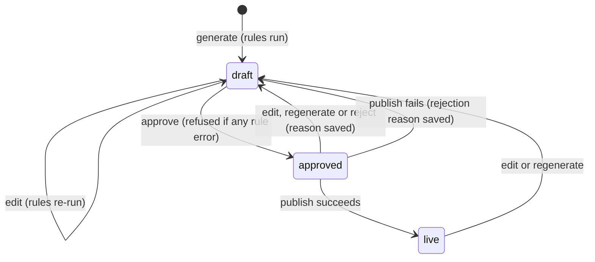

# ListingPilot: How the Product Works Today

> A description of the product **as it currently runs**: what each screen and button does, what happens behind it, which parts talk to real systems and which are simulated, and where the behaviour has gaps.
>
> **As of:** 28 Oct 2026 · commit `66e2e78` on `main` · 35/35 backend tests passing
>
> The product spec lives in [`ListingPilot_PRD_SRS_v1.1.md`](ListingPilot_PRD_SRS_v1.1.md) (single-seller MVP). The original client PRD and SRS are in [`PRD.md`](PRD.md) and [`SRS.md`](SRS.md). This document describes the code, not the spec.

---

## Contents

1. [What ListingPilot does](#1-what-listingpilot-does)
2. [Status at a glance: real, simulated, missing](#2-status-at-a-glance-real-simulated-missing)
3. [What happens when it starts](#3-what-happens-when-it-starts)
4. [Walkthrough: a product from sheet to marketplace](#4-walkthrough-a-product-from-sheet-to-marketplace)
5. [The AI engine](#5-the-ai-engine)
6. [The rule engine](#6-the-rule-engine)
7. [Draft lifecycle](#7-draft-lifecycle)
8. [Marketplace adapters](#8-marketplace-adapters)
9. [The dashboard's offline fallbacks](#9-the-dashboards-offline-fallbacks)
10. [Where data lives](#10-where-data-lives)
11. [Configuration](#11-configuration)
12. [Running and testing](#12-running-and-testing)
13. [API reference](#13-api-reference)
14. [Current gaps and known issues](#14-current-gaps-and-known-issues)
15. [What comes next](#15-what-comes-next)

---

## 1. What ListingPilot does

One seller enters each product once in a **master catalogue**. ListingPilot then, for each of **Amazon.in, Flipkart and Meesho**:

1. writes the listing copy with AI (title, 5 bullets, description, keywords, technical specs, A+ content),
2. checks it against that marketplace's rules and scores it out of 25,
3. lets the seller edit, approve or reject it,
4. publishes it: Amazon and Flipkart through their APIs (currently simulated, see §2), Meesho as a filled official Excel template the seller uploads themselves,
5. shows every SKU's status on every marketplace in one grid.

Nothing can be published until it passes the rule checks and the seller approves it. This is enforced by the backend.

**Single-seller MVP:** one business, one operator, **no login** (per spec v1.1). Until the Auth phase, the app must only run locally or behind a VPN, IP allowlist or reverse-proxy password.

---

## 2. Status at a glance: real, simulated, missing

| Capability | How it behaves today |
| --- | --- |
| Catalogue: template download, import (Excel/CSV/Tally XML), export (Excel/CSV/JSON), add/edit/delete, photo upload | **Real** |
| AI copy generation | **Real** via OpenRouter (9-model cascade, rate-limit cooldown, BYOK Google key), with a built-in template generator when every model fails |
| Rule checks and 0–25 quality score | **Real** |
| Approve / reject / edit with automatic re-check | **Real**, enforced by the backend |
| Amazon publish | **Simulated** unless all 4 SP-API credentials are set. Simulation returns a fake ASIN and randomly rejects ~5 % of listings. The live code path exists but has never run against a real account |
| Amazon price/stock update | **Simulated only** |
| Flipkart publish and price/stock | **Simulated only**; returns a fake FSN. The live branch is empty |
| Meesho export | **Real**: fills the official templates for Bedsheets, Shirts, Sneakers and T-shirts; other categories get a generic workbook that Meesho may not accept |
| Meesho "publish" | Marks the draft `live` with ID `MSH-<sku>`; nothing is sent anywhere |
| Multi-channel status grid | **Real** (reflects the database, including simulated IDs) |
| Reports | **Partly real**: the dashboard replaces zero values with built-in demo numbers (§9) |
| Settings: brand voice, banned claims, credentials | **Real**, stored in a local JSON file, credentials in plain text |
| System health | **Static**: always reports every service as connected |
| Background jobs (Celery) | **Real**, but the dashboard doesn't use them; it calls the synchronous batch endpoint |
| Login, audit log, Setup wizard, workspaces | **Not built** |

---

## 3. What happens when it starts

### Backend (`uvicorn app.main:app --app-dir backend --port 8000`)

1. **Settings load** from the root `.env` (`backend/app/core/config.py`).
2. **Database choice** (`core/database.py`): it opens a 2.5-second test connection to the host in `DATABASE_URL`.
   - Reachable → uses **Neon PostgreSQL**.
   - Unreachable or `DATABASE_URL` empty → prints a notice and **silently uses `test_pilot.db` (SQLite)** in the folder the server was started from. On the co-working Wi-Fi, port 5432 is blocked, so this happens there.
3. **Tables** `products` and `listing_drafts` are created if missing (no migrations).
4. **Queue choice** (`core/celery_app.py`): pings Redis for 0.5 s. If Redis is down, Celery switches to an in-memory broker and runs tasks inline (eager mode).
5. Mounts `backend/uploads/` at `/static/uploads` for product photos.
6. Adds CORS for `localhost:3000/5173` and a middleware that prints every request: `[POST] /api/v1/drafts/generate/4 -> 200 (5321.4ms)`.
7. The settings file `backend/app/data/dynamic_settings.json` is created with defaults the first time anything reads settings. It is gitignored.

### Frontend (`cd frontend && npm run dev` → http://localhost:3000)

On load, `page.js` **starts with built-in demo data** (`INITIAL_PILOT_PRODUCTS`, `INITIAL_PILOT_DRAFTS`), then fires 8 parallel requests: products (first 200), categories, catalogue stats, drafts, baseline report, settings, system health, Meesho templates. Each response replaces the demo data **only if it is non-empty**. If the backend is down, or the database is empty, the demo products stay on screen.

---

## 4. Walkthrough: a product from sheet to marketplace

### Step 1: Get products into the catalogue (Catalogue tab)

| Action | What happens |
| --- | --- |
| **Download Template** | `GET /catalogue/template` builds a branded multi-sheet Excel: columns with guidance, sample rows, required attributes per category, photo rules |
| **Import** (drag and drop) | `POST /catalogue/import`. The parser detects the format by extension: `.xlsx`, `.csv`, or Tally XML (`<STOCKITEM>`, SKU from `PARTNO` or `TALLY-0001`…). Headers are matched loosely: "Item Code", "Particulars", "Closing Balance", "Meesho Price (₹) *" and others map to SKU, name, stock, price. Recognised extra columns (material, size, colour, HSN, GST, net weight…) go into `attributes`. Rows are **upserted by SKU**: new SKUs created, existing ones updated |
| **Add Product** | Form with SKU, name, category, prices, stock, attributes; photos by file upload (`POST /catalogue/upload-image`, saved to `backend/uploads/`) or by URL |
| **Product Inspector** (click any product) | Slide-over drawer: attributes, photo gallery (add, remove, set primary), per-marketplace pre-check status, edit and save |
| **Export** | `GET /catalogue/export?format=xlsx|csv|json`: the whole catalogue with every attribute as a column |

The KPI bar above the tabs shows Total SKUs, Available Stock, Average Price and a Data Health Score. These come from `GET /catalogue/stats`, which counts products missing required attributes or with fewer than 3 photos.

**Gap:** the import API returns row-level errors and warnings, but the dashboard only shows a toast with the number of *new* SKUs; it doesn't show updated rows or the error list.

### Step 2: Generate listing copy (AI Drafts tab)

- **Single product:** choose the marketplace, click generate → `POST /drafts/generate/{product_id}?marketplace=amazon|flipkart|meesho`. Takes a few seconds to ~30 s depending on which AI model answers (§5). The draft is saved (one draft per product per marketplace; regenerating overwrites it and clears any approval).
- **Batch:** the "Batch AI Listing Generation" modal picks a marketplace (or **All**), a category (or **All**) and whether to overwrite existing drafts → `POST /drafts/generate-batch`. It runs **inside the HTTP request**, one draft at a time. With 59 products × 3 marketplaces that's 177 AI calls, so it can take a long time. **Closing the modal cancels it**: the browser aborts the request, the backend notices the disconnect before the next draft and stops. Drafts already written are kept.

Every generated draft is checked by the rule engine straight away and stored with its score and issues.

### Step 3: Review and edit

The drafts workspace has an SKU list on the left and an editor on the right with five views:

1. **Listing copy**: title, 5 bullets, description, keywords, with live character counts.
2. **Technical details**: the Amazon spec table (`technical_specs`).
3. **A+ content**: headline, brand story, 3 feature cards, comparison table.
4. **API payloads**: the exact JSON that would be sent to Amazon (`GET /drafts/{id}/amazon-payload` for Listings Items 2021-08-01, `/aplus-payload` for A+ Content 2020-11-01).
5. **Live twin preview**: the draft rendered as an Amazon, Flipkart or Meesho product page, desktop or mobile, plus a compliance audit view. Products without photos show stock Unsplash images.

The rule score, rating and each issue (error / warning) are shown next to the editor.

**Saving edits** → `PUT /drafts/{id}`: the rule engine runs again, and the draft goes back to `draft` with approval cleared.

### Step 4: Approve or reject

- **Approve** → `POST /drafts/{id}/approve`. The backend **refuses with 400 if the draft has any rule error**. Otherwise status becomes `approved`.
- **Reject** → modal asks for a reason → `POST /drafts/{id}/reject`: status goes back to `draft`, approval cleared, reason stored.

### Step 5: Publish

`POST /drafts/{id}/publish`. The backend refuses with 400 unless the draft is approved. Then, by marketplace:

| Marketplace | What happens now |
| --- | --- |
| Amazon | Builds the full SP-API Listings Items payload. **No credentials (current state):** returns a fake ASIN `B0XXXXXXXX`; about 1 in 20 attempts is randomly rejected with `MISSING_LEGAL_METROLOGY`. **With credentials:** gets a Login with Amazon token and `PUT`s to `sellingpartnerapi-eu.amazon.com/listings/2021-08-01/items/{seller}/{sku}` |
| Flipkart | Always returns a fake FSN `LST…` |
| Meesho | Marks the draft certified for the bulk sheet, ID `MSH-<sku>` |

On success the draft becomes `live` with the external ID and a sync timestamp, and the marketplace's "last sync" time is updated in settings. On failure it goes back to `draft` with `rejection_reason` set, ready to fix and resend.

### Step 6: Meesho upload (Multi-Channel Hub)

**Download Meesho sheet** → `GET /drafts/meesho/export` (one category as `.xlsx`, or all categories as a `.zip`). For each category, `MeeshoAdapter`:

1. finds the matching official template in `docs/meesho/templates/` (exact name, then the Meesho category tree, then partial match, then synonyms such as bedding → Bedsheets, tee → T-shirts, footwear → Sneakers);
2. copies it in memory (the master files are never modified) and reads the column names from row 3;
3. writes one row per product from row 5: Meesho-draft title (or product name) ≤ 100 characters, plain-text description, Meesho price, wrong/defective price (₹22 lower), MRP, GST, HSN, net weight, Legal Metrology fields, images, colour, dimensions, pillow sizes, and any other column matched to the product's attributes;
4. **snaps every value to an allowed option** from the template's Validation Sheet, so cells don't fail Meesho's dropdown checks;
5. gives each product its own Style Code (its SKU) and leaves Group ID empty, so Meesho doesn't merge different designs into one product.

Categories with no official template get a generic 27-column workbook. The seller then uploads the file at supplier.meesho.com → Catalog Upload → Add Catalog in Bulk.

The hub also has a **Meesho templates and taxonomy** browser (`/drafts/meesho/templates`, `/drafts/meesho/categories`) for searching the full Meesho category tree.

### Step 7: Track status (Multi-Channel Hub)

`GET /drafts/marketplace-status` returns one row per SKU with, for each marketplace: draft status (`not_started`, `draft`, `approved`, `live`), quality score, whether there are errors, external ID, last sync and rejection reason. Each cell links back to its draft.

### Step 8: Reports and Settings

- **Reports** (`GET /reports/baseline`): coverage, pipeline counts, average score, first-pass rate, approval rate, rejection rate, quality distribution, and "time saved" (calculated as 45 minutes per draft).
- **Settings**, five sub-tabs:
  1. **Brand voice**: brand name, tone, audience, claims to avoid. Fed into every AI prompt.
  2. **Banned claims**: the list the rule engine scans for (default 12: "free delivery", "best seller", "cheapest", "100% guarantee", "money back", "cash on delivery"…).
  3. **Credentials**: Amazon, Flipkart and OpenRouter keys. Shown masked (`abc****xyz`); masked values sent back are ignored so they don't overwrite the real ones.
  4. **System health**: service list, last sync per marketplace, alerts (only "running in stub mode" alerts exist).
  5. **Operations manual**: built-in user guide.

---

## 5. The AI engine

`backend/app/services/ai_service.py`

**What goes in:** product name, SKU, category, brand, price, all attributes, notes, the target marketplace, brand voice from Settings, and Amazon product-type guidance for the category (from `amazon_ptd_service.py`, which maps keywords like "bedsheet" or "kurta" to Amazon product types and their expected fields).

**What the prompt demands:** strict JSON; title under 200 / 120 / 100 characters (Amazon / Flipkart / Meesho); exactly 5 bullets starting with a capitalised headline; 2–3 paragraph description; 5–8 keywords under 250 bytes; 6–10 tech specs; A+ content; no invented facts; no promotional claims.

**Which key:** an OpenRouter key saved in Settings wins over `OPENROUTER_API_KEY` in `.env`. Placeholder or masked keys are ignored.

**Which model.** With `AI_PROVIDER=openrouter` (the current setting), models are tried in this order until one returns valid JSON:

| # | Model | Notes |
| --- | --- | --- |
| 1 | `OPENROUTER_MODEL` from `.env` | currently `minimax/minimax-m3.1-flash` |
| 2 | `google/gemma-4-26b-a4b-it` | uses the seller's own Google AI Studio key via OpenRouter BYOK |
| 3 | `google/gemini-3.5-flash-lite` | BYOK |
| 4 | `google/gemma-4-26b-a4b-it:free` | shared free pool |
| 5 | `nvidia/nemotron-3.5-lightning:free` | |
| 6 | `minimax/minimax-m3.1-flash` | skipped if it's #1 |
| 7 | `nvidia/nemotron-3-ultra-550b-a55b:free` | |
| 8 | `google/gemma-4-31b-it:free` | |
| 9 | `liquid/lfm-2.5-2.6b:free` | |
| 10 | `recursive/flint-v1.0:free` | |
| 11 | `openrouter/free` | OpenRouter picks any available free model |

Each call has a 22-second timeout, temperature 0.3, 3,000 max tokens. A model is skipped and the next one tried when it:
- returns **429 (rate-limited)**: it is then **skipped for every request** for as long as OpenRouter's `Retry-After` says (default 60 s, maximum 10 min), so a batch doesn't keep retrying it;
- returns an HTTP or network error;
- returns empty content (reasoning models that put the JSON in a `reasoning` field are handled);
- returns JSON that can't be parsed.

Each skip prints one line to the backend log, e.g. `OpenRouter: google/gemma-4-26b-a4b-it:free rate-limited (429); skipping it for 60s`.

**If every model fails**, a built-in generator writes the listing **only from the product's own attributes** (material, size, colour, care, contents, pattern, occasion), so it never invents facts. The result is tagged `engine: category_agnostic_rule_engine`. Missing tech specs and A+ sections are filled from product data in both cases.

With `AI_PROVIDER=anthropic` and `ANTHROPIC_API_KEY` set, a single Claude call is made instead (`CLAUDE_MODEL`), with the same built-in fallback.

---

## 6. The rule engine

`backend/app/services/rule_engine.py` runs on every generate, every edit, and as a pre-check for products without a draft.

| Check | Amazon | Flipkart | Meesho | Level |
| --- | --- | --- | --- | --- |
| Required attributes for the category | ✓ | ✓ | ✓ | error per missing attribute |
| Photos | < 3 error, < 5 warning | < 1 error, < 3 warning | < 1 error | |
| Price > 0 | ✓ | ✓ | ✓ | error |
| Title too long | > 200 | > 120 | > 100 | error |
| Title under 40 characters | ✓ | ✓ | ✓ | warning |
| Banned claim anywhere in title, bullets or description (whole-word, case-insensitive) | ✓ | ✓ | ✓ | error |
| HTML tags in description | | | ✓ | error |
| Too few bullets | < 5 | < 3 | < 3 | warning |

**Required attributes** are fixed for six categories (any other category only needs "Material"):

| Category | Required |
| --- | --- |
| Bedsheets | Material, Size, Thread count, Care |
| Pooja items | Material, Dimensions, Finish |
| Kurtas | Material, Fit, Sleeve, Length, Care |
| Planters | Material, Dimensions, Drainage |
| Ethnic footwear | Upper material, Sole, Sizes, Closure |
| Quilts | Fill, Outer, Size, Weight, Care |

**Score (0–25):** five parts worth up to 5 each: title, bullets, attributes, keywords, photos. **Excellent** ≥ 20, **Good** ≥ 15, otherwise **Needs Improvement**. A draft **passes** when it exists and has no errors; only passing drafts can be approved.

The title limits and required attributes are written in the code. The limits shown in `dynamic_settings.json` under `marketplace_limits` are **not** read by the rule engine.

---

## 7. Draft lifecycle



There is one draft per product per marketplace. A "stuck" listing is a draft with `rejection_reason` set. There's no separate `rejected` or `submitted` status in the backend.

---

## 8. Marketplace adapters

### Amazon (`amazon_adapter.py`)
- **Mode:** live only when seller ID, client ID, client secret and refresh token are all set (Settings first, then `.env`). Today: **stub**.
- **Payload:** product type from the category; title, bullets, description, keywords, brand, price and MRP, quantity, parsed dimensions and weight, images, Legal Metrology fields (country of origin, manufacturer). Marketplace `A21TJRUUN4KGV` (Amazon.in).
- **Live flow:** exchanges the refresh token for an access token, then a single `PUT` to the Listings Items API. HTTP 200/201/202 counts as live; other responses become a rejection carrying Amazon's issue messages.
- **Not done:** Amazon processes listings asynchronously and the PUT response doesn't contain an ASIN, so in live mode the stored ID would be a made-up one until status polling is added. Price/stock update is a stub. The AWS keys in `.env` are not used.

### Flipkart (`flipkart_adapter.py`)
Stub only: fake FSN `LST` + 13 characters, every time. It only checks `.env` for credentials, so keys entered in Settings don't change anything.

### Meesho (`meesho_adapter.py`)
See [Step 6](#step-6-meesho-upload-multi-channel-hub). Official templates available: **Bedsheets (10058), Shirts (10001), Sneakers (13178), T-shirts (10000)**. The pilot catalogue's other categories (Pooja items, Kurtas, Planters, Quilts, Ethnic footwear) currently fall back to the generic workbook.

---

## 9. The dashboard's offline fallbacks

The dashboard is built to keep working in demos even when the backend fails. When a request fails **for any reason, including the backend deliberately refusing it**, many actions fake a success on screen:

| Action | If the request fails, the screen shows… | Saved in the database? |
| --- | --- | --- |
| Page load | Built-in demo products and drafts | — |
| Generate draft | A locally written draft scored 24/25 "Excellent" | No |
| Batch generate | A local simulation | No |
| Approve | "Draft Approved! 🎉" and status approved, **even if the backend refused because of rule errors** (the dashboard checks errors first, so this mostly shows up when the backend is down) | No |
| Reject | Status `rejected` (a status the backend doesn't have) | No |
| Publish | "Published to Amazon! 🚀" with a simulated ASIN/FSN and status live, **even if the backend refused because the draft wasn't approved** | No |
| Import | "Import Simulated" toast | No |
| Reports | Any value that is **0** is replaced with a demo number (coverage 81.3 %, first-pass 88.4 %, approval 35.2 %, a fixed quality distribution) | — |

The real state is always what's in the database and what `GET /drafts/marketplace-status` returns. Reloading the page brings the screen back in line with it.

---

## 10. Where data lives

| What | Where |
| --- | --- |
| Products and drafts | Neon PostgreSQL, or `test_pilot.db` (SQLite) when Neon is unreachable |
| Product photos uploaded from the dashboard | `backend/uploads/`, served at `/static/uploads/...` |
| Brand voice, banned claims, credentials, last-sync times | `backend/app/data/dynamic_settings.json` (gitignored; credentials in plain text) |
| Official Meesho templates | `docs/meesho/templates/*.xlsx` (read-only masters) |
| Meesho category tree | `docs/meesho/categories/meeshoCategories.json` |
| Secrets for the server | root `.env` (gitignored) |

### Tables

**`products`**: `id`, `sku` (unique), `name`, `category`, `brand`, `mrp`, `price`, `stock`, `images` (list), `image_count`, `attributes` (key/value JSON), `description`, `current_listing` (the existing portal listing, for before/after comparison), timestamps.

**`listing_drafts`**: `id`, `product_id`, `marketplace`, `title`, `bullets`, `description`, `keywords`, `technical_specs`, `aplus_content`, `status`, `is_approved`, `rule_results` (score, rating, issues), `marketplace_sku`, `external_listing_id`, `last_sync_at`, `rejection_reason`, timestamps. Deleting a product deletes its drafts.

### Sample data
`backend/app/seeds/seed_pilot_data.py` loads **59 products** for the pilot brand Gulmohar Home, Jaipur: 19 written by hand (bedsheets, pooja items, kurtas, planters, ethnic footwear, quilts, with realistic attributes and a weak "current listing") plus 40 generated variants, every fifth missing attributes so the validation screens have something to show.

---

## 11. Configuration

Root `.env` (template in `.env.example`):

| Variable | Current use |
| --- | --- |
| `DATABASE_URL` | Neon connection string; empty or unreachable → SQLite |
| `AI_PROVIDER` | `openrouter` (default) or `anthropic` |
| `OPENROUTER_API_KEY`, `OPENROUTER_MODEL` | AI key and first model tried |
| `ANTHROPIC_API_KEY`, `CLAUDE_MODEL` | Direct Claude alternative |
| `REDIS_URL`, `CELERY_BROKER_URL`, `CELERY_RESULT_BACKEND`, `CELERY_TASK_ALWAYS_EAGER` | Background jobs |
| `AMAZON_SELLER_ID`, `AMAZON_SP_API_CLIENT_ID`, `AMAZON_SP_API_CLIENT_SECRET`, `AMAZON_SP_API_REFRESH_TOKEN` | All four switch Amazon to live |
| `AMAZON_MARKETPLACE_ID` | `A21TJRUUN4KGV` (Amazon.in) |
| `AMAZON_AWS_ACCESS_KEY`, `AMAZON_AWS_SECRET_KEY`, `AMAZON_AWS_ROLE_ARN` | Declared, not used |
| `FLIPKART_APP_ID`, `FLIPKART_APP_SECRET` | Read but have no effect yet (adapter is a stub) |
| `BACKEND_CORS_ORIGINS`, `DEFAULT_BRAND` | CORS, default brand name |
| `NEXT_PUBLIC_API_BASE` | Frontend → backend URL (default `http://localhost:8000/api/v1`) |
| `LISTINGPILOT_SETTINGS_FILE` | Optional path for the settings file (tests use a temporary one) |

**OpenRouter BYOK:** the seller's Google AI Studio key is configured in the OpenRouter dashboard (Settings → Integrations), not in ListingPilot. Requests to the regular (non-`:free`) Google models then use the seller's Google quota.

---

## 12. Running and testing

```powershell
# From D:\Education\Work\ListingPilot

.venv\Scripts\python.exe -m pip install -r backend/requirements.txt
.venv\Scripts\python.exe backend/app/seeds/seed_pilot_data.py            # load 59 sample products
.venv\Scripts\python.exe -m uvicorn app.main:app --app-dir backend --reload --port 8000

cd frontend; npm install; npm run dev                                     # http://localhost:3000

# Optional, needs Redis:
.venv\Scripts\python.exe -m celery -A app.core.celery_app worker --loglevel=info -P solo

.venv\Scripts\python.exe -m pytest backend/tests -q                      # 35 tests
```

API docs: http://127.0.0.1:8000/api/v1/docs

**Tests** (`backend/tests/`, SQLite, AI calls mocked, settings in a temporary file): catalogue CRUD and stats; template, import and export; generation, rules and the approval gate; Amazon publish, status grid and reports; Flipkart and Meesho export with dropdown validation; settings, credential masking and health; Celery batch tasks in eager mode. There are no frontend tests.

---

## 13. API reference

Base URL `http://127.0.0.1:8000/api/v1`. No authentication.

**Catalogue** `/catalogue`

| Method | Path | Does |
| --- | --- | --- |
| GET | `/template` | Download the master Excel template |
| POST | `/import` | Import `.xlsx` / `.csv` / Tally XML; returns created, updated, row errors and warnings |
| GET | `/export?format=xlsx\|csv\|json` | Export everything |
| GET / POST | `/products` | List (filters, pages up to 500) / create |
| GET / PUT / DELETE | `/products/{id}` | Read / update / delete |
| GET | `/stats` | KPIs for the header bar |
| GET | `/categories` | Distinct categories |
| POST | `/upload-image` | Upload a product photo |

**Drafts** `/drafts`

| Method | Path | Does |
| --- | --- | --- |
| POST | `/generate/{product_id}?marketplace=` | Generate one draft and check it |
| POST | `/generate-batch?marketplace=amazon\|flipkart\|meesho\|all&category=&overwrite=` | Batch generate inside the request; cancels when the client disconnects |
| POST | `/tasks/generate-batch` | Same via Celery; returns a `task_id` |
| POST | `/tasks/publish-batch?marketplace=` | Batch publish via Celery (body: list of draft IDs) |
| GET | `/tasks/{task_id}` | Celery task progress |
| GET | `` | List drafts (`?marketplace=&status=`) |
| GET | `/product/{product_id}?marketplace=` | One product's draft, or a rule pre-check if none exists |
| PUT | `/{id}` | Edit; re-checks; clears approval |
| POST | `/{id}/approve` | Approve; 400 if rule errors |
| POST | `/{id}/reject` | Reject with a reason |
| POST | `/{id}/publish` | Publish; 400 unless approved |
| GET | `/{id}/amazon-payload`, `/{id}/aplus-payload` | Preview Amazon JSON |
| GET | `/marketplace-status?category=&search=` | SKU × marketplace grid |
| GET | `/meesho/export?category=&as_zip=` | Download filled Meesho file(s) |
| GET | `/meesho/templates`, `/meesho/categories?search=` | Templates found; category search |
| GET | `/credentials-status`, `/amazon-status` | Live or stub per marketplace |
| GET | `/stats` | Draft counts and average score |

**Reports** `/reports`: `GET /baseline`, `GET /draft-stats`

**Settings** `/settings`: `GET ''` (everything, credentials masked), `PUT /brand-voice`, `GET|PUT /banned-claims`, `GET|PUT /credentials`, `GET /system-health`

**Health:** `GET /health`

---

## 14. Current gaps and known issues

**Behaviour that can mislead**
- The dashboard fakes success when requests fail, including approve and publish (§9).
- Reports replace genuine zeros with demo numbers.
- System health always says every service is connected.
- Simulated Amazon publishing randomly rejects about 5 % of listings, so demos aren't repeatable.
- If Neon is unreachable the backend quietly switches to a local SQLite file; data written then won't be in Neon.

**Functional gaps**
- Amazon live publishing is untested, doesn't poll for the real ASIN or Amazon's later errors, and has no price/stock update.
- Flipkart is simulated only and ignores credentials entered in Settings.
- Rule limits and required attributes can't be changed from Settings; the `marketplace_limits` setting is ignored.
- Official Meesho templates exist for only 4 categories.
- The import screen doesn't show row errors, warnings or updated counts.
- Batch generation runs inside one long HTTP request; the Celery endpoints exist but the dashboard doesn't use them.
- Batch drafts are generated one at a time; on free AI models a full 3-marketplace batch is slow.
- No check yet for repeated images, titles or SKU IDs across products, which Meesho and Flipkart reject (noted in the seed file).
- The time-per-listing baseline can't be entered; "time saved" assumes 45 minutes per draft.

**Not built (in the v1.1 spec)**
- Workspace and user IDs on every table (needed so login can be added later without a data migration).
- Audit log; first-run Setup wizard; encrypted per-workspace credentials.
- Login (deliberately deferred to the Auth phase).

**Engineering**
- No database migrations (tables are created on startup only).
- `frontend/app/page.js` is ~4,500 lines in one component.
- Logging uses `print`.
- No CI; no frontend tests.

---

## 15. What comes next

The dated plan, scope and definition of done for the **20 Nov 2026 pilot** are in [`ListingPilot_PRD_SRS_v1.1.md` §20.0](ListingPilot_PRD_SRS_v1.1.md#200-pilot-delivery-plan-28-oct--20-nov-2026-v11). It also lists spec conflicts in the current code to fix first: Amazon's 75-character title limit and 200-byte keywords, Meesho value snapping and image links, and the silent SQLite switch. The list below is the broad order.

1. **Make the screen tell the truth:** remove or flag the dashboard's fake-success fallbacks, stop replacing zeros in Reports, make System Health check real connections.
2. **Real Amazon:** connect the seller's SP-API credentials, verify publishing, poll submission status for the real ASIN and errors, add price/stock updates.
3. **Load real pilot data:** import the seller's catalogue and photos; show import errors in the dashboard.
4. **Auth-ready data layer (FR-AD-07):** add migrations, then `workspace_id` and `user_id` columns, and pass workspace context through services and Celery jobs.
5. **Audit log (FR-AD-03), Setup wizard (FR-AD-06), encrypted credentials (FR-AD-08).**
6. **Editable rule sets (FR-AD-04):** move limits and required attributes into settings the rule engine reads.
7. **Flipkart:** Listings v3 publishing and price/stock; read credentials from Settings.
8. **Meesho:** official templates for the remaining categories; duplicate image/title/SKU checks; import Meesho's processed files to capture rejection reasons.
9. **Batch through Celery** with a progress bar.
10. **Auth phase** (login, users, roles, maker-checker), then agency mode and cross-seller features.
