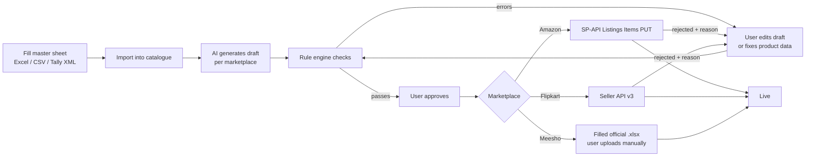
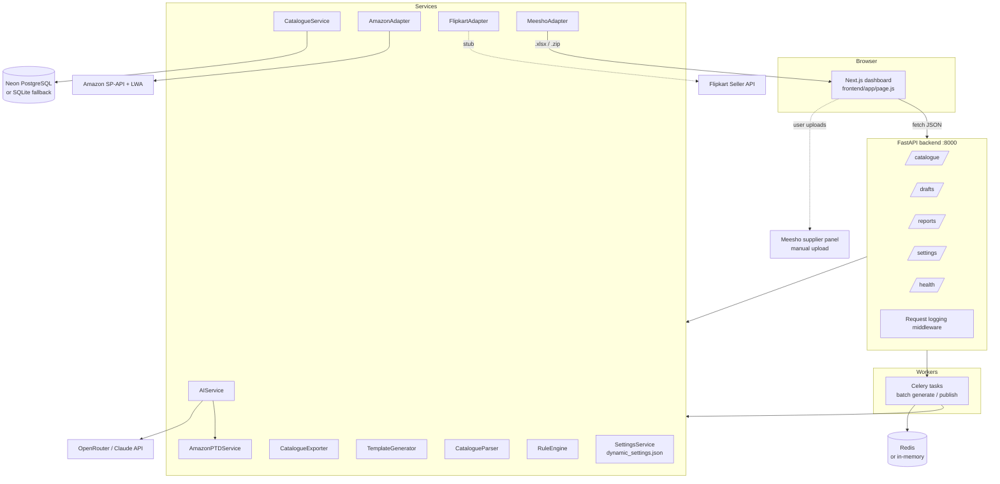
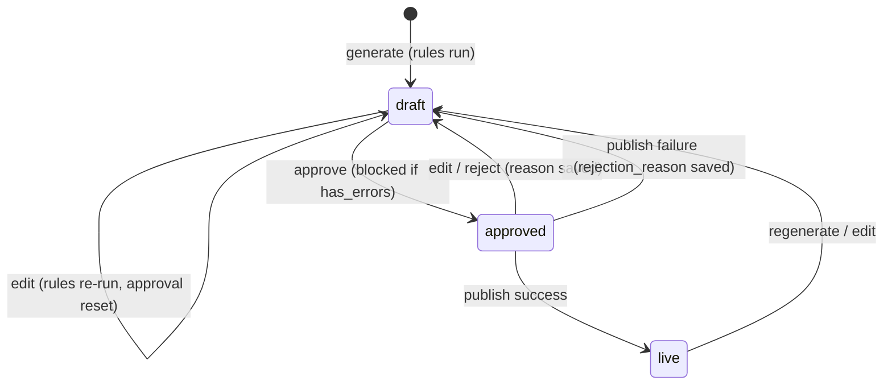

# ListingPilot: Complete Project Overview

> Everything about the project in one place: what it is, why it exists, what has been built, how it works, what is incomplete, and what is planned next.
>
> **Last updated:** 28 Oct 2026 · **Vendor:** IterativeTech, Jaipur · **Branch:** `main` @ `234f351`
>
> Sources: `docs/PRD.md`, `docs/SRS.md`, `README.md`, the full source tree, git history, and a test run on 28 Oct 2026. Where the README and the code disagree, this document follows the code and lists the difference in [§16](#16-documentation-drift-readme-vs-code).

---

## Table of contents

1. [Executive summary](#1-executive-summary)
2. [Problem, goals and non-goals](#2-problem-goals-and-non-goals)
3. [Users and core journey](#3-users-and-core-journey)
4. [Delivery plan and timeline](#4-delivery-plan-and-timeline)
5. [Technology stack](#5-technology-stack)
6. [System architecture](#6-system-architecture)
7. [Repository layout](#7-repository-layout)
8. [Data model](#8-data-model)
9. [Backend modules in detail](#9-backend-modules-in-detail)
10. [Complete API reference](#10-complete-api-reference)
11. [Frontend dashboard](#11-frontend-dashboard)
12. [Configuration and environment](#12-configuration-and-environment)
13. [Running, seeding and testing](#13-running-seeding-and-testing)
14. [Development history](#14-development-history)
15. [Requirement status (traceability matrix)](#15-requirement-status-traceability-matrix)
16. [Documentation drift (README vs code)](#16-documentation-drift-readme-vs-code)
17. [Known issues, risks and technical debt](#17-known-issues-risks-and-technical-debt)
18. [Roadmap: what is planned and what is left](#18-roadmap-what-is-planned-and-what-is-left)
19. [Client dependencies and inputs](#19-client-dependencies-and-inputs)
20. [Commercial terms and assumptions](#20-commercial-terms-and-assumptions)
21. [Reference assets in `docs/`](#21-reference-assets-in-docs)
22. [Glossary](#22-glossary)

---

## 1. Executive summary

**ListingPilot** turns one master product sheet into complete, rule-checked listings on **Amazon** (SP-API), **Flipkart** (Seller API) and **Meesho** (bulk upload files). The client enters each product once instead of three times. Nothing reaches a marketplace until it passes automated rule checks **and** a person approves it.

| Item | Detail |
| --- | --- |
| Product | ListingPilot, marketplace listing automation |
| Client | Single client, one deployment (pilot brand in sample data: **Gulmohar Home**, Jaipur) |
| Vendor | IterativeTech, Jaipur |
| Marketplaces | Amazon.in (SP-API), Flipkart (Seller API), Meesho (supplier-panel Excel files) |
| Stack | FastAPI + SQLAlchemy, PostgreSQL on Neon (SQLite fallback), Celery + Redis, Next.js 16 / React 19, OpenRouter or Claude API |
| Duration | 10 weeks: pilot sign-off at week 5, go-live at week 10 |
| After go-live | IterativeTech has minimal involvement; the client runs the system day to day |

### Where things stand (28 Oct 2026)

| Area | State |
| --- | --- |
| Master catalogue (template, import, export, CRUD) | **Built and working** |
| AI listing generation (title, 5 bullets, description, keywords, tech specs, A+ content) | **Built and working**, with multi-model fallback and an offline generator |
| Rule engine (required attributes, title length, photos, banned claims, HTML, price) | **Built and working** |
| Draft → approve → publish workflow with approval gate | **Built and working** |
| Amazon SP-API | Payload builder and LWA token exchange **built**; live create is coded but **untested against real credentials**; price/stock update is a **stub** |
| Flipkart Seller API | **Stub only**; the live branch is an empty `pass` |
| Meesho bulk files | **Built and working** against 4 official templates (Bedsheets, Shirts, Sneakers, T-shirts), with dropdown snapping and a synthetic fallback for other categories |
| Celery background jobs | **Built**; falls back to in-process eager execution when Redis is offline |
| Reports | Quality, pipeline and rejection metrics **built**; the time-per-listing baseline is **not captured** |
| Self-serve admin | Brand voice, banned claims and masked credentials **built**; rule limits, template upload and email alerts **not yet** |
| Authentication / login | **Not built** (the PRD expects one login) |
| Tests | **35 / 35 passing** (`pytest backend/tests`, 9.8 s) |

---

## 2. Problem, goals and non-goals

### 2.1 The problem today

The client's team types every product by hand into three seller portals. Each portal has different fields and rules, so one product is entered three times and mistakes surface only after a listing is rejected.

| Pain point | Effect on the business |
| --- | --- |
| Same product entered three times | Repeated manual work per SKU, growing with catalogue size |
| Missing or wrong specs (size, material, category fields) | Rejected or hidden listings, lost sales days |
| Titles and bullets written by different people | Uneven quality, weak search keywords |
| New products wait in a data-entry queue | Slow launches |
| No single status view | Nobody knows what is live where, or what is stuck |

### 2.2 Goals

1. One master catalogue is the single place products are entered and maintained.
2. Cut the time to create a listing and the first-pass rejection rate, measured against a baseline.
3. Catch missing specs and banned claims **before** submission, not after rejection.
4. Consistent listing quality: brand voice, per-marketplace length limits, relevant keywords.
5. One live view of every SKU's status on every marketplace.
6. Protect the client's seller accounts: official APIs only, human approval before anything is published.
7. Keep the client in control: they own data, accounts and credentials, and can export the full catalogue at any time.

### 2.3 Non-goals (explicitly out of scope)

- Ads management on any marketplace.
- WhatsApp integration (photo-to-listing, daily owner summary). This can be quoted later as a separate project.
- Order processing, shipping labels, returns.
- Product photography, image editing, A+ content *design* (ListingPilot generates A+ *copy* and payloads, not imagery).
- Marketplace fees, ad spend, Brand Registry costs.
- Automatic stock or order sync with Meesho (MSH-2).

---

## 3. Users and core journey

**Users**

- **A single user** does everything: maintains the catalogue, reviews, edits and approves drafts, fixes rejections, uploads Meesho files. One login, no roles.
- **IterativeTech** builds, trains (two sessions plus a user guide) and supports the system.

**Core journey**



---

## 4. Delivery plan and timeline

### 4.1 Contracted plan (PRD §10, SRS §11)

| Phase | Weeks | Content | Gate |
| --- | --- | --- | --- |
| 1. Setup | 1–2 | Catalogue template, import, data model, marketplace access requests start | — |
| 2. Amazon pilot | 3–5 | AI content, rule checks, review dashboard, Amazon SP-API, baseline measurement | **Pilot sign-off at week 5**: 50–100 pilot SKUs live on Amazon |
| 3. Flipkart and Meesho | 6–8 | Flipkart Seller API, Meesho bulk files, error report | — |
| 4. Rollout | 9–10 | Full catalogue, training, self-serve admin, support begins | **Go-live at week 10** |

PRD feature to phase mapping: F1 → 1; F2, F3, F4, F5, F9 → 2; F6, F7, F8 → 3; F10, F11 → 4.

### 4.2 Calendar estimate

The PRD and SRS are dated **13 Oct 2026**. If week 1 started that day:

| Milestone | Approximate date |
| --- | --- |
| Week 1 start | 13 Oct 2026 |
| Today | 28 Oct 2026 (week 3) |
| Pilot sign-off (end of week 5) | ~14 Nov 2026 |
| Flipkart and Meesho complete (end of week 8) | ~5 Dec 2026 |
| Go-live (end of week 10) | ~19 Dec 2026 |

These dates are an inference; the contract says timelines depend on marketplace access approvals and on receiving pilot data in week 1.

### 4.3 Actual progress against the plan

The build is **ahead of plan on code** (features from phases 1–4 exist in some form) and **behind on real-world integration**: no client pilot data has been loaded, and no live Amazon or Flipkart credentials have been connected. The pilot sign-off criterion ("50–100 pilot SKUs live on Amazon") cannot be met until the client supplies data and SP-API access.

---

## 5. Technology stack

| Layer | Technology | Notes |
| --- | --- | --- |
| API | **FastAPI** ≥ 0.115, Uvicorn | Swagger at `/api/v1/docs`, ReDoc at `/api/v1/redoc` |
| ORM | **SQLAlchemy 2.x** | Tables created with `Base.metadata.create_all` on startup (no migrations) |
| Database | **Neon PostgreSQL** (psycopg2) | Automatic fallback to local **SQLite** `test_pilot.db` if port 5432 is unreachable |
| Validation | Pydantic v2, pydantic-settings | Settings loaded from root `.env` |
| Jobs | **Celery 5.4 + Redis** | Falls back to `memory://` broker and eager execution if Redis is down |
| Excel | openpyxl | Template generation, import parsing, Meesho template filling |
| HTTP | httpx (async) | OpenRouter, Anthropic, Amazon LWA and SP-API |
| AI | **OpenRouter** (default) or **Anthropic Claude** | Plus a deterministic offline generator |
| Frontend | **Next.js 16.4.2**, React 19.3, plain CSS | Single-page dashboard; pnpm declared as package manager |
| Tests | pytest | 35 tests, SQLite-backed fixtures |
| Python env | `.venv` at repo root (uv or pip) | Python 3.11+ |

`backend/requirements.txt`: fastapi, uvicorn[standard], sqlalchemy, psycopg2-binary, pydantic, pydantic-settings, python-multipart, httpx, openpyxl, python-dotenv, pytest, aiosqlite, celery, redis.

---

## 6. System architecture



The dashboard talks only to the API. The API keeps state in PostgreSQL and queues long jobs through Celery. Marketplace access is isolated behind one adapter per marketplace. Meesho has no seller API, so its adapter produces files the user uploads.

**Resilience by design** (so development keeps moving on unreliable networks):

- **DB:** `core/database.py` does a 2.5 s socket pre-check to the Neon host. If it fails (port 5432 is blocked on the co-working Wi-Fi), the app uses `sqlite:///./test_pilot.db`.
- **Queue:** `core/celery_app.py` pings Redis (0.5 s). If Redis is offline it switches to `memory://` with `task_always_eager=True`.
- **AI:** OpenRouter tries up to 6 models in turn, then falls back to a rule-based generator built only from catalogue data.
- **Frontend:** if the batch API call fails, the UI runs a local simulation fallback.

---

## 7. Repository layout

```
ListingPilot/
├── .env / .env.example          Environment config (.env is gitignored)
├── README.md                    Quick-start and feature summary
├── pytest.ini                   pythonpath=backend, testpaths=backend/tests
├── test_pilot.db                SQLite fallback DB (gitignored)
├── scratch_validate_all_dropdowns.py   Ad-hoc Meesho dropdown validator (gitignored)
├── *.xlsx / *.zip (root)        Generated Meesho test outputs (gitignored)
├── backend/
│   ├── requirements.txt
│   ├── uploads/                 Uploaded product images, served at /static/uploads
│   ├── tests/                   7 test modules, 35 tests
│   └── app/
│       ├── main.py              App factory, CORS, logging middleware, static mount
│       ├── core/                config.py, database.py, celery_app.py
│       ├── models/              product.py, draft.py
│       ├── schemas/             product.py, import_export.py
│       ├── data/dynamic_settings.json   Persisted admin settings (gitignored, created on first run)
│       ├── seeds/seed_pilot_data.py     59 pilot products
│       ├── tasks/batch_tasks.py         Celery tasks
│       ├── api/v1/api.py + endpoints/   catalogue, drafts, reports, settings, health
│       └── services/
│           ├── template_generator.py    (335 lines) master Excel template + CATEGORIES_INFO
│           ├── catalogue_parser.py      (384) Excel / CSV / Tally XML import
│           ├── catalogue_exporter.py    (147) Excel / CSV / JSON export
│           ├── catalogue_service.py     (203) CRUD, upsert, stats
│           ├── ai_service.py            (470) OpenRouter / Claude / fallback
│           ├── amazon_ptd_service.py    (901) Amazon product-type definitions
│           ├── rule_engine.py           (230) compliance checks + 0–25 score
│           ├── amazon_adapter.py        (706) SP-API payloads, LWA, publish
│           ├── flipkart_adapter.py      (120) stub
│           ├── meesho_adapter.py        (1050) template engine
│           └── settings_service.py      (240) brand voice, claims, creds, health
├── frontend/
│   ├── package.json             next 16.4.2, react 19.3.0
│   ├── AGENTS.md                Auto-generated Next.js agent rules
│   └── app/
│       ├── layout.js            HTML shell + metadata
│       ├── page.js              (4,546 lines) entire dashboard
│       ├── globals.css          (1,852 lines) design system, dark/light themes
│       └── components/MarketplaceLiveTwinPreview.jsx  (1,259 lines)
└── docs/
    ├── PRD.md, SRS.md, PROJECT_OVERVIEW.md (this file)
    ├── assets/                  Proposal .docx, demo HTML, SP-API tutorial transcript, image
    └── meesho/
        ├── categories/meeshoCategories.json   Full Meesho taxonomy (~5,100 nodes)
        └── templates/           4 official Meesho flat-file templates
```

---

## 8. Data model

Two tables exist today. The SRS also lists *Listing, Rejection, Rule set, Meesho file, Credential*; these are folded into the two tables or into `dynamic_settings.json` (see §15).

### 8.1 `products`

| Column | Type | Notes |
| --- | --- | --- |
| `id` | int PK | |
| `sku` | str(100), unique, indexed | |
| `name` | str(255) | |
| `category` | str(100), indexed | Free text; drives required attributes, Amazon product type and Meesho template |
| `brand` | str(100) | Default "Gulmohar Home" |
| `mrp`, `price` | float | `price` required |
| `stock` | int | |
| `images` | JSON list | URLs or `/static/uploads/...` paths |
| `image_count` | int | |
| `attributes` | JSON dict | e.g. `{"Material": "100% cotton", "Size": "90 x 100 in"}` |
| `description` | text | Raw notes from import |
| `current_listing` | JSON | Existing portal listing, kept for baseline / gap analysis |
| `created_at`, `updated_at` | datetime (UTC) | |

### 8.2 `listing_drafts`

One row per (product, marketplace). Generation upserts it.

| Column | Type | Notes |
| --- | --- | --- |
| `id` | int PK | |
| `product_id` | FK → products, cascade delete | |
| `marketplace` | `amazon` / `flipkart` / `meesho` | |
| `title`, `bullets`, `description`, `keywords` | str / JSON / text / JSON | GEN-1 output |
| `technical_specs` | JSON | Amazon "Technical Details" table |
| `aplus_content` | JSON | headline, brand story, 3 feature cards, comparison table |
| `status` | `draft` / `approved` / `live` | |
| `is_approved` | bool | |
| `rule_results` | JSON | `{passed, has_errors, score, quality_rating, issues[], checks_summary}` |
| `marketplace_sku`, `external_listing_id` | str | ASIN / FSN / `MSH-<sku>` |
| `last_sync_at` | datetime | |
| `rejection_reason` | text | Set by manual reject or failed publish |

### 8.3 Draft state machine (as implemented)



The SRS describes **5 states**; the code uses **3** plus a `rejection_reason` field. There is no explicit `submitted` or `rejected` status, so "stuck" listings are inferred from `rejection_reason` being set.

---

## 9. Backend modules in detail

### 9.1 Master catalogue (CAT-1 to CAT-3)

**Template generator** (`template_generator.py`): builds a multi-sheet branded Excel workbook (Forest Green styling) with column guidance, sample SKUs, category attribute requirements and photo guidelines. It also defines `CATEGORIES_INFO`, which the rule engine uses:

| Category | Required attributes | Min images |
| --- | --- | --- |
| Bedsheets | Material, Size, Thread count, Care | 3 |
| Pooja items | Material, Dimensions, Finish | 3 |
| Kurtas | Material, Fit, Sleeve, Length, Care | 3 |
| Planters | Material, Dimensions, Drainage | 3 |
| Ethnic footwear | Upper material, Sole, Sizes, Closure | 3 |
| Quilts | Fill, Outer, Size, Weight, Care | 3 |
| *(any other)* | Material | 3 |

**Parser** (`catalogue_parser.py`):
- Formats: `.xlsx`, `.csv`, Tally XML (`<STOCKITEM>`, falling back to `<LEDGER>`; SKU from `PARTNO` or `TALLY-0001`…).
- Fuzzy header matching through `HEADER_MAPPINGS` for sku, name, category, brand, mrp, price, stock and images. It recognises common ERP and Meesho column names such as "Item Code", "Particulars", "Closing Balance" and "Meesho Price (₹) *".
- Known attribute headers (material, size, colour, HSN, GST, net weight, country of origin…) are folded into `attributes`.
- Returns `(products, errors, warnings)` with row numbers: duplicate SKUs, missing required fields, and a banned-claims pre-check.

**Service** (`catalogue_service.py`): CRUD, `batch_upsert_products` (create or update by SKU), categories, and stats (total SKUs, stock, average price, data-health score).

**Exporter** (`catalogue_exporter.py`): Excel, CSV or JSON with dynamic attribute columns. This covers the "client can export everything on exit" requirement.

**Image upload**: `POST /catalogue/upload-image` saves to `backend/uploads/` and serves the file at `/static/uploads/...`.

### 9.2 AI listing generation (GEN-1 to GEN-4), `ai_service.py`

**Inputs:** product fields and attributes, brand voice (from settings), marketplace, and Amazon product-type guidance from `AmazonPTDService.get_category_prompt_guidance()`.

**Output JSON:** `title`, 5 `bullets` (each "HEADLINE — text"), `description` (2–3 paragraphs), 5–8 `keywords` (≤ 250 bytes), `technical_specs` (6–10 keys), and `aplus_content` (headline, brand story, 3 feature cards, comparison table).

**Prompt rules:** title ≤ 200 / 120 / 100 characters (Amazon / Flipkart / Meesho); formula `[Brand] + [Type/Key attrs] + [Material/Size/Colour] + [Use]`; no all-caps; use only the supplied attributes; never include promotional or policy claims.

**Provider selection:**
1. API key: the `openrouter_api_key` saved through the Settings UI wins over `OPENROUTER_API_KEY` in `.env`. Placeholder or masked keys are ignored.
2. If `AI_PROVIDER == "openrouter"` (the default), call OpenRouter. If an Anthropic key is set and OpenRouter is not chosen, call Claude (`CLAUDE_MODEL`, default `claude-3-5-sonnet-20241022`). Otherwise use the fallback generator.

**OpenRouter model cascade** (temperature 0.3, max_tokens 3000, 22 s timeout per model): the configured `OPENROUTER_MODEL`, then `google/gemma-4-26b-a4b-it:free`, `nvidia/nemotron-3.5-lightning:free`, `minimax/minimax-m3.1-flash`, `liquid/lfm-2.5-2.6b:free`, `recursive/flint-v1.0:free`. Each model is tried on HTTP error, network error, empty content or unparseable JSON. Reasoning models that return `content: null` have their JSON extracted from the `reasoning` field (commit `234f351`).

**Parsing:** strips code fences, extracts the outermost `{…}`, truncates titles over 200 characters, then runs `_enrich_with_apple_grade_specs_and_aplus` to fill missing specs and A+ sections.

**Fallback generator:** deterministic and category-agnostic. It builds the title and 5 bullets **only from verified attributes** (Material/Fabric, Size/Dimensions, Care, Colour, Included, Occasion, Pattern), and truncates titles to 195 / 115 / 95 characters. Tagged `engine: category_agnostic_rule_engine`.

### 9.3 Amazon product-type definitions, `amazon_ptd_service.py`

A large keyword → Amazon `productType` map with per-type schema hints and prompt guidance. It covers 34 types, including CELLULAR_PHONE, NOTEBOOK_COMPUTER, TABLET_COMPUTER, HEADPHONES, SPEAKERS, WATCH, BED_LINEN_SET, BLANKET, HOME_CURTAIN, COOKWARE, SMALL_HOME_APPLIANCES, DRINKWARE, SHIRT, ETHNIC_WEAR, PANTS, SHOES, SANDAL, BEAUTY_*, FRAGRANCE, GROCERY, SPORTING_GOODS, BACKPACK, LUGGAGE, JEWELRY, BABY_PRODUCT, TOYS_AND_GAMES, PET_SUPPLIES, OFFICE_PRODUCTS, AUTO_ACCESSORY, HARDWARE_TOOL, MUSICAL_INSTRUMENTS, PLANT_CARE, and the generic PRODUCT. `fetch_live_ptd_schema()` is in place for pulling the live schema from SP-API once credentials exist.

### 9.4 Rule engine (RUL-1 to RUL-5), `rule_engine.py`

`RuleEngine.evaluate(product, draft, marketplace)` returns issues (`error` / `warning` / `info`) and a **quality score out of 25** (5 points each for title, bullets, attributes, keywords and images).

| Check | Amazon | Flipkart | Meesho |
| --- | --- | --- | --- |
| Required category attributes (RUL-1) | error per missing attribute | same | same |
| Photos (RUL-3) | < 3 error; < 5 warning | < 1 error; < 3 warning | < 1 error |
| Price > 0 | error | error | error |
| Title length (RUL-2) | > 200 error | > 120 error | > 100 error |
| Short title | < 40 chars warning | same | same |
| Banned claims (RUL-4) | word-boundary regex over title, bullets and description; list editable in Settings | same | same |
| HTML in description | — | — | error |
| Bullets | < 5 warning | < 3 warning | < 3 warning |

`passed = draft exists and no errors`. Ratings: Excellent ≥ 20, Good ≥ 15, otherwise Needs Improvement. Rules run on generate, on every edit, and as a pre-check when no draft exists (RUL-5).

### 9.5 Workflow (WF-1 to WF-3)

- `PUT /drafts/{id}` re-runs rules and **resets approval** to `draft`.
- `POST /drafts/{id}/approve` returns **400** if `rule_results.has_errors`.
- `POST /drafts/{id}/publish` returns **400** unless the draft is approved. On success the draft goes to `live` and stores `external_listing_id` and `last_sync_at`, and `SettingsService.record_sync()` runs. On failure it returns to `draft` with `rejection_reason` (ERR-1).
- `POST /drafts/{id}/reject` records a manual reason.
- `GET /drafts/marketplace-status` returns the SKU × marketplace grid (WF-3) with status, score, errors, external ID, last sync and rejection reason.

### 9.6 Amazon adapter (AMZ-1, AMZ-2), `amazon_adapter.py`

- **Credentials:** `dynamic_settings.json` first, then `.env`. Live mode requires seller ID, client ID, client secret and refresh token.
- **Payload:** `build_sp_api_listing_payload()` builds a **Listings Items API 2021-08-01** body: productType from PTD, `item_name`, `bullet_point`, `product_description`, `generic_keyword`, brand, price and MRP, fulfilment quantity, parsed dimensions and weight, images, and Legal Metrology fields (country of origin, manufacturer). Preview it with `GET /drafts/{id}/amazon-payload`.
- **A+ payload:** `build_aplus_content_payload()` builds an **A+ Content API 2020-11-01** document. Preview it with `GET /drafts/{id}/aplus-payload`.
- **Live publish:** LWA token exchange at `api.amazon.com/auth/o2/token`, then `PUT {eu endpoint}/listings/2021-08-01/items/{sellerId}/{sku}?marketplaceIds=A21TJRUUN4KGV`. 200/201/202 counts as success; anything else becomes a rejection with the `issues[]` messages.
- **Stub publish:** returns a mock ASIN `B0XXXXXXXX`, with a **5 % simulated rejection** (`MISSING_LEGAL_METROLOGY`) to exercise error handling.
- `update_price_stock()` and `get_listing_status()` are **stubs** that return success without calling Amazon.

### 9.7 Flipkart adapter (FK-1, FK-2), `flipkart_adapter.py`

**Stub only.** It returns a mock FSN `LST` + 13 characters. `is_configured()` reads `FLIPKART_APP_ID` and `FLIPKART_APP_SECRET` **from `.env` only**, not from the Settings UI. The live branches are `pass`. The Listings v3 (`/listings/v3/update`) integration is still to be written.

### 9.8 Meesho template engine (MSH-1), `meesho_adapter.py`

The most heavily engineered adapter, because Meesho rejects files at QC for very small mistakes.

- **Template discovery:** scans `docs/meesho/templates/*.xlsx` (fallback `docs/templates/`), reads column headers from **row 3**, finds the fill sheet, and loads the **Validation Sheet** dropdown options. The registry is cached.
- **Templates present:** Bedsheets (10058), Shirts (10001), Sneakers (13178), T-shirts (10000), all "EXTERNAL-MeeshoTemplate2PricesGSTIN".
- **Category matching:** exact normalised key, then taxonomy hierarchy path (`meeshoCategories.json`), then substring (longest first, so "tshirts" is tried before "shirts"), then a synonym table (bedding/duvet → bedsheets, tee → tshirts, shoes/footwear → sneakers).
- **Filling:** works on an in-memory copy (masters stay read-only) and writes from **row 5**. System columns B and C are left blank. Title is plain text and ≤ 100 characters. Pricing is Meesho price plus a wrong/defective price with a ₹22 suggested discount. Description is plain text. Image URLs, Legal Metrology fields, colour, dimensions, pillow length/width/count, and any other column are fuzzy-matched from `product.attributes`.
- **Dropdown snapping:** `_match_dropdown_option()` snaps each value to an exact allowed option (case-insensitive, normalised, partial), and uses the first option for compulsory fields, so cells never fail validation.
- **Variant fix (commit `557b713`):** each product gets its own Style Code (the full SKU, not a truncated prefix) and Group ID stays empty. This stopped Meesho from merging different designs into one product, which had caused the QC error "Attributes/Name/Images cannot be different for different sizes".
- **Spelling and dimensions fix (commit `f8bc3e2`):** product dimensions and pillow sizes are mapped, and British spellings ("Colour") are matched.
- **Batch export:** groups products by category, one `.xlsx` per category, optionally zipped (`ListingPilot_Meesho_Batch_YYYYMMDD_HHMM.zip`). Categories without an official template get a synthetic 27-column workbook (`MEESHO_HEADERS`).
- Publishing a Meesho draft marks it `live` with ID `MSH-<sku>`, meaning it is certified for the bulk sheet. The real upload is manual at supplier.meesho.com → Catalog Upload → Add Catalog in Bulk.

### 9.9 Background jobs, `tasks/batch_tasks.py`

- `generate_batch_drafts_task(marketplace|all, category, product_ids, overwrite, tenant_id)`: reports progress with `update_state`, skips existing drafts unless `overwrite`, and collects per-SKU errors.
- `publish_batch_drafts_task(draft_ids, marketplace, tenant_id)`
- `get_celery_task_status(task_id)` returns state, percentage and result.
- **"Multi-tenant"** scoping filters products by `brand ILIKE tenant_id`. This is lightweight and is not real tenant isolation.
- `_run_async()` runs the async AI and adapter calls inside sync workers. `get_task_db_session()` respects test dependency overrides.

The synchronous `POST /drafts/generate-batch` (which the dashboard currently uses) loops in the request. **Uncommitted work** adds cancellation: the backend checks `request.is_disconnected()` before each draft, and the frontend aborts the fetch through an `AbortController` when the modal closes.

### 9.10 Settings and administration (ADM-1 to ADM-4), `settings_service.py`

Persisted in `backend/app/data/dynamic_settings.json`:

| Key | Content | Editable in UI |
| --- | --- | --- |
| `brand_voice` | brand name, tone, target audience, claims to avoid | Yes |
| `banned_claims` | list (13 entries currently: free delivery, best seller, cheapest, 100% guarantee, money back, COD available, unbeatable price, …) | Yes |
| `marketplace_limits` | max title, min photos, required bullets per marketplace | **Stored, but not read by the rule engine** |
| `credentials` | Amazon, Flipkart and OpenRouter keys | Yes (masked `abc****xyz` on read) |
| `meesho_templates` | category → file name map | **Stale**: lists files that do not exist; the real registry is the templates folder |
| `last_sync` | ISO timestamp per marketplace | Updated on publish / export |

`get_system_health()` returns services, last sync and alerts. Alerts are raised only for "running in stub mode"; service statuses are hard-coded as `connected`.

### 9.11 Reports (RPT-1), `reports.py`

`GET /reports/baseline` returns coverage (products with or without drafts), the pipeline (draft / approved / live), quality (average score out of 25, first-pass rate, approval rate, rejection rate, Excellent/Good/Needs Improvement distribution), drafts per marketplace and live-on-Amazon count. `GET /reports/draft-stats` and `GET /drafts/stats` give summaries.

### 9.12 Cross-cutting

- `main.py`: CORS (localhost 3000 and 5173), an HTTP middleware that prints `[METHOD] path -> status (ms)` with flush (commit `d9672de`), static mount `/static/uploads`, and a root `GET /` banner.
- Logging is `print`-based; there is no structured logger.

---

## 10. Complete API reference

Base: `http://127.0.0.1:8000/api/v1`

### Health
| Method | Path | Purpose |
| --- | --- | --- |
| GET | `/health` | Service health |

### Catalogue (`/catalogue`)
| Method | Path | Purpose | Req |
| --- | --- | --- | --- |
| GET | `/categories` | Distinct categories (declared twice in code) | |
| POST | `/upload-image` | Upload a product image | |
| GET | `/template` | Download master Excel template | CAT-1 |
| POST | `/import` | Import .xlsx / .csv / Tally XML; returns created/updated counts and row errors/warnings | CAT-2 |
| GET | `/export?format=xlsx\|csv\|json` | Full export | CAT-3 |
| GET | `/products` | List (filters, pagination) | |
| GET | `/products/{id}` | Get one | |
| POST | `/products` | Create | |
| PUT | `/products/{id}` | Update | |
| DELETE | `/products/{id}` | Delete (cascades drafts) | |
| GET | `/stats` | Catalogue KPIs | |

### Drafts (`/drafts`)
| Method | Path | Purpose | Req |
| --- | --- | --- | --- |
| POST | `/generate/{product_id}?marketplace=` | Generate one draft and run rules | GEN, RUL |
| POST | `/generate-batch?marketplace=amazon\|flipkart\|meesho\|all&category=&overwrite=` | Synchronous batch (cancellable once uncommitted work lands) | |
| POST | `/tasks/generate-batch` | Celery batch generate, returns `task_id` | |
| GET | `/tasks/{task_id}` | Poll task progress | |
| POST | `/tasks/publish-batch?marketplace=` (body: draft IDs) | Celery batch publish | |
| GET | `/product/{product_id}?marketplace=` | Draft for a product, or a rule pre-check if none exists | RUL-5 |
| PUT | `/{draft_id}` | Edit; re-runs rules; resets approval | WF-2 |
| POST | `/{draft_id}/approve` | Approve (blocked by errors) | WF-2 |
| POST | `/{draft_id}/reject` | Reject with a reason | ERR-1 |
| POST | `/{draft_id}/publish` | Publish to marketplace | AMZ-1, FK-1 |
| GET | `/{draft_id}/amazon-payload` | Preview SP-API Listings payload | |
| GET | `/{draft_id}/aplus-payload` | Preview A+ Content payload | |
| GET | `/marketplace-status?category=&search=` | SKU × marketplace grid | WF-3 |
| GET | `/meesho/export?category=&as_zip=` | Download filled Meesho file(s) | MSH-1 |
| GET | `/meesho/templates` | List discovered templates | ADM-2 |
| GET | `/meesho/categories?search=&limit=` | Search the Meesho taxonomy | |
| GET | `/credentials-status` | Amazon / Flipkart / Meesho connection status | ADM-3 |
| GET | `/amazon-status` | Amazon status only | |
| GET | `/stats` | Pipeline summary | |
| GET | `` (root) `?marketplace=&status=` | List drafts | |

### Reports (`/reports`)
| GET | `/baseline` | Baseline and quality metrics (RPT-1) |
| --- | --- | --- |
| GET | `/draft-stats` | Draft summary |

### Settings (`/settings`)
| Method | Path | Purpose |
| --- | --- | --- |
| GET | `` | All settings (credentials masked) |
| PUT | `/brand-voice` | Update brand voice |
| GET / PUT | `/banned-claims` | Read / replace the banned claims list |
| GET / PUT | `/credentials` | Masked read / update (masked `***` values are ignored on write) |
| GET | `/system-health` | Health, last sync, alerts |

---

## 11. Frontend dashboard

A single client component, `frontend/app/page.js` (`ListingPilotPhase3App`, about 4,500 lines), plus `MarketplaceLiveTwinPreview.jsx` and `globals.css`. The API base is `NEXT_PUBLIC_API_BASE`.

**Global chrome:** top header with a dark/light theme toggle; a KPI bar (Total SKUs, Available Stock, Average Price, Data Health Score); toast notifications.

| Tab | What it does |
| --- | --- |
| **Catalogue** | Product grid with search and category filter; template download; drag-and-drop import modal with row-level validation feedback; Add Product modal (image by file upload or link); export. |
| **AI Drafts & Review** | Two-column workspace: SKU selector rail plus editor. Generate per marketplace; batch generation modal (marketplace incl. **All**, category incl. **All**, overwrite). Five sub-views: (1) listing copy editor, (2) Amazon Technical Details table, (3) A+ content and comparison table, (4) raw SP-API and A+ JSON payloads, (5) live marketplace twin preview. Rule issues, quality score, approve / reject (modal with reason) / publish. |
| **Multi-Channel Hub** | SKU × Amazon/Flipkart/Meesho status matrix with ASIN/FSN, score, errors and rejection reasons; jump-to-draft actions; Meesho export (per category or zip); Meesho templates and taxonomy browser modal. |
| **Reports** | Pipeline counts, quality distribution, first-pass / approval / rejection rates, coverage, ROI framing. |
| **Settings** | Five sub-tabs: Brand Voice (ADM-1), Banned Claims (ADM-1/RUL-4), masked API Credentials (ADM-3), System Health and Sync Heartbeat (ADM-4), and a built-in **Operations Manual** (F10 user guide). |

**Product Inspector drawer** (slide-over, available from any tab): dynamic attributes, photo gallery and per-marketplace pre-check status.

**Marketplace Live Twin Preview:** renders the draft as an Amazon, Flipkart or Meesho product page in desktop or mobile mode, with views for PDP, SP-API payload, A+ API payload and a compliance audit, plus copy and publish actions. When a product has no images it uses Unsplash placeholder images, a placeholder price of ₹1,499 and stock of 45.

**Offline behaviour:** several actions fall back to local simulation when the API fails (for example batch generation). This keeps demos smooth but can hide backend failures.

---

## 12. Configuration and environment

From `.env.example` (copy to `.env` at the repo root; the backend reads `ROOT/.env`):

| Variable | Default / example | Required | Purpose |
| --- | --- | --- | --- |
| `PROJECT_NAME`, `API_V1_STR`, `HOST`, `PORT` | ListingPilot, /api/v1, 127.0.0.1, 8000 | | Server |
| `BACKEND_CORS_ORIGINS` | localhost/127.0.0.1:3000 | | CORS |
| `DATABASE_URL` | Neon `postgresql://…?sslmode=require` | **Yes** | DB (SQLite fallback if unreachable) |
| `DEFAULT_BRAND` | Gulmohar Home | | |
| `AI_PROVIDER` | `openrouter` | | `openrouter` or `anthropic` |
| `OPENROUTER_API_KEY` | — | **Yes** (or set in UI) | |
| `OPENROUTER_MODEL` | code: `minimax/minimax-m3.1-flash`; example: `nvidia/nemotron-3.5-lightning:free` | | First model in cascade |
| `ANTHROPIC_API_KEY`, `CLAUDE_MODEL` | —, `claude-3-5-sonnet-20241022` | | Direct Claude |
| `REDIS_URL`, `CELERY_BROKER_URL`, `CELERY_RESULT_BACKEND` | redis://localhost:6379/0 | | Queue |
| `CELERY_TASK_ALWAYS_EAGER` | false | | Force eager mode |
| `AMAZON_SELLER_ID`, `AMAZON_SP_API_CLIENT_ID`, `_CLIENT_SECRET`, `_REFRESH_TOKEN` | — | For live Amazon | |
| `AMAZON_MARKETPLACE_ID` | `A21TJRUUN4KGV` (Amazon.in) | | |
| `AMAZON_AWS_ACCESS_KEY`, `_SECRET_KEY`, `_ROLE_ARN` | — | | Declared but **unused** (no SigV4 signing) |
| `FLIPKART_APP_ID`, `FLIPKART_APP_SECRET` | — | For live Flipkart | |
| `NEXT_PUBLIC_API_BASE` | `http://127.0.0.1:8000/api/v1` | **Yes** | Frontend |

Credentials entered in the Settings UI are stored in `dynamic_settings.json` and take priority over `.env` for Amazon and OpenRouter (not for Flipkart).

---

## 13. Running, seeding and testing

```powershell
# From D:\Education\Work\ListingPilot

# Backend deps
.venv\Scripts\python.exe -m pip install -r backend/requirements.txt

# Seed 59 pilot products (19 hand-written + 40 generated, some with missing attributes on purpose)
.venv\Scripts\python.exe backend/app/seeds/seed_pilot_data.py

# API
.venv\Scripts\python.exe -m uvicorn app.main:app --app-dir backend --reload --port 8000

# Frontend
cd frontend; npm install; npm run dev     # http://localhost:3000

# Optional worker (needs Redis)
.venv\Scripts\python.exe -m celery -A app.core.celery_app worker --loglevel=info -P solo

# Tests
.venv\Scripts\python.exe -m pytest backend/tests -v
```

**Pilot dataset:** brand Gulmohar Home, Jaipur. Hand-written SKUs: Bedsheets ×5 (e.g. `JBP-101` hand-block-print double bedsheet), Pooja items ×5, Kurtas ×3, Planters ×2, Ethnic footwear ×2, Quilts ×2. Each has realistic attributes and a weak `current_listing` for before/after comparison. A further 40 synthetic SKUs are generated, with every fifth one missing attributes to exercise the validation dashboard.

**Test suite (35 tests, all passing on 28 Oct 2026):**

| File | Covers |
| --- | --- |
| `test_catalogue_api.py` | CRUD, stats, categories |
| `test_import_export.py` | Template, Excel/CSV/Tally import, export formats |
| `test_ai_drafts.py` | Generation, rule results, edit, approve gate |
| `test_phase2_endpoints.py` | Amazon publish, marketplace status, reports |
| `test_phase3_endpoints.py` | Flipkart, Meesho export / templates / dropdowns |
| `test_phase4_endpoints.py` | Settings, credentials masking, system health |
| `test_celery_tasks.py` | Eager-mode batch generate / publish, tenant scoping |

There are no frontend tests. `scratch_validate_all_dropdowns.py` (gitignored) is a manual script that checks every generated Meesho cell against the template's dropdown options.

---

## 14. Development history

| Date | Commit | Change |
| --- | --- | --- |
| 13 Oct 2026 | — | PRD and SRS written; proposal sent |
| 26 Oct | `928ac3e` | Project scaffolding, config templates, specifications |
| 26 Oct | `c655e7b` | Core config and resilient DB engine (Neon with SQLite fallback) |
| 26 Oct | `adf1139` | Product and ListingDraft ORM models and schemas |
| 26 Oct | `9049deb` | Multi-format catalogue parser, exporter, pilot seeder |
| 26 Oct | `e81f5cf` | AI listing generator plus compliance rule engine |
| 26 Oct | `5e21b9c` | Celery async task queue for batch operations |
| 26 Oct | `1ea6041` | Amazon SP-API and Flipkart Listings v3 adapters |
| 26 Oct | `2177ca2` | Category-agnostic Meesho flat-file engine with dropdown validation |
| 26 Oct | `6c72fe1` | FastAPI REST endpoints and router architecture |
| 26 Oct | `6e54ff5` | Next.js multi-marketplace dashboard, live twin preview, test suite |
| 26 Oct | `557b713` | Meesho: fix variant collapse (unique style codes, no group IDs) |
| 26 Oct | `126546e` | Ignore root-level temporary xlsx reports |
| 26 Oct | `f8bc3e2` | Meesho: dimensions, pillow sizes, British spellings |
| 27 Oct | `98a2544` | "All Marketplaces" and "All Categories" in batch generation |
| 27 Oct | `d9672de` | Real-time request logging middleware with flush |
| 27 Oct | `234f351` | AI: handle reasoning models with null content |

Work done between 13 and 26 Oct was committed in one go on 26 Oct as logical commits, so commit dates do not show when each piece was actually built.

**Uncommitted work in progress (working tree, 28 Oct):**
- `drafts.py`: cancellable synchronous batch generation (`request.is_disconnected()` check, `cancelled` flag in the response).
- `page.js`: `AbortController` for batch generation; closing the modal aborts it; "Batch Generation Cancelled" toast; drafts already generated are kept.
- `dynamic_settings.json`: last-sync timestamps refreshed.
- `seed_pilot_data.py`: trailing note `# meesho/flipkart no picture/title/sku-id repeat` / `# amazon`, which looks like a reminder that Meesho and Flipkart reject repeated images, titles or SKU IDs across products. This has not been acted on yet.

---

## 15. Requirement status (traceability matrix)

Legend: ✅ done · 🟡 partial · ❌ not started

| ID | Requirement | Status | Evidence / gap |
| --- | --- | --- | --- |
| **CAT-1** | Master template | ✅ | `GET /catalogue/template`. Google Sheets is supported only via Excel/CSV download, not linked live |
| **CAT-2** | Import sheet / Tally | ✅ | xlsx, csv, Tally XML with fuzzy headers |
| **CAT-3** | Export anytime | ✅ | xlsx / csv / json |
| **GEN-1** | Title, 5 bullets, description, keywords | ✅ | Plus tech specs and A+ |
| **GEN-2** | Marketplace limits | 🟡 | In prompt and fallback; the AI parser truncates at 200 for every marketplace, so Flipkart and Meesho overruns are left to the rule engine to flag |
| **GEN-3** | Brand voice, target keywords, avoid claims | 🟡 | Voice and avoid-claims done; there is no "target keywords" field |
| **GEN-4** | Only supplied data | 🟡 | Prompted, and the fallback is strictly grounded; the A+ comparison table asks the model for "alternatives", which invites invented content |
| **RUL-1** | Required fields per category | 🟡 | 6 hard-coded categories; every other category only checks Material; not editable |
| **RUL-2** | Title length | ✅ | Limits hard-coded (200/120/100) |
| **RUL-3** | Photo count | ✅ | Per marketplace; the white-background requirement is advice only, not checked |
| **RUL-4** | Banned claims | ✅ | Editable list |
| **RUL-5** | Check before send, report each failure | ✅ | |
| **WF-1** | Review/edit/approve dashboard | ✅ | |
| **WF-2** | Nothing sent without pass + approval | ✅ | Enforced on approve and publish endpoints |
| **WF-3** | SKU × marketplace status | ✅ | |
| **ERR-1** | Show rejections with reason | 🟡 | One `rejection_reason` per draft; no history; Amazon async processing issues are not polled after submit |
| **ERR-2** | Fix and resend from one place | ✅ | Edit, approve, publish again |
| **RPT-1** | Baseline time per listing and rejection rate | 🟡 | Rejection and quality metrics exist; manual baseline (listings/month, minutes per listing) cannot be entered or timed |
| **ADM-1** | Edit rule sets, banned claims, brand voice | 🟡 | Claims and voice done; rule sets (limits, required attributes) not editable or not applied |
| **ADM-2** | Upload/update Meesho templates | 🟡 | Engine reads any template dropped in the folder; no upload endpoint or UI |
| **ADM-3** | Enter credentials; show present **and working** | 🟡 | Masked entry done; "working" is a presence check only; Flipkart ignores UI-entered credentials |
| **ADM-4** | Email and dashboard alerts for failed jobs / expired creds; last sync | 🟡 | Last sync shown; no email; no failed-job or expiry detection; health statuses hard-coded |
| **AMZ-1** | Create/update via SP-API | 🟡 | Coded (payload + LWA + PUT); not run against a real account; listing marked `live` immediately although Amazon processes asynchronously |
| **AMZ-2** | Price and stock via SP-API | ❌ | Stub |
| **FK-1** | Create/update via Flipkart API | ❌ | Stub |
| **FK-2** | Price and stock via Flipkart | ❌ | Stub |
| **MSH-1** | Fill Meesho templates | ✅ | 4 official templates plus synthetic fallback; pilot categories such as Pooja items, Kurtas, Planters and Quilts still need their official templates |
| **MSH-2** | No Meesho stock/order sync | ✅ | By design |
| PRD §4 | One login | ❌ | No authentication at all |
| SRS §8 | Listing, Rejection, Rule set, Credential entities | 🟡 | Folded into drafts / JSON file; no separate tables |
| F10 | Training and user guide | 🟡 | In-app Operations Manual exists; training sessions not yet held |

---

## 16. Documentation drift (README vs code)

| Topic | README says | Code does |
| --- | --- | --- |
| Status | "Production Ready — All Phases Complete" | Flipkart and Amazon price/stock are stubs; no auth; see §15 |
| Tests | 32/32 passing | **35/35** passing |
| Flipkart title limit | 150 | **120** (rule engine and settings) |
| Meesho title limit | 95 | **100** in rule engine; fallback generator uses 95 |
| Default OpenRouter model | `nvidia/nemotron-3.5-lightning:free` | `config.py` default `minimax/minimax-m3.1-flash`; Settings UI always *displays* nemotron |
| Amazon live mode | "AWS SigV4 signed requests" (adapter docstring) | Only the LWA token is used; AWS keys unused (current SP-API does not need SigV4, so the docstring is the part that is out of date) |
| Stub rejection rate | Comment says 10 % | Code uses 5 % |
| Root `/` banner | — | Reports `phase: 3`; system health reports `phase: 4` |
| Project structure | Omits `amazon_ptd_service.py`, `components/`, `docs/meesho/`, `uploads/` | Present |

---

## 17. Known issues, risks and technical debt

### 17.1 Security (fix first)

1. **Fixed (28 Oct):** `backend/app/data/dynamic_settings.json` used to be tracked in git. It only ever held dummy test credentials, written there because `test_phase4_endpoints.py` wrote to the real file. It is now gitignored and created on first run with empty credentials; tests use a temporary file (`LISTINGPILOT_SETTINGS_FILE`); `.env` secrets are no longer copied into it; the hard-coded Neon hostname fallback in `database.py` is gone.
2. **No authentication.** Anyone who can reach the API can read settings, change credentials or publish listings.
3. **Credentials are stored in plain text** in a JSON file on disk. They should be encrypted at rest (e.g. Fernet with a key from env) or moved to a secrets store.
4. `/catalogue/upload-image` checks the file extension but not the size or the actual content type.

### 17.2 Correctness and behaviour

- Rule limits in `marketplace_limits` (settings) are ignored; the rule engine hard-codes them. ADM-1 changes to limits do nothing.
- `FlipkartAdapter.is_configured()` reads only `.env`, so credentials entered in the UI never switch Flipkart to live.
- Amazon live publish marks the listing `live` on HTTP 202 and builds `external_listing_id` from `identifiers`. Listings Items PUT returns a submission status, not an ASIN, so the code falls back to a **random fake ASIN even in live mode**. It needs a follow-up `getListingsItem` poll to capture the real ASIN, status and issues.
- The stub's 5 % random rejection makes publish non-deterministic during demos.
- `GET /catalogue/categories` is declared twice.
- System health always returns `healthy` / `connected` regardless of the real state.
- `settings.meesho_templates` names files that do not exist.
- The synchronous `/generate-batch` runs AI calls inside the HTTP request (up to 22 s × 6 models per draft), so large batches can hit timeouts. The UI should switch to the Celery task endpoints and poll progress.
- Frontend local simulation fallbacks can show success when the backend actually failed.
- The seed note about repeated pictures, titles and SKU IDs on Meesho/Flipkart points to a duplicate-content check the rule engine does not have yet.

### 17.3 Architecture and maintainability

- **No DB migrations**: `create_all` only. Adding columns on Neon will need Alembic.
- **Silent SQLite fallback**: convenient on blocked Wi-Fi, but in production a Neon outage would quietly write to a local file. Make it opt-in (e.g. `ALLOW_SQLITE_FALLBACK=true` only in dev).
- `page.js` is about 4,500 lines in one component; it should be split into per-tab components with a shared API client.
- Logging uses `print`; there are no request IDs and no log levels.
- No CI pipeline and no frontend tests.
- Product `category` is free text, so a typo silently changes required attributes and template matching.
- Repo root clutter: generated `.xlsx`/`.zip` outputs and a scratch script (gitignored, but worth moving to `scratch/`).
- `.pnpm-store/` sits in the repo root (gitignored).

### 17.4 Delivery risks

| Risk | Impact | Mitigation |
| --- | --- | --- |
| Amazon SP-API developer approval is slow | Week 5 pilot sign-off slips | Client registers as a private developer in week 1; stub mode keeps UI work moving |
| No client pilot data yet | Cannot measure baseline or go live | Sample Gulmohar data in use; chase the client's 50–100 SKUs and photos |
| Meesho templates change | QC rejections | Engine reads headers dynamically; client must refresh templates from the panel |
| Free OpenRouter models are rate-limited or retired | Generation quality varies | Model cascade plus offline fallback; budget for a paid model (Claude) in production |
| Flipkart API access | Phase 3 slip | Request developer access early via Manage Profile → Developer Access |

---

## 18. Roadmap: what is planned and what is left

### 18.1 Immediate (this week)
- [x] Untrack `dynamic_settings.json`; isolate tests from it; remove the hard-coded Neon hostname.
- [ ] Commit the batch-cancellation work (backend disconnect check plus frontend AbortController).
- [ ] Update README (status, test count, limits, model) to match the code.

### 18.2 Before pilot sign-off (week 5)
- [ ] Load the client's real 50–100 pilot SKUs and photos via import.
- [ ] Connect real Amazon SP-API credentials; verify LWA, the Listings Items PUT, and **poll submission status** to capture the real ASIN and issues.
- [ ] Implement AMZ-2: price and stock via Listings Items PATCH (`purchasable_offer`, `fulfillment_availability`).
- [ ] Use the live Product Type Definitions schema (`fetch_live_ptd_schema`) to validate required attributes per product type.
- [ ] Add simple single-user login (session or JWT) to protect the dashboard and API.
- [ ] Baseline capture: let the user enter current listings/month and minutes per listing; time draft→approve in the app; show baseline vs pilot in Reports (RPT-1).
- [ ] Remove the random stub rejection, or put it behind a flag.
- [ ] Switch the dashboard's batch flow to Celery tasks with a progress bar.

### 18.3 Phase 3 (weeks 6–8)
- [ ] Flipkart Listings v3: OAuth client-credentials token, `/listings/v3` create/update, price and inventory update; read credentials from Settings (FK-1, FK-2).
- [ ] Official Meesho templates for the remaining pilot categories (Pooja items, Kurtas, Planters, Quilts, Ethnic footwear) from the client's supplier panel.
- [ ] Meesho/Flipkart duplicate check: flag repeated images, titles and SKU IDs across products (per the seed note).
- [ ] Error report: a rejection history table (marketplace, reason, timestamp, resolved?) instead of a single field; filter for "stuck" listings (ERR-1).

### 18.4 Phase 4 (weeks 9–10)
- [ ] ADM-1: an editable rule-set screen (title limits, min photos, required attributes per category) that the rule engine actually reads.
- [ ] ADM-2: Meesho template upload endpoint and UI (validate row-3 headers and Validation Sheet on upload).
- [ ] ADM-3: real credential "test connection" calls (LWA token fetch, Flipkart token fetch).
- [ ] ADM-4: failed-job log and alerts by email (SMTP or a transactional email service) and on the dashboard; credential expiry detection.
- [ ] Production hardening: Alembic migrations, disable the SQLite fallback, structured logging, encrypted credential storage, CI running pytest, deployment (backend host plus Redis plus Next.js host), backups.
- [ ] Full catalogue rollout, two training sessions, user guide (expand the in-app Operations Manual into a PDF), handover with a full catalogue export.

### 18.5 Later / separately quoted (out of current scope)
- WhatsApp photo-to-listing and a daily owner summary.
- Ads management.
- Order, shipping and returns.
- Real multi-tenant isolation (the current `tenant_id` filters by brand only).

---

## 19. Client dependencies and inputs

| Area | What the client provides | Status |
| --- | --- | --- |
| All | 50–100 pilot SKUs (Excel, Tally export or supplier catalogue) | Pending; sample data in use |
| All | Photos, ideally 5+ per product, one on a plain white background | Pending |
| All | Size charts, materials, care details per category | Pending |
| All | Brand name, tone of voice, target keywords, claims to avoid | Pending (settings currently show test values) |
| All | Named user; current listings/month and time per listing (baseline) | Pending |
| Amazon | Professional seller account; primary user registers as private developer in Seller Central; listing, pricing and inventory roles; Brand Registry / category approvals; existing ASIN list | Pending |
| Flipkart | Seller account; developer access via Manage Profile → Developer Access (credentials stay with the client); existing listing IDs and brand approvals | Pending |
| Meesho | Supplier panel access for the uploader; latest category templates; existing Meesho SKU list | 4 templates obtained (Bedsheets, Shirts, Sneakers, T-shirts) |

The client owns product data, marketplace accounts and API credentials throughout.

---

## 20. Commercial terms and assumptions

- Single client, one deployment.
- Development starts with sample data until the client supplies pilot data.
- Timelines depend on marketplace access approvals and on receiving pilot data in week 1.
- Marketplace fees, ad spend and Brand Registry costs are paid by the client directly.
- Marketplace rule or API changes are handled under the monthly support plan.
- AI drafts are reviewed and approved by the user; final listing content is the client's responsibility.
- New features (ads, WhatsApp) are quoted separately.
- Support: bug fixes, monitoring and marketplace rule updates. Minimum term 6 months, then either party may end it with 30 days' notice.
- On exit, IterativeTech hands over the full master catalogue.
- The proposal was valid for 30 days from its date.
- **Acceptance criteria** (SRS §12): pilot SKUs imported; every draft complete; checks catch issues before submission; nothing sent without checks and approval; approved pilot SKUs live on Amazon with the right content, price and stock; Flipkart publishes via API and Meesho files are ready; rejections show a reason and can be fixed and resent; results vs baseline available at sign-off.

---

## 21. Reference assets in `docs/`

| Path | What it is |
| --- | --- |
| `docs/PRD.md` | Product requirements (13 Oct 2026) |
| `docs/SRS.md` | Software requirements with requirement IDs and acceptance criteria |
| `docs/PROJECT_OVERVIEW.md` | This document |
| `docs/assets/ListingPilot Proposal — Marketplace Listing Automation.docx` | Commercial proposal sent to the client |
| `docs/assets/ListingPilot Demo.html` | Standalone demo / prototype page |
| `docs/assets/amazonSellerApiTutorialTranscription.txt` | Transcript of an Amazon SP-API tutorial used as reference while building the adapter |
| `docs/assets/images/download.jpg` | Image asset |
| `docs/meesho/categories/meeshoCategories.json` | Full Meesho category taxonomy, used for category search and template matching |
| `docs/meesho/templates/*.xlsx` | Official Meesho bulk templates: Bedsheets-10058, Shirts-10001, Sneakers-13178, Tshirts-10000 |

---

## 22. Glossary

| Term | Meaning |
| --- | --- |
| SKU | Stock keeping unit: one sellable product or variant |
| Master catalogue | The single source of product data entered by the client |
| Draft | Generated listing content for one product on one marketplace |
| Rule set | Configured checks for one marketplace and category |
| Adapter | Component that talks to one marketplace |
| SP-API | Amazon Selling Partner API |
| LWA | Login with Amazon, the OAuth token service used by SP-API |
| PTD | Amazon Product Type Definitions (per-category attribute schema) |
| ASIN | Amazon Standard Identification Number |
| FSN | Flipkart Serial Number |
| A+ / EBC | Amazon enhanced brand content shown below the product page |
| Legal Metrology | Indian labelling rules (country of origin, manufacturer, net quantity) required on listings |
| Style Code / Group ID | Meesho fields that decide whether rows are size variants of one product |
| Stub mode | Adapter simulates marketplace responses because no credentials are configured |
| Eager mode | Celery runs tasks in-process when Redis is unavailable |
